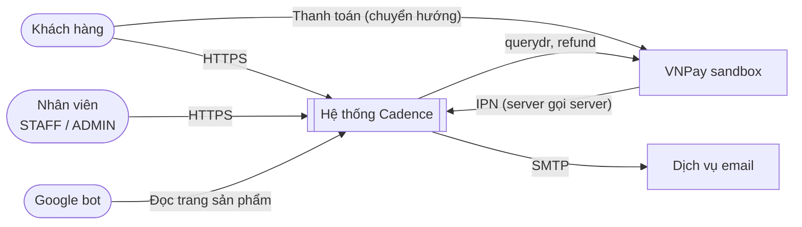
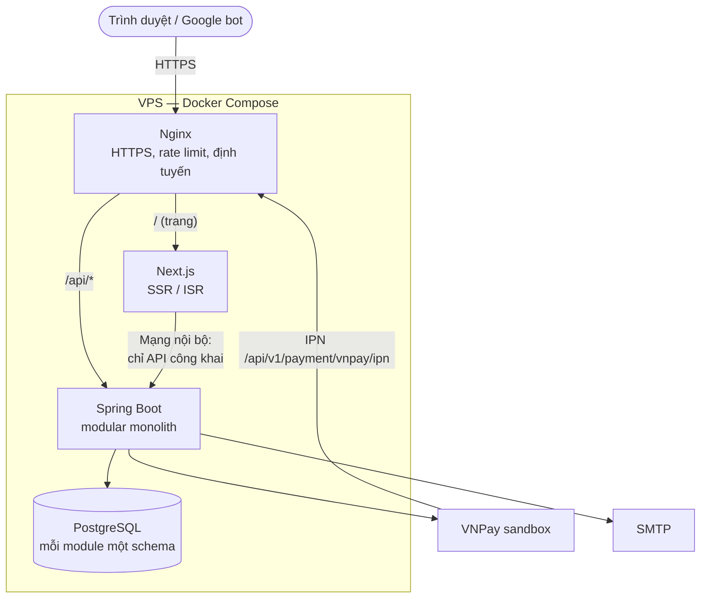
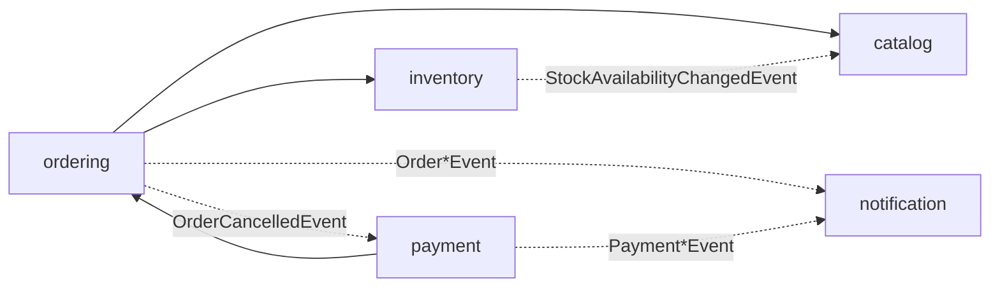
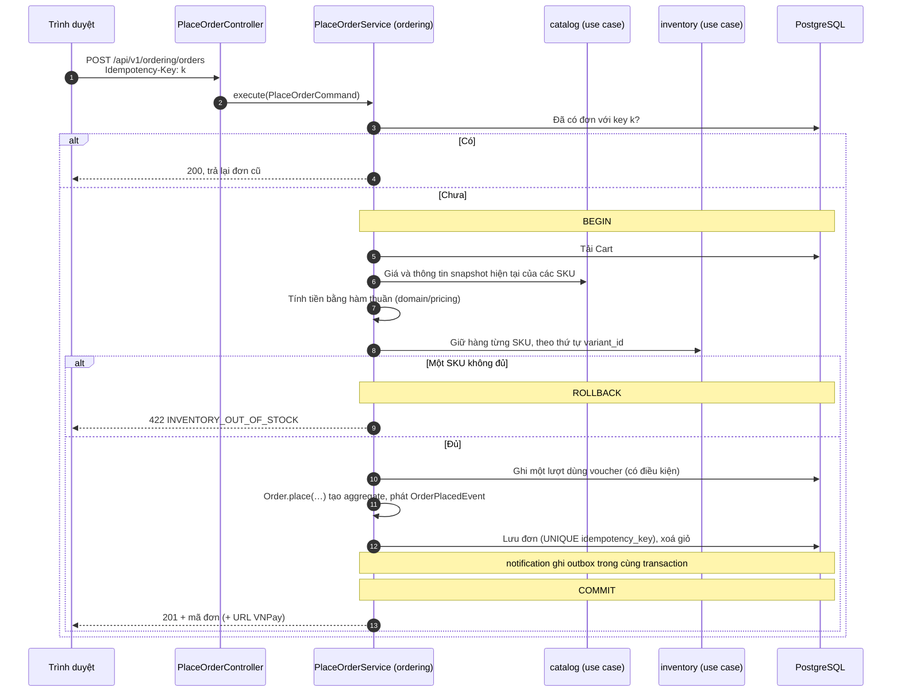

# Thiết kế kiến trúc — Cadence

| | |
|---|---|
| **Phiên bản tài liệu** | 1.3 |
| **Trạng thái** | Đã duyệt (baseline). Mọi thay đổi sau này ghi vào lịch sử thay đổi |
| **Căn cứ** | [`01-srs.md`](01-srs.md) v1.4 |
| **Quyết định khó đảo ngược** | Thư mục [`adr/`](adr/README.md) |

### Lịch sử thay đổi

| Phiên bản | Ngày | Thay đổi |
|---|---|---|
| 0.1 | 2026-11-24 | Bản đầu (frontend JS thuần, Caddy, Spring Modulith) |
| 0.2 | 2026-11-24 | Viết lại: frontend Next.js, Nginx, backend theo DDD + Hexagonal + Clean Architecture; thêm mục IAM; thêm bảng áp dụng kiến thức; gom quyết định nhỏ vào một bảng, chỉ giữ ADR cho quyết định khó đảo ngược |
| 0.3 | 2026-11-24 | Gom 10 module còn 6 (mục 7.2, 7.3); thêm cách `catalog` biết size còn hàng (7.8); bỏ ShedLock; nói rõ đánh đổi của listener ghi outbox (9.3) và ngoại lệ của rate limit trong bộ nhớ (12.4); sửa tên module và đường dẫn API |
| 0.4 | 2026-11-24 | Thêm mục 9.7: ảnh hiện là mock, thiết kế sẵn cho ảnh riêng (object storage, upload bằng URL ký sẵn) ở giai đoạn 2 |
| 1.0 | 2026-11-24 | Chốt baseline. Bỏ `unaccent`: chuẩn hoá bỏ dấu tiếng Việt ở tầng ứng dụng (lý do ở [`03-database.md`](03-database.md#41-catalog)). Các ADR chuyển sang "Chấp nhận". Đồng bộ tên bảng và mã lỗi với `03-database.md` |
| 1.1 | 2026-11-24 | Theo SRS v1.4: kiểm tổng tiền khi đặt hàng (8.1); chế độ email của môi trường demo (9.3, 11.1); tạo `ADMIN` đầu tiên (10.4) |
| 1.2 | 2026-11-24 | Theo thực tế khi dựng M0: Spring Boot 4.2.x (bản ổn định mới nhất lúc khởi tạo), Next.js 16 với Cache Components (ISR viết bằng `use cache`). Dữ liệu lấy lúc chạy phải nằm trong `<Suspense>` |
| 1.3 | 2026-11-24 | Thêm rủi ro mất kết nối khi triển khai (mục 14); healthcheck cho backend và frontend trong Docker |

### Cách đọc

- Mục 2–4: **vì sao** hệ thống có hình dạng này.
- Mục 5–7: frontend, Nginx, backend.
- Mục 8–10: các luồng khó, cơ chế xuyên suốt, định danh và phân quyền.
- Mục 12: kiến thức nào được áp dụng, kiến thức nào **cố ý không dùng**, và lý do. Nguyên tắc chung: chỉ thêm một kỹ thuật khi có yêu cầu cụ thể trong SRS đòi hỏi nó.

---

## 1. Mục đích và phạm vi

Tài liệu trả lời câu hỏi **hệ thống được dựng như thế nào** để đáp ứng SRS. Chi tiết bảng và cột nằm ở `03-database.md`; chi tiết từng endpoint sinh tự động bằng OpenAPI.

---

## 2. Yếu tố dẫn dắt kiến trúc

| # | Yếu tố | Nguồn SRS | Hệ quả |
|---|---|---|---|
| D1 | Không bán quá tồn kho khi nhiều người mua cùng lúc | G2, BR-INV-04, NFR-04 | Giữ hàng là một lệnh ghi có điều kiện trong DB; một nguồn sự thật cho tồn kho |
| D2 | Tiền và trạng thái thanh toán luôn đúng, kể cả khi IPN lặp hoặc tới muộn | G3, FR-PAY-03…06, NFR-05 | Trạng thái chỉ đi một chiều; chuyển trạng thái được kiểm tra trong domain và chặn ghi đồng thời |
| D3 | Đặt hàng không bị trùng | FR-CHK-09, NFR-06 | Idempotency key có ràng buộc duy nhất |
| D4 | Việc phụ (email) không được mất và không được làm hỏng việc chính | FR-NTF, NFR-REL-01 | Outbox trong cùng transaction |
| D5 | Trang sản phẩm phải được Google đọc được | NFR-SEO | Render HTML phía server cho trang công khai |
| D6 | Nghiệp vụ phức tạp (giá, kho, 3 trục trạng thái) cần dễ đọc, dễ test | G4 | Luật nghiệp vụ nằm trong domain thuần Java, không phụ thuộc framework |
| D7 | Một người làm, ngân sách gần bằng 0 | C-07 | Ít thành phần nhất có thể: một backend, một frontend, một DB, một reverse proxy |

---

## 3. Tổng quan giải pháp

**Một câu:** một **modular monolith** Spring Boot, mỗi module là một bounded context theo DDD và được tổ chức theo Hexagonal / Clean Architecture; frontend **Next.js** render phía server cho trang công khai; **Nginx** đứng trước cả hai, cùng một domain; **PostgreSQL** là nguồn sự thật duy nhất.

### 3.1 Ngữ cảnh (C4 mức 1)



VNPay báo kết quả bằng **hai đường**: trình duyệt quay về qua Return URL, còn server VNPay gọi IPN. Chỉ IPN được tin để ghi nhận tiền (FR-PAY-03).

### 3.2 Các container (C4 mức 2)



| Container | Trách nhiệm | Không làm |
|---|---|---|
| **Nginx** | Kết thúc HTTPS, định tuyến `/api` và `/`, rate limit sớm, nén, header bảo mật | Không chứa logic nghiệp vụ |
| **Next.js** | Render trang công khai cho SEO; giao diện tương tác (giỏ, checkout, tài khoản, admin) | **Không** tính tiền, tồn kho, trạng thái; **không** giữ phiên đăng nhập |
| **Spring Boot** | Toàn bộ nghiệp vụ, API, xác thực, tác vụ nền | Không render HTML |
| **PostgreSQL** | Dữ liệu nghiệp vụ, phiên đăng nhập, outbox, khoá tác vụ nền | — |

Frontend và API **cùng origin** (cùng domain qua Nginx): cookie phiên hoạt động tự nhiên, **không cần CORS**.

---

## 4. Công nghệ

| Lớp | Lựa chọn | Vì sao |
|---|---|---|
| Backend | **Java 25** (LTS), **Spring Boot 4.2.x** | Phổ biến nhất trong tin tuyển dụng backend Java tại Việt Nam; virtual threads |
| Truy cập dữ liệu | Spring Data JPA cho aggregate; `NamedParameterJdbcTemplate` cho read model và lệnh ghi có điều kiện | JPA tiện cho load/save aggregate; SQL tay khi cần kiểm soát chính xác câu lệnh |
| CSDL | **PostgreSQL 17**, Flyway | ACID, ràng buộc mạnh, full-text search |
| Bảo mật | Spring Security, Spring Session JDBC, BCrypt | [ADR-0003](adr/0003-phien-cookie-thay-vi-jwt.md) |
| Tác vụ nền | `@Scheduled` | Một instance; mọi tác vụ vốn chạy lại an toàn (mục 8.3) |
| Rate limit trong app | Bucket4j (token bucket) | Giới hạn theo tài khoản, bổ sung cho Nginx |
| Tài liệu API | springdoc-openapi | NFR-MNT-04 |
| Code phụ trợ | Lombok | Theo template; MapStruct chỉ dùng khi mapper viết tay quá dài |
| Test backend | JUnit 5, AssertJ, Mockito, Testcontainers, MockMvc, WireMock, ArchUnit | Theo template |
| Frontend | **Next.js 16** (App Router, Cache Components), **TypeScript**, React | SEO: [ADR-0004](adr/0004-nextjs-render-phia-server.md) |
| Giao diện | CSS từ prototype (`tokens.css`, `styles.css`, `commerce.css`) chuyển thành CSS Modules | Tái dùng thiết kế đã trau chuốt |
| Test frontend | Playwright cho luồng chính; ESLint, `tsc` | Test luồng người dùng thật, không test từng component |
| Reverse proxy | **Nginx**, Let's Encrypt (certbot) | Mục 6 |
| Test tải | k6 | NFR-01, 02, 04 |
| CI / triển khai | GitHub Actions, Docker, GitHub Container Registry | NFR-MNT-02, 03 |

> Phiên bản patch cụ thể chốt khi khởi tạo dự án.

---

## 5. Frontend: Next.js

### 5.1 Chiến lược render theo từng trang

Không phải trang nào cũng cần SEO. Chọn cách render theo **ai đọc trang và dữ liệu đổi nhanh tới đâu**:

| Trang | Cách render | Index Google | Vì sao |
|---|---|---|---|
| Trang chủ, danh mục (PLP), chi tiết sản phẩm (PDP) | Server Component, **ISR**: trong Next.js 16 viết bằng `'use cache'` + `cacheLife` (làm mới 5 phút) + `cacheTag` (admin sửa sản phẩm thì `revalidateTag`) | Có | Cần SEO; nội dung ít đổi; trả HTML có sẵn rất nhanh |
| Kết quả tìm kiếm | Server Component, render mỗi request | Không (`noindex`) | Vô hạn tổ hợp từ khoá; tránh trang rác trong chỉ mục |
| **Tồn kho theo size, giá đang áp dụng** trên PDP | Client gọi API khi trang mở | — | Đổi theo từng giây; không để HTML tạo sẵn hiển thị "còn hàng" sai |
| Giỏ hàng, checkout, kết quả đơn, tra cứu đơn, tài khoản | Client Component | Không | Dữ liệu riêng của từng người, cần cookie phiên |
| Admin (`/admin/*`) | Client Component | Không, chặn trong `robots.txt` | Không cần SEO; giao diện thao tác |

Giá trong HTML tạo sẵn có thể cũ tối đa 5 phút. Điều đó **an toàn**: tiền chỉ được tính ở backend khi vào giỏ và khi đặt hàng (FR-CART-04, FR-CHK-08), nên khách không bao giờ bị tính theo giá cũ.

### 5.2 Ai gọi API

| Bên gọi | Gọi gì | Cookie |
|---|---|---|
| Next.js server (khi render) | Chỉ **API công khai** (danh mục, sản phẩm), qua mạng nội bộ Docker `http://api:8080` | Không chuyển cookie |
| Trình duyệt | Mọi API, qua Nginx `/api/*` | Cookie phiên + CSRF token |

**Không dùng mẫu BFF** (Next.js đứng giữa giữ token, chuyển tiếp mọi request): vì đã cùng origin và dùng cookie phiên, BFF chỉ thêm một chặng và thêm chỗ phải giữ bí mật. Xem [ADR-0003](adr/0003-phien-cookie-thay-vi-jwt.md).

### 5.3 SEO (NFR-SEO)

- URL thân thiện: `/san-pham/{slug}`, `/danh-muc/{slug}`.
- `generateMetadata` cho tiêu đề, mô tả, Open Graph, canonical.
- `sitemap.xml` sinh từ danh sách sản phẩm đang bán; `robots.txt` chặn `/admin`, `/gio-hang`, `/thanh-toan`, `/tai-khoan`.
- Dữ liệu có cấu trúc JSON-LD `Product` (tên, ảnh, giá VND, tình trạng còn hàng) trên PDP.
- Sản phẩm không tồn tại hoặc chưa mở bán trả **HTTP 404 thật** (`notFound()`), không phải trang 200 báo lỗi.
- Ảnh qua `next/image` (đúng kích thước, lazy load) để đạt LCP (NFR-03). Host ảnh được phép đọc từ cấu hình vì ảnh hiện là mock và sẽ đổi nguồn (mục 9.7).

### 5.4 Cấu trúc thư mục

```
frontend/src/
├── app/
│   ├── (shop)/                 trang công khai: page.tsx, danh-muc/[slug], san-pham/[slug], tim-kiem
│   ├── (checkout)/             gio-hang, thanh-toan, don-hang/[number]
│   ├── tai-khoan/
│   ├── admin/                  layout riêng, kiểm tra đăng nhập nhân viên
│   ├── sitemap.ts, robots.ts
├── features/                   theo module nghiệp vụ, khớp với backend: catalog, cart, checkout, order, account, admin
│   └── <feature>/{components, api.ts, types.ts}
├── shared/
│   ├── api/client.ts           fetch chung: CSRF, Problem Details → thông báo theo `code`
│   └── ui/                     nút, ô nhập, hộp thoại… từ CSS của prototype
```

Kiểu dữ liệu TypeScript sinh từ OpenAPI của backend (`openapi-typescript`), để frontend và backend không lệch nhau.

---

## 6. Nginx

| Việc | Cấu hình | Vì sao |
|---|---|---|
| HTTPS | Chứng chỉ Let's Encrypt (certbot tự gia hạn), chuyển HTTP → HTTPS, HSTS | NFR-SEC-06 |
| Định tuyến | `location /api/` → `api:8080`; `location /` → `next:3000` | Cùng origin |
| Rate limit sớm | `limit_req` theo IP cho đăng nhập (`/api/v1/account/…/login`), tra cứu đơn (`/api/v1/ordering/orders/lookup`), áp voucher (`/api/v1/ordering/cart/voucher`) | Chặn càng sớm càng rẻ; app không phải xử lý request rác |
| Header chuyển tiếp | `X-Forwarded-For`, `X-Forwarded-Proto`, `X-Request-Id` | Backend biết IP thật và giao thức (`forward-headers-strategy: framework`) |
| Nén, cache file tĩnh | `gzip`; `/_next/static/*` cache dài hạn (tên file đã có hash) | NFR-03 |
| Giới hạn | `client_max_body_size 1m`; timeout hợp lý | API không nhận file lớn |
| Header bảo mật | `X-Content-Type-Options`, `Referrer-Policy`, `frame-ancestors` | Phòng thủ nhiều lớp |

Nginx **không** làm load balancer ở giai đoạn này vì chỉ có một instance mỗi loại. Khi cần chạy hai instance backend, chỉ cần thêm `upstream`.

---

## 7. Backend: DDD + Hexagonal + Clean Architecture

### 7.1 Ba trường phái, mỗi cái đóng góp một việc

| Trường phái | Đóng góp | Trong Cadence |
|---|---|---|
| **DDD** | Chia theo nghiệp vụ (bounded context); mô hình có hành vi (aggregate, value object) | Mỗi module là một package gốc; luật như "chỉ huỷ được đơn chưa đóng gói" nằm trong `Order` |
| **Hexagonal** | Lõi không biết thế giới ngoài, nói chuyện qua port | `PaymentGatewayPort` có hai adapter: VNPay thật và cổng giả lập |
| **Clean Architecture** | Phụ thuộc chỉ hướng vào trong | `infrastructure → application → domain` |

Cấu trúc thư mục, quy ước đặt tên, kernel `common`, cách viết use case, xử lý lỗi và test theo **quy ước DDD + Hexagonal chung của dự án**; các luật phụ thuộc R1–R7 được kiểm tự động bằng ArchUnit (`backend/src/test/java/com/cadence/architecture/ArchitectureTest.java`). Tài liệu này chỉ ghi phần **riêng của Cadence**.

### 7.2 Bounded context và mức áp dụng

Template có hai mức: **lõi** (mọi module) và **khi cần** (chỉ khi SRS đòi). Không phải module nào cũng xứng đáng có domain giàu hành vi:

Tiêu chí để tách một module (bounded context), theo template: có **ngôn ngữ / mô hình riêng**, có **luật và dữ liệu riêng**, và **thay đổi vì lý do riêng**. Module không qua được tiêu chí thì gộp vào module gần nhất.

| Module | Trách nhiệm | Aggregate chính | Mức | Vì sao là một module |
|---|---|---|---|---|
| `catalog` | Sản phẩm, phối màu, variant, giá niêm yết, mở bán, tìm kiếm | `Product` | Đầy đủ + read model | Thay đổi khi admin sửa nội dung; chủ yếu là đọc; PLP cần SQL lọc và đếm facet |
| `inventory` | On hand, giữ hàng, giải phóng, xuất kho, sổ cái | `InventoryItem` | Đầy đủ + lệnh ghi có điều kiện | Bất biến riêng (`reserved ≤ on_hand`), tranh chấp cao, thay đổi theo từng đơn chứ không theo admin. Lõi của D1 |
| `ordering` | **Từ giỏ tới đơn:** giỏ hàng, tính tiền, voucher, đặt hàng, 3 trục trạng thái, lịch sử, tra cứu, huỷ, số liệu đơn cho trang tổng quan | `Cart`, `Voucher`, `Order` + hàm tính tiền thuần (`domain/pricing`) | Đầy đủ + domain event | Giỏ và đơn dùng chung một ngôn ngữ (SKU, số lượng, đơn giá, giảm giá); giỏ chỉ là "đơn chưa đặt". Phức tạp nhất (mục 6 SRS) |
| `payment` | Giao dịch VNPay, IPN, đối soát, hoàn tiền | `PaymentTransaction`, `Refund` | Đầy đủ + adapter ngoài | Tích hợp bên ngoài, dữ liệu riêng, nhạy cảm bảo mật, đổi khi cổng thanh toán đổi API. Lõi của D2 |
| `account` | Tài khoản khách và nhân viên, đăng nhập, vai trò, quyền, phiên; sổ địa chỉ của khách | `CustomerAccount`, `StaffAccount` | Đầy đủ (sổ địa chỉ làm mỏng) | Mục 10 (IAM) |
| `notification` | Dựng và gửi email từ sự kiện | — | Mỏng + outbox | *Generic subdomain*: không có luật nghiệp vụ, nhưng cô lập SMTP, mẫu email, cơ chế thử lại. Cái khó là "không mất" (D4) |

### 7.3 Vì sao 6 module, không nhiều hơn

Bản 0.2 có 10 module. Đối chiếu với tiêu chí trên, 4 module không đứng riêng được:

| Đã từng tách | Giờ | Lý do |
|---|---|---|
| `cart` | Gộp vào `ordering` | Cùng ngôn ngữ với đơn hàng. Tách ra chỉ sinh thêm port và adapter giữa hai bên |
| `pricing` | Gộp vào `ordering` | Lý do thường gặp để tách khuyến mãi là bộ phận marketing quản lý theo nhịp riêng, nhưng SRS không có màn hình quản lý voucher nào. Phần tính tiền vẫn là hàm thuần trong `ordering/domain/pricing`, test dễ như cũ |
| `customer` | Gộp vào `account` | Chỉ có sổ địa chỉ, không có luật: một bảng CRUD không đáng làm một module |
| `reporting` | Bỏ | Không có dữ liệu, không có luật, chỉ gọi lại module khác. Trang tổng quan gọi use case đọc của `ordering` (doanh thu, đơn chờ xử lý), `inventory` (SKU sắp hết) và `payment` (yêu cầu hoàn tiền), rồi tự ghép kết quả |

Cũng đã xét và **không tách** `shipping` / `fulfillment`: chưa tích hợp hãng vận chuyển, mã vận đơn do nhân viên nhập tay, và trục giao hàng gắn chặt với trạng thái đơn. Tách khi có tích hợp GHN/GHTK.

Cái giá: `ordering` là module lớn nhất. Chấp nhận được, vì ranh giới giữa các aggregate (`Cart`, `Voucher`, `Order`) vẫn còn bên trong module, và một bounded context có nhiều aggregate là chuyện bình thường.

### 7.4 Quan hệ giữa các module



Mũi tên liền: **gọi use case** của module kia, qua một port của module gọi và một adapter (luật R5 của template). Mũi tên đứt: **nghe domain event**. `account` không nằm trong đồ thị: module khác chỉ nhận `customerId` / `staffId` từ phiên đăng nhập, không gọi `account`.

Đồ thị **không có vòng**. Một vài lựa chọn để giữ điều đó:

- Hàm tính tiền **không** phụ thuộc `catalog`: nó nhận vào danh sách `(sku, đơn giá, số lượng)` và trả về tổng tiền. Nhờ vậy nó là hàm thuần, test không cần dữ liệu sản phẩm.
- Trạng thái thanh toán là **một trục của `Order`** (`ordering` sở hữu). `payment` sở hữu các **giao dịch** với VNPay và yêu cầu hoàn tiền, và gọi use case của `ordering` để báo "đã trả tiền". `ordering` không bao giờ gọi `payment`.
- Huỷ đơn đã trả tiền: `Order.cancel()` tự chuyển trục thanh toán sang `REFUND_PENDING` (luật nằm trong domain) và phát `OrderCancelledEvent`; `payment` nghe sự kiện để tạo yêu cầu hoàn tiền.
- `catalog` cần biết size nào còn hàng (mục 7.8) nhưng **không** gọi `inventory`: nó nghe sự kiện, nên chiều phụ thuộc vẫn là `inventory → catalog` qua sự kiện, còn `ordering → inventory` qua use case.

### 7.5 Gọi đồng bộ hay dùng sự kiện

| Cách | Dùng khi | Ví dụ trong Cadence |
|---|---|---|
| **Gọi use case** (cùng transaction) | Bên gọi cần kết quả ngay, hoặc hai việc phải cùng thành công / cùng thất bại | Đặt hàng → giữ hàng ở `inventory`; IPN thành công → `payment` báo `ordering` |
| **Sự kiện, nghe đồng bộ trong cùng transaction** (`@EventListener`) | Bên phát không nên biết bên nghe, nhưng việc của bên nghe phải nguyên tử với việc chính | `OrderCancelledEvent` → `payment` tạo yêu cầu hoàn tiền; `StockAvailabilityChangedEvent` → `catalog` cập nhật cờ còn hàng |
| **Sự kiện → outbox → xử lý sau** | Việc ở hệ thống ngoài, có thể chậm hoặc lỗi, nhưng **không được mất** | Mọi email (FR-NTF) |

Không dùng message broker (Kafka, RabbitMQ). Xem mục 12.

### 7.6 Aggregate chính và bất biến của chúng

| Aggregate | Bất biến (luôn đúng sau mỗi thao tác) | Chặn ghi đồng thời bằng |
|---|---|---|
| `Product` (catalog) | Chỉ nháp mới đăng bán; slug duy nhất; giá > 0, giá khuyến mãi < giá gốc | `@Version` (khoá lạc quan) |
| `InventoryItem` (inventory) | `0 ≤ reserved ≤ on_hand`; mọi thay đổi on hand có một dòng sổ cái | **Lệnh ghi có điều kiện** ([ADR-0002](adr/0002-giu-hang-bang-update-co-dieu-kien.md)) + `CHECK` trong DB |
| `Voucher` (ordering) | Lượt đã dùng ≤ giới hạn; chỉ dùng trong thời hạn | Lệnh ghi có điều kiện |
| `Cart` (ordering) | ≤ 5 mỗi dòng, ≤ 10 mỗi giỏ | `@Version` |
| `Order` (ordering) | Chỉ chuyển trạng thái theo bảng ở mục 6 SRS; snapshot không đổi sau khi đặt | `@Version` |
| `PaymentTransaction` (payment) | Mỗi giao dịch chỉ đi `PENDING → PAID/FAILED` một lần; số tiền IPN phải khớp | `@Version` + `txnRef` duy nhất |
| `StaffAccount`, `CustomerAccount` (account) | Email duy nhất; tài khoản bị khoá không đăng nhập được | `@Version` |

**Vì sao `Order` không dùng State pattern (GoF):** ba trục trạng thái ràng buộc lẫn nhau (ví dụ chỉ huỷ khi giao hàng còn `UNFULFILLED`). State pattern sẽ cần một lớp cho mỗi tổ hợp trạng thái. Thay vào đó, mỗi hành vi (`confirm`, `markPaid`, `pack`, `ship`, `deliver`, `failDelivery`, `cancel`, `complete`) là một method của `Order`, kiểm tra điều kiện ở đầu method. Bảng chuyển trạng thái được kiểm bằng test tham số hoá: mọi cặp hợp lệ chạy được, mọi cặp không hợp lệ ném lỗi.

**Voucher dùng `sealed interface` thay cho Strategy kiểu cổ điển:** ba loại voucher (phần trăm, số tiền, miễn phí giao hàng) là một tập **đóng**, đọc từ dữ liệu. `sealed interface DiscountRule permits PercentOff, FixedOff, FreeShipping` + `switch` theo pattern matching: trình biên dịch báo lỗi nếu thêm loại mới mà quên xử lý. Strategy với các bean Spring chỉ đáng khi cần cắm thêm cách làm mới lúc chạy, mà ở đây không có nhu cầu đó.

### 7.7 Luật phụ thuộc

Áp dụng R1–R7 của template, kiểm bằng ArchUnit trong CI. Vì có nhiều module gọi nhau ngay từ đầu, bật thêm:

- **R5** (không import `domain` / `application` của module khác, chỉ gọi use case công khai qua adapter).
- **Không có vòng phụ thuộc giữa module** (`slices().matching("com.cadence.(*)..").should().beFreeOfCycles()`).

Thay cho Spring Modulith của bản 0.1: ArchUnit đã đủ để kiểm ranh giới, và ít "phép màu" hơn.

### 7.8 Database theo module

- Mỗi module một **schema** (`catalog`, `inventory`, `ordering`, `payment`, `account`, `notification`), migration Flyway ở `db/migration/<module>/`.
- Module không đọc bảng của module khác. Không có ngoại lệ.
- Tất cả schema nằm chung một database PostgreSQL, nên một transaction vẫn bao được nhiều module (cần cho luồng đặt hàng). Đây là lợi thế lớn nhất của modular monolith so với microservices.

**Bài toán: PLP lọc theo size còn hàng.** FR-CAT-02 chỉ tính size **còn hàng** khi lọc và đếm facet, tức là truy vấn danh sách của `catalog` cần dữ liệu tồn kho, mà `catalog` không được đọc bảng của `inventory`.

| Cách | Đánh giá |
|---|---|
| JOIN sang `inventory.inventory_items` | Nhanh nhất để viết, nhưng phá luật ranh giới: đổi bảng kho là vỡ truy vấn của catalog |
| `catalog` gọi use case của `inventory` cho từng sản phẩm | N+1 lời gọi cho mỗi trang danh sách; không đếm facet được bằng SQL |
| **`catalog` giữ bản sao một cờ `available` trên mỗi variant** | Đọc nhanh, đếm facet bằng SQL. Cần cơ chế cập nhật cờ |

Chọn cách thứ ba. `inventory` phát `StockAvailabilityChangedEvent` **chỉ khi ATS của một SKU đi qua mốc 0** (hết hàng ↔ có hàng lại), không phải mỗi lần giữ hàng. Lệnh ghi có điều kiện trả về ATS mới (`RETURNING`), nên biết ngay có qua mốc 0 hay không mà không cần đọc thêm. `catalog` nghe đồng bộ và cập nhật cờ trong **cùng transaction**, nên cờ không bao giờ lệch với kho. Vì chỉ phát khi qua mốc 0, transaction giữ hàng thông thường không phải ghi thêm vào bảng của catalog. Đây là một **read model** nhỏ (bản sao dữ liệu phục vụ đọc), không phải chia sẻ bảng.

---

## 8. Các luồng khó

### 8.1 Đặt hàng (FR-CHK-08…10)



Ngay sau bước tính tiền, service so tổng vừa tính với **tổng tiền khách đã thấy** (gửi kèm request). Lệch thì rollback và trả `409 ORDERING_PRICE_CHANGED` kèm tổng mới (SRS FR-CHK-12). Voucher không còn dùng được thì lệnh ghi có điều kiện trả 0 dòng, rollback và trả `ORDERING_VOUCHER_UNAVAILABLE`; hệ thống không tự bỏ voucher rồi đặt tiếp (FR-CHK-13).

Hai request cùng key chạy song song: request sau vướng ràng buộc `UNIQUE`, rollback, đọc lại và trả về đơn của request trước (NFR-06).

### 8.2 IPN từ VNPay (FR-PAY-03…06)

`VnpayIpnController` (adapter vào) → `HandlePaymentNotificationService`:

1. Lưu dữ liệu IPN thô (để đối soát và điều tra).
2. Kiểm chữ ký HMAC-SHA512. Sai → trả `97`.
3. Tải `PaymentTransaction` theo `txnRef`. Không có → `01`.
4. `transaction.confirm(amount, now)`: domain kiểm số tiền (sai → `04`) và trạng thái (đã xử lý → trả `02`, không làm gì thêm).
5. Gọi use case `ordering.MarkOrderPaid`. Nếu đơn đã hết hạn và bị huỷ, `Order` tự chuyển thanh toán sang `REFUND_PENDING` thay vì `PAID` (FR-PAY-06).
6. Commit. Hai IPN trùng chạy song song: một bên vướng `@Version`, đọc lại thấy đã `PAID`, trả `02` (NFR-05).

Gọi ra VNPay (`querydr`, `refund`) đi qua `PaymentGatewayPort`:

| Tình huống | Xử lý |
|---|---|
| Timeout khi gọi VNPay | Coi là **chưa biết**, không coi là thất bại. Hỏi lại bằng `querydr` với mã giao dịch |
| `querydr` lỗi mạng | Thử lại tối đa 3 lần, chờ tăng dần (1 s, 2 s, 4 s). An toàn vì đây là thao tác đọc |
| `refund` lỗi mạng | **Không** tự gửi lại. Hỏi lại trạng thái trước; nếu vẫn chưa rõ thì để admin xử lý |
| Dev ở máy local | VNPay không gọi được `localhost`: dùng tunnel khi thử tay; test tự động dùng WireMock |
| VNPay sandbox không dùng được | Bật adapter cổng giả lập bằng cấu hình (dùng lại trang cổng giả của prototype) |

### 8.3 Tác vụ nền

| Tác vụ | Chu kỳ | Việc | Yêu cầu |
|---|---|---|---|
| Hết hạn thanh toán | 1 phút | Đơn VNPay quá 15 phút → `querydr`; chưa trả → `EXPIRED`, huỷ, giải phóng hàng | FR-PAY-09 |
| Huỷ COD quá hạn | 15 phút | `PENDING_CONFIRMATION` quá 48 giờ → huỷ, giải phóng hàng | BR-ORD-05 |
| Hoàn tất đơn | 1 giờ | Giao thành công quá 7 ngày → `COMPLETED` | BR-ORD-04 |
| Gửi email | 10 giây | Nhận email chưa gửi bằng lease (`SKIP LOCKED`), gửi ngoài transaction, rồi đánh dấu (database 5.4); lỗi thì thử lại chờ tăng dần, quá 5 lần thì đánh dấu thất bại cho admin xem | FR-NTF |
| Đối soát hằng đêm | 02:00 | So các giao dịch `PENDING` / `REFUND_PENDING` trong 48 giờ qua với VNPay | FR-PAY-12 |

Mọi tác vụ xử lý theo lô nhỏ, **mỗi đơn một transaction**, và **chạy lại an toàn**: trạng thái chỉ đi một chiều, có kiểm tra trong domain và `@Version`; outbox lấy dòng bằng `SKIP LOCKED`. Vì vậy chưa cần ShedLock (khoá để chỉ một instance chạy tác vụ). Thêm nó khi chạy từ hai instance trở lên, để tránh làm việc thừa, chứ không phải để đảm bảo đúng.

---

## 9. Cơ chế xuyên suốt

### 9.1 Đồng thời: ba kỹ thuật, ba chỗ dùng

| Kỹ thuật | Dùng ở | Vì sao chọn ở chỗ này |
|---|---|---|
| **Lệnh ghi có điều kiện** (`UPDATE … WHERE còn đủ`) | Giữ hàng, lượt dùng voucher | Hàng "nóng", nhiều người tranh cùng một dòng. Khoá lạc quan sẽ làm phần lớn request thất bại rồi thử lại |
| **Khoá lạc quan** (`@Version`) | Mọi aggregate còn lại: sản phẩm, đơn, giao dịch, giỏ | Xung đột hiếm (hai nhân viên cùng sửa một đơn). Bên thua nhận `409 CONCURRENT_UPDATE` |
| **Ràng buộc duy nhất** | Idempotency key, `txnRef`, email tài khoản, slug sản phẩm | DB đảm bảo, không phụ thuộc code |
| *Khoá bi quan* (`SELECT … FOR UPDATE`) | Chỉ cho outbox (`SKIP LOCKED`) | Các chỗ khác không cần giữ khoá qua nhiều câu lệnh |

PostgreSQL chạy ở mức cô lập mặc định **Read Committed**. Mức này không tự chặn được *lost update* (hai người cùng đọc rồi cùng ghi), nên ba kỹ thuật trên là bắt buộc. Không dùng `SERIALIZABLE` vì mọi transaction khi đó đều phải sẵn sàng thử lại, trong khi các điểm tranh chấp đã được xác định rõ và xử lý riêng.

### 9.2 Idempotency

| Chỗ | Cách làm |
|---|---|
| Đặt hàng | Header `Idempotency-Key` + `UNIQUE` |
| IPN | Trạng thái giao dịch chỉ đi một chiều + `@Version` |
| Tác vụ nền | Như trên |
| Email | Outbox có khoá duy nhất `(loại email, mã đơn)`: một sự kiện không thể sinh hai email |

### 9.3 Outbox cho email

1. Use case phát domain event (`OrderPlacedEvent`…) bằng `ApplicationEventPublisher`.
2. `notification` nghe **đồng bộ, trước khi commit**, ghi một dòng vào `notification.outbox_messages`. Cùng transaction với đơn hàng: đơn lưu được thì email chắc chắn được ghi nhận; đơn rollback thì không có email.
3. Tác vụ nền gửi email từ outbox. SMTP sập chỉ làm email đến muộn, không ảnh hưởng đặt hàng.

**Môi trường demo** (SRS NFR-DEMO-03): adapter gửi email là `DemoMailAdapter` thay cho SMTP, chọn bằng cấu hình. Nó không gửi ra ngoài mà chỉ đánh dấu đã gửi; trang đơn hàng đọc nội dung email từ outbox, và chỉ của chính đơn đó (cùng quy tắc quyền như xem đơn). Code nghiệp vụ không biết mình đang chạy ở demo.

**Đánh đổi có chủ đích:** vì listener ở bước 2 chạy trong transaction đặt hàng, nếu nó ném lỗi thì đơn cũng rollback. Chọn vậy vì thà khách không đặt được đơn (và thấy lỗi ngay) còn hơn đặt được mà không bao giờ nhận email xác nhận. Để rủi ro này gần bằng 0, listener chỉ làm **một** việc: `INSERT` một dòng outbox với dữ liệu có sẵn trong sự kiện. Dựng nội dung email, gọi SMTP đều để cho tác vụ nền.

Viết outbox tay (một bảng, một tác vụ nền) thay vì dùng thư viện: đủ ngắn để hiểu từng dòng, và đây là chỗ duy nhất cần outbox.

### 9.4 API và lỗi

Theo template: URL `/api/v1/<module>/<tài-nguyên>`, admin `/api/v1/<module>/admin/<tài-nguyên>`; thành công trả `{"data": …}`; lỗi trả **Problem Details** (RFC 9457) kèm `code` ổn định (`INVENTORY_OUT_OF_STOCK`, `ORDERING_VOUCHER_MIN_NOT_MET`, `ORDERING_INVALID_TRANSITION`…). Frontend hiển thị thông báo theo `code`, không theo chuỗi `detail`.

### 9.5 Tiền, thời gian, ID

- Tiền: `long` (VND) bọc trong value object `Money`; cột `bigint`.
- Thời gian: `Instant` / `timestamptz` (UTC). Chỉ đổi sang `Asia/Ho_Chi_Minh` khi hiển thị hoặc áp luật theo giờ địa phương (hoả tốc trước 14:00, giờ mở bán). `Clock` được tiêm vào service để test các mốc 15 phút / 48 giờ / 7 ngày.
- ID: UUIDv7 do code sinh. Mã đơn hiển thị `CAD-YYMMDD-XXXX` là một cột riêng có `UNIQUE`.

### 9.6 Log và giám sát

- Log JSON có cấu trúc; `requestId` từ Nginx đưa vào MDC.
- Log nghiệp vụ mức INFO: đặt đơn, IPN (đã bỏ dữ liệu nhạy cảm), chuyển trạng thái, biến động kho, đăng nhập nhân viên.
- Actuator `/actuator/health` công khai; metrics chỉ trong mạng nội bộ.

### 9.7 Ảnh sản phẩm

Ảnh hiện tại là **ảnh mock** (SRS A-04). Ảnh riêng của Cadence sẽ có ở giai đoạn 2. MVP chưa làm upload, nhưng thiết kế sẵn để lúc đổi không phải sửa dữ liệu cũ.

**MVP (làm ngay):**

| Việc | Cách làm | Vì sao |
|---|---|---|
| Lưu ảnh | Bảng `catalog.product_images`: phối màu, URL đầy đủ, thứ tự, mô tả thay thế (`alt`) | Cùng một cột chứa được URL Unsplash bây giờ và URL storage sau này |
| Hiển thị | `next/image` với danh sách host cho phép đọc từ biến môi trường | Đổi nguồn ảnh chỉ cần đổi cấu hình, không sửa code (A-04) |
| Snapshot đơn hàng | Dòng đơn lưu URL ảnh tại lúc đặt (BR-ORD-01) | Đơn cũ vẫn hiện đúng ảnh dù sản phẩm đổi ảnh |

**Giai đoạn 2 (khi có ảnh riêng):**

| Việc | Cách làm |
|---|---|
| Nơi lưu | Object storage tương thích S3: MinIO khi dev, Cloudflare R2 hoặc S3 khi demo. Đi qua `ProductImageStoragePort` trong `catalog`, nên đổi nhà cung cấp chỉ là đổi adapter |
| Upload | Trình duyệt admin xin backend một **URL ký sẵn** (presigned URL, hết hạn sau vài phút) rồi tải ảnh **thẳng lên storage**. Backend chỉ kiểm tra loại file, kích thước, và ghi lại URL |
| Phục vụ ảnh | Từ domain công khai của storage (có CDN đi kèm), không đi qua backend |
| Tên file | Đặt theo nội dung (hash), **không bao giờ ghi đè hay xoá** ảnh đã được đơn hàng tham chiếu. Ảnh không còn ai dùng được dọn bằng tác vụ định kỳ |
| Ảnh mock cũ | Thay dần bằng cách sửa sản phẩm trong admin; đơn cũ giữ nguyên URL cũ |

**Vì sao tải thẳng lên storage thay vì gửi qua backend:** ảnh sản phẩm vài MB mỗi file. Gửi qua backend thì phải nới giới hạn kích thước request ở Nginx (hiện là 1 MB cho mọi API) và để app giữ file trong bộ nhớ. Với URL ký sẵn, file không đi qua server, còn backend vẫn kiểm soát được ai upload, upload vào đâu, trong bao lâu.

---

## 10. Định danh và phân quyền (IAM)

### 10.1 Bốn câu hỏi của IAM

| Câu hỏi | Trong Cadence |
|---|---|
| **Bạn là ai?** (định danh) | Hai loại danh tính tách hẳn nhau: **khách hàng** và **nhân viên**. Hai bảng, hai endpoint đăng nhập, hai `SecurityFilterChain` |
| **Chứng minh đi** (xác thực) | Email + mật khẩu (BCrypt). Phiên server, cookie `HttpOnly` ([ADR-0003](adr/0003-phien-cookie-thay-vi-jwt.md)) |
| **Bạn được làm gì?** (phân quyền) | Vai trò → quyền (RBAC) cho quyền chung; chính sách theo thuộc tính trong domain cho luật phụ thuộc dữ liệu (mục 10.3) |
| **Bạn đã làm gì?** (kiểm toán) | Lịch sử đơn, sổ cái kho ghi người thực hiện; nhật ký đăng nhập nhân viên |

Tách hai loại danh tính vì chúng khác nhau ở mọi mặt: ai tạo tài khoản (khách tự đăng ký, nhân viên do admin tạo), thời hạn phiên, mức rủi ro. Một bảng `users` chung với cột `type` sẽ dễ dẫn tới lỗi khách hàng gọi được API admin.

### 10.2 Vai trò và quyền (RBAC)

Code kiểm tra **quyền**, không kiểm tra **vai trò**. Nhờ vậy khi thêm vai trò mới (ví dụ "Kho") chỉ cần sửa bảng ánh xạ, không sửa code nghiệp vụ.

| Quyền | `STAFF` | `ADMIN` |
|---|:-:|:-:|
| `order:read`, `order:process` (xác nhận, đóng gói, giao, huỷ) | ✓ | ✓ |
| `order:refund` | ✓ (có hạn mức, 10.3) | ✓ |
| `inventory:adjust` | ✓ | ✓ |
| `product:write` (nội dung) | ✓ | ✓ |
| `product:price:write` | | ✓ |
| `staff:manage` | | ✓ |

Ánh xạ vai trò → quyền là một `enum` trong code, **không** phải bảng trong DB: chỉ có hai vai trò, đổi rất hiếm, và để trong code thì được review qua pull request.

### 10.3 Luật phân quyền phụ thuộc dữ liệu (kiểu ABAC)

Có những luật mà vai trò thôi không trả lời được, vì phụ thuộc **thuộc tính của dữ liệu**:

| Luật | Đặt ở đâu |
|---|---|
| `STAFF` chỉ hoàn tiền đơn ≤ 2.000.000 ₫ | `RefundPolicy` trong domain của `ordering`, nhận vào người thực hiện và số tiền |
| Khách chỉ xem / huỷ được đơn của mình | Truy vấn luôn lọc theo `customerId` lấy từ phiên, **không** từ tham số (chống IDOR) |
| Tra cứu đơn vãng lai cần mã đơn + email/số điện thoại khớp | Use case tra cứu; sai thì báo chung "không tìm thấy" |

Đặt các luật này trong domain / use case (không phải trong `@PreAuthorize`) vì chúng là **luật nghiệp vụ** và cần unit test.

### 10.4 Vòng đời danh tính và phiên

| Việc | Cách làm |
|---|---|
| Đăng nhập | Đổi session id mới (chống session fixation); giới hạn sai 5 lần / 15 phút |
| Thời hạn phiên | Khách: 30 ngày. Nhân viên: hết sau 30 phút không thao tác, tối đa 12 giờ |
| Khoá nhân viên | Xoá ngay mọi phiên của người đó (Spring Session tìm phiên theo tên đăng nhập) |
| Đổi mật khẩu | Đăng xuất mọi phiên khác |
| CSRF | Token trong cookie đọc được bằng JS, gửi lại qua header; Spring Security kiểm |
| Đặc quyền tối thiểu | Ứng dụng kết nối DB bằng user không phải superuser; bí mật lấy từ biến môi trường |
| `ADMIN` đầu tiên (FR-ADM-05) | Lần khởi động đầu, nếu chưa có `ADMIN` nào: tạo từ biến môi trường `CADENCE_BOOTSTRAP_ADMIN_EMAIL` và `CADENCE_BOOTSTRAP_ADMIN_PASSWORD`, đặt `must_change_password`. Đã có `ADMIN` thì bỏ qua, nên khởi động lại không tạo trùng hay ghi đè. Không có `ADMIN` nào trong dữ liệu mẫu |

### 10.5 Cố ý chưa dùng

| Kỹ thuật | Vì sao chưa | Khi nào dùng |
|---|---|---|
| **OAuth2 / OIDC, Keycloak** | Chỉ có một ứng dụng, không cần SSO, không có bên thứ ba, đăng nhập mạng xã hội nằm ngoài phạm vi. Chạy thêm Keycloak tốn RAM và công cấu hình | Khi nhân viên cần SSO với công cụ khác, hoặc có app di động / đối tác. Lúc đó backend trở thành *resource server*; phần xác thực trong module `account` được thay mà không đụng module khác |
| **JWT** | [ADR-0003](adr/0003-phien-cookie-thay-vi-jwt.md) | Khi có client không phải trình duyệt |
| **MFA** cho `ADMIN` | Không có trong MVP | Giai đoạn 2 (TOTP) |
| Quyền lưu trong DB, màn hình quản lý quyền | Chỉ hai vai trò | Khi có từ 4–5 vai trò trở lên |

---

## 11. Triển khai

### 11.1 Môi trường

| Môi trường | Cách chạy |
|---|---|
| **Local** | `docker compose up`: PostgreSQL, Mailpit; backend chạy từ IDE, frontend `npm run dev` |
| **CI** | GitHub Actions: backend (build, test với Testcontainers, ArchUnit); frontend (lint, `tsc`, build); Playwright chạy trên stack dựng bằng Compose |
| **Demo** | Một VPS: Nginx + Next.js + Spring Boot + PostgreSQL bằng Docker Compose; domain + HTTPS. Tài khoản dùng thử là `STAFF`, dữ liệu dựng lại mỗi đêm, email không gửi ra ngoài (SRS mục 7.8) |

### 11.2 Phát hành

1. Pull request → CI phải xanh.
2. Merge `main` → build image backend và frontend, gắn tag theo commit, đẩy lên GitHub Container Registry.
3. Trên VPS: kéo image mới, khởi động lại; Flyway chạy migration khi backend khởi động.
4. `pg_dump` hằng ngày.

### 11.3 Cấu trúc repo

```
cadence/
├── backend/            Spring Boot (Maven), package gốc com.cadence.{common, catalog, inventory, ordering, payment, account, notification}
├── frontend/           Next.js (TypeScript)
├── deploy/             docker-compose.yml, nginx/, .env.example
├── load-tests/         k6
├── e2e/                Playwright
├── docs/               SRS, kiến trúc, ADR, DB, kế hoạch test, template backend
└── .github/workflows/
```

---

## 12. Kiến thức đã học: dùng ở đâu, cố ý không dùng ở đâu

Nguyên tắc: một kỹ thuật chỉ vào hệ thống khi **chỉ ra được yêu cầu nào đòi nó**. "Không dùng" có lý do cũng là một quyết định thiết kế.

### 12.1 Nguyên lý thiết kế

| Kiến thức | Áp dụng | Ở đâu / vì sao |
|---|---|---|
| **SRP** | ✓ | Mỗi use case ghi một service; controller chỉ đổi HTTP ↔ command |
| **OCP** | Có chọn lọc | Thêm cổng thanh toán mới = thêm adapter, không sửa use case. Ngược lại, thêm loại voucher **cố ý** phải sửa `sealed interface` (7.6): tập đóng, trình biên dịch tìm mọi chỗ cần sửa |
| **LSP** | ✓ | Mọi adapter của một port phải chạy được cùng bộ test hợp đồng (ví dụ VNPay thật và cổng giả lập) |
| **ISP** | ✓ | Port nhỏ theo nhu cầu bên dùng: `ordering` chỉ thấy `CatalogLookupPort.findBySkus`, không thấy cả catalog |
| **DIP** | ✓ | Toàn bộ Hexagonal: application phụ thuộc port, infrastructure cài đặt port |
| **Coupling / Cohesion** | ✓ | Module theo nghiệp vụ (cohesion cao); giao tiếp qua use case công khai (coupling thấp); ArchUnit chặn vòng phụ thuộc |
| **DRY** | Có chọn lọc | Luật tính tiền chỉ viết ở backend, frontend không tính lại. Nhưng **không** gộp DTO giữa các tầng chỉ vì giống field: `*Request`, `*View`, `*JpaEntity` đổi vì những lý do khác nhau |
| **KISS / YAGNI** | ✓ | Mục 12.4 |

### 12.2 Design pattern

| Pattern | Dùng | Ở đâu / vì sao |
|---|---|---|
| **Adapter** | ✓ | `VnpayGatewayAdapter`, `SmtpMailAdapter`, các adapter gọi module khác. Bản chất của Hexagonal |
| **Factory method** | ✓ | `Order.place(…)`, `Product.create(…)`: chỉ tạo được đối tượng hợp lệ |
| **Builder** | ✓ | Chỉ để dựng lại aggregate từ DB (`rehydrate`); không dùng để tạo mới vì sẽ bỏ qua kiểm tra |
| **Observer** | ✓ | Domain event + listener (7.5) |
| **Strategy** | Dạng hiện đại | Voucher: `sealed interface` + `switch` (7.6). Không dùng dạng nhiều bean Spring |
| **Proxy** | Biết để tránh bẫy | `@Transactional`, `@PreAuthorize` là proxy: gọi method trong cùng class sẽ **bỏ qua** chúng. Quy ước: chỉ đặt hai annotation này trên method public được gọi từ bên ngoài |
| **Facade** | ✓ | Use case công khai của một module là facade cho module khác |
| **Chain of Responsibility** | Dùng sẵn | Bộ lọc của Spring Security; không tự viết thêm |
| **State** | ✗ | Lý do ở 7.6 |
| **Decorator** cho tính giá | ✗ | Thứ tự tính tiền cố định (BR-PRC-02): một hàm tuần tự rõ hơn chuỗi decorator |
| **Singleton** tự viết | ✗ | Bean Spring mặc định đã là singleton |
| Template Method, Visitor, Flyweight, Memento, Interpreter, Mediator, Bridge, Composite | ✗ | Không có bài toán tương ứng |

### 12.3 Dữ liệu, transaction, hệ phân tán

| Kiến thức | Dùng | Ở đâu / vì sao |
|---|---|---|
| **ACID, transaction nhiều đối tượng** | ✓ | Đặt hàng: giữ hàng + voucher + đơn + outbox + xoá giỏ trong một transaction |
| **Mức cô lập, lost update** | ✓ | 9.1: Read Committed + ba kỹ thuật chặn ghi đồng thời |
| **Write skew** | Đã xét | Giới hạn voucher mỗi khách (giai đoạn 2) là write skew nếu làm "đếm rồi ghi". Cách chặn: ràng buộc `UNIQUE (voucher_id, customer_id)` |
| **Index B-Tree, full-text** | ✓ | Index cho lọc PLP; full-text trên cột đã bỏ dấu cho tìm kiếm |
| **Outbox** | ✓ | Chỉ cho email (9.3) |
| **Idempotency** | ✓ | 9.2 |
| **Retry + exponential backoff** | ✓ | Gọi `querydr`, gửi email. **Không** tự retry `refund` (8.2) |
| **Timeout = chưa biết** | ✓ | Gọi VNPay (8.2) |
| **Đối soát với nguồn sự thật bên ngoài** | ✓ | Tác vụ đối soát hằng đêm (8.3) |
| **Graceful degradation** | ✓ | SMTP sập: đơn vẫn đặt được, email gửi sau |
| **Circuit breaker** | ✗ | Chỉ một bên ngoài, gọi ít, phần lớn từ tác vụ nền. Timeout + retry có giới hạn là đủ |
| **Bulkhead** | ✗ | Một instance, không có tài nguyên dùng chung đáng tách |
| **SERIALIZABLE** | ✗ | 9.1 |
| **Replication, sharding, consensus** | ✗ | Một node DB, dữ liệu vài nghìn sản phẩm. Sao lưu bằng `pg_dump` là đủ cho demo |
| **Event sourcing** | ✗ | Bảng lịch sử đơn là **nhật ký kiểm toán**, không phải nguồn sự thật. Trạng thái hiện tại vẫn lưu trực tiếp |
| **CDC (Debezium)** | ✗ | Outbox đọc bằng polling là đủ; CDC cần Kafka |
| **2PC, SAGA** | ✗ | Cần khi một nghiệp vụ trải qua nhiều DB. Ở đây một DB, một transaction |
| **Xử lý theo lô / luồng** | ✗ | Số liệu tổng quan tính bằng SQL lúc xem |

### 12.4 Kiến trúc hệ thống và mở rộng

| Kiến thức | Dùng | Ở đâu / vì sao |
|---|---|---|
| **Layered / Hexagonal / Clean** | ✓ | Mục 7 |
| **Modular monolith** | ✓ | [ADR-0001](adr/0001-modular-monolith.md) |
| **Microservices, SOA** | ✗ | [ADR-0001](adr/0001-modular-monolith.md) |
| **Event-driven giữa module** | Một phần | Chỉ nơi bên phát không nên biết bên nghe (7.5) |
| **Reverse proxy** | ✓ | Nginx (mục 6) |
| **Load balancer** | ✗ | Một instance. Phiên nằm ở DB nên thêm instance sau này gần như chỉ cần thêm `upstream`. **Ngoại lệ:** bộ đếm rate limit theo tài khoản (Bucket4j) nằm trong bộ nhớ, mỗi instance đếm riêng. Khi có nhiều instance thì chuyển bộ đếm ra chỗ dùng chung (bảng PostgreSQL hoặc Redis) |
| **Cache** | Ở đúng tầng | Trang công khai: ISR của Next.js + cache file tĩnh ở Nginx. **Không** cache dữ liệu tồn kho và giá ở backend |
| **Redis** | ✗ | Phiên, giỏ, rate limit, khoá đều đã có chỗ ở PostgreSQL hoặc bộ nhớ. Thêm khi chạy nhiều instance cần đếm rate limit chung |
| **CDN** | Giai đoạn 2 | MVP: ảnh mock đã nằm trên CDN của Unsplash; file tĩnh Next.js nhỏ. Khi có ảnh riêng: dùng CDN đi kèm object storage (mục 9.7). Nguyên tắc: file lớn không đi qua server; người dùng → CDN → storage |
| **Message queue (Kafka, RabbitMQ)** | ✗ | Lượng việc bất đồng bộ nhỏ (email); outbox + tác vụ nền đủ. Thêm khi có nhiều bên nhận sự kiện hoặc cần chịu tải đột biến |
| **Rate limit** | ✓ (2 lớp) | Nginx theo IP (chặn sớm); Bucket4j token bucket theo tài khoản trong app |
| **Waiting room cho đợt mở bán** | ✗ | Đám đông demo nhỏ. Lệnh ghi có điều kiện đã đảm bảo đúng; waiting room chỉ giải bài toán tải |

### 12.5 Bảo mật

| Kiến thức | Dùng | Ở đâu |
|---|---|---|
| Session + cookie `HttpOnly` | ✓ | 10.1 |
| CSRF | ✓ | Bắt buộc vì dùng cookie (10.4) |
| CORS | ✗ | Cùng origin, không cần. Nhớ: CORS và CSRF là hai chuyện khác nhau |
| BCrypt + salt | ✓ | Mật khẩu |
| RBAC | ✓ | 10.2 |
| ABAC | Dạng nhẹ | Luật trong domain (10.3) |
| IDOR | ✓ | Lọc theo chủ sở hữu từ phiên (10.3) |
| XSS | ✓ | React tự escape; cấm `dangerouslySetInnerHTML` trừ JSON-LD do server sinh |
| SQL injection | ✓ | Chỉ dùng truy vấn có tham số |
| HTTPS, HSTS | ✓ | Nginx |
| OAuth2 / OIDC | ✗ | 10.5 |

---

## 13. Bảng quyết định

Quyết định dễ đổi được ghi gọn ở đây. Chỉ quyết định **khó đảo ngược** mới có ADR riêng.

| Quyết định | Chọn | Bỏ qua | Lý do ngắn |
|---|---|---|---|
| Hình dạng hệ thống | Modular monolith | Microservices | [ADR-0001](adr/0001-modular-monolith.md) |
| Số module | 6 | 10 (tách riêng giỏ, giá, khách hàng, báo cáo) | Mục 7.3 |
| `catalog` biết size còn hàng | Cờ `available` cập nhật bằng sự kiện khi ATS qua mốc 0 | JOIN sang bảng kho; gọi `inventory` từng sản phẩm | Mục 7.8 |
| Khoá tác vụ nền | Chưa dùng | ShedLock | Một instance, tác vụ đã chạy lại an toàn. Thêm khi có từ 2 instance |
| Chống bán lố | Lệnh ghi có điều kiện | Khoá bi quan, khoá lạc quan, khoá Redis | [ADR-0002](adr/0002-giu-hang-bang-update-co-dieu-kien.md) |
| Xác thực | Phiên server + cookie | JWT | [ADR-0003](adr/0003-phien-cookie-thay-vi-jwt.md) |
| Frontend | Next.js SSR/ISR | SPA thuần, Thymeleaf | [ADR-0004](adr/0004-nextjs-render-phia-server.md) |
| Tìm kiếm | PostgreSQL full-text, bỏ dấu ở tầng ứng dụng | Elasticsearch, Meilisearch | Đủ cho vài nghìn sản phẩm, không thêm hệ thống, dữ liệu luôn khớp. Đổi khi cần chịu lỗi gõ hoặc > 100.000 sản phẩm |
| Kiểm ranh giới module | ArchUnit | Spring Modulith | Template đã có luật ArchUnit; ít phép màu hơn |
| Outbox | Tự viết, chỉ cho email | Thư viện, outbox cho mọi sự kiện | Chỉ một chỗ cần |
| Reverse proxy | Nginx | Caddy | Phổ biến hơn trong môi trường doanh nghiệp |
| Mapper | Viết tay, `static from(…)` | MapStruct | Ít field; dùng MapStruct khi một mapper quá dài |
| Upload ảnh (giai đoạn 2) | Tải thẳng lên object storage bằng URL ký sẵn | Gửi file qua backend | Không phải nới giới hạn request của Nginx; app không giữ file trong bộ nhớ (mục 9.7) |
| Redis | Chưa dùng | — | 12.4 |

---

## 14. Rủi ro

| Rủi ro | Ảnh hưởng | Cách giảm |
|---|---|---|
| Học cùng lúc Next.js và Spring Boot 4 | Chậm tiến độ | Làm backend trước tới hết luồng đặt hàng; frontend sau, bám API đã có |
| VNPay sandbox không ổn định | Không demo được thanh toán | Adapter cổng giả lập bật bằng cấu hình |
| IPN không vào được máy local | Khó phát triển | Tunnel khi thử tay; WireMock trong test |
| Áp dụng quá tay template (hexagon cho mọi thứ) | Code nặng, chậm | Module mỏng cho CRUD (7.2); checklist "Có thứ gì SRS không đòi không?" khi review |
| Phạm vi phình to | Không xong MVP | Bám MoSCoW của SRS |
| Một VPS | Sập là mất demo | Sao lưu DB, dựng lại bằng một lệnh |
| Mỗi lần triển khai mất kết nối khoảng 10–30 giây | Khách đang thao tác gặp lỗi 502 | Chấp nhận cho demo; triển khai lúc ít người dùng. Khi có người dùng thật thì chuyển sang blue-green (`deploy/README.md` mục 5) |
