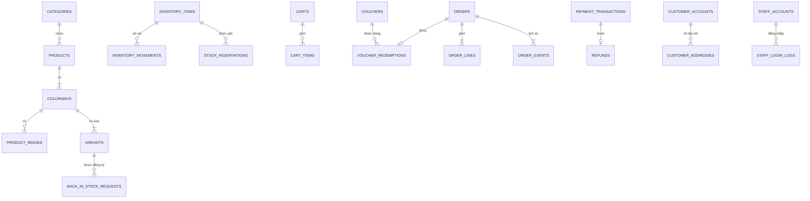

# Thiết kế cơ sở dữ liệu — Cadence

| | |
|---|---|
| **Phiên bản tài liệu** | 1.2 |
| **Trạng thái** | Đã duyệt (baseline). Mọi thay đổi sau này ghi vào lịch sử thay đổi |
| **Căn cứ** | [`01-srs.md`](01-srs.md) v1.5, [`02-architecture.md`](02-architecture.md) v1.4 |
| **CSDL** | PostgreSQL 17 |

### Lịch sử thay đổi

| Phiên bản | Ngày | Thay đổi |
|---|---|---|
| 0.1 | 2026-11-24 | Bản đầu |
| 0.2 | 2026-11-24 | Thêm 3 index còn thiếu (variants theo sản phẩm, hoàn tiền theo đơn, sổ địa chỉ theo khách); outbox nhận việc bằng lease, không giữ transaction khi gọi SMTP (5.4); thêm mục 5.5 ranh giới transaction |
| 1.0 | 2026-11-24 | Chốt baseline |
| 1.1 | 2026-11-24 | Theo SRS v1.4: giá chuyển từ `variants` lên `products`; bỏ nhãn `MEMBER`; ràng buộc hoả tốc chỉ với VNPay; thêm `staff_accounts.must_change_password`; dữ liệu mẫu không chứa `ADMIN`; cập nhật bảng đối chiếu |
| 1.2 | 2026-11-24 | Theo SRS v1.5: khuyến mãi có thời hạn (`sale_starts_at`, `sale_ends_at`); `launch_at` bắt buộc khi đã đăng bán, bỏ `published_at`; bỏ `badge` (nhãn được suy ra); `fit_hint` thành `fit`; ảnh lưu `image_key` kèm `width`, `height` (cả trong `order_lines`); bỏ `orders.marketing_opt_in`; thêm `order_access_tokens`; outbox lưu nội dung đã dựng và `order_id`; thêm `staff_accounts.is_demo`; cập nhật mục 9 |

### Cách đọc

- Mục 1–3: quy ước chung áp cho mọi bảng.
- Mục 4: từng schema, viết dưới dạng DDL (gần như dùng thẳng được làm migration Flyway), kèm **vì sao** cho các ràng buộc và index không hiển nhiên.
- Mục 5: các câu SQL quan trọng (giữ hàng, voucher, outbox).
- Mục 6–8: quyền truy cập DB, migration, lưu giữ dữ liệu.

---

## 1. Nguyên tắc

| # | Nguyên tắc | Vì sao |
|---|---|---|
| P1 | **Mỗi module một schema**: `account`, `catalog`, `inventory`, `ordering`, `payment`, `notification` | Ranh giới module nhìn thấy được ngay trong DB (kiến trúc 7.8) |
| P2 | **Khoá ngoại chỉ trong cùng schema.** Tham chiếu sang module khác là một cột `uuid` thường, không có `REFERENCES` | Khoá ngoại xuyên schema buộc hai module phải đổi cùng nhau, và chặn việc sau này tách module ra DB riêng. Tính đúng của tham chiếu chéo do use case đảm bảo |
| P3 | **Bất biến quan trọng được viết thành ràng buộc DB** (`CHECK`, `UNIQUE`), không chỉ trong Java | Lớp phòng thủ cuối: code sai thì DB từ chối, thay vì lưu dữ liệu sai |
| P4 | **Bảng nhật ký chỉ thêm** (sổ cái kho, lịch sử đơn, nhật ký IPN, nhật ký đăng nhập): user của ứng dụng không có quyền `UPDATE`, `DELETE` | Nhật ký kiểm toán phải không sửa được, kể cả khi code có lỗi (mục 6) |
| P5 | **Chuẩn hoá tới 3NF**, chỉ phi chuẩn hoá có chủ đích ở 3 chỗ: snapshot dòng đơn, cờ `available` trên variant, `order_number` trong giao dịch thanh toán | Mỗi chỗ phi chuẩn hoá được ghi lý do tại chỗ |

---

## 2. Quy ước

| Hạng mục | Quy ước | Ví dụ |
|---|---|---|
| Tên bảng | `snake_case`, **số nhiều** (theo template backend) | `ordering.orders`, `catalog.variants` |
| Tên cột | `snake_case`, số ít | `payment_status`, `created_at` |
| Khoá chính | `id uuid`, **UUIDv7 do ứng dụng sinh** | Có thứ tự theo thời gian nên index B-Tree không bị phân mảnh như UUIDv4; sinh ở app nên biết id trước khi lưu |
| Tiền | `bigint` (đồng VND) | `unit_price bigint` |
| Số lượng | `integer` | `quantity integer` |
| Thời gian | `timestamptz` (lưu UTC) | `created_at timestamptz` |
| Trạng thái, loại | `text` + `CHECK (… IN (…))` | `status text CHECK (status IN ('DRAFT', 'PUBLISHED'))` |
| Cột chung của aggregate | `created_at`, `updated_at`, `version bigint` (khoá lạc quan) | Lớp `AuditEntity` trong template |
| Email | Lưu chữ thường (domain chuẩn hoá trước khi lưu), `CHECK (email = lower(email))` | Không cần extension `citext` |
| Tên index | `<bảng>_<cột>_idx`, `<bảng>_<cột>_key` cho unique | `orders_customer_id_idx` |

**Vì sao `text + CHECK` thay cho kiểu `ENUM` của PostgreSQL:** thêm giá trị vào `ENUM` cần `ALTER TYPE`, còn bớt giá trị thì gần như không làm được. Sửa một `CHECK` chỉ là xoá ràng buộc cũ và tạo lại. Hibernate cũng đọc ghi `text` ↔ `enum` Java mà không cần cấu hình thêm.

**Vì sao không dùng extension nào:** bỏ dấu tiếng Việt làm ở tầng ứng dụng (mục 4.1). Ít extension thì dễ dựng môi trường và dễ chuyển nhà cung cấp DB.

---

## 3. Tổng quan quan hệ



Sơ đồ chỉ vẽ quan hệ **trong cùng schema** (có khoá ngoại). Tham chiếu chéo giữa module, không có khoá ngoại:

| Cột | Trỏ tới | Ghi chú |
|---|---|---|
| `inventory.inventory_items.variant_id` | `catalog.variants.id` | Quan hệ 1–1; dòng kho được tạo khi tạo variant |
| `inventory.stock_reservations.order_id` | `ordering.orders.id` | |
| `ordering.cart_items.variant_id`, `order_lines.variant_id` | `catalog.variants.id` | |
| `ordering.carts.customer_id`, `orders.customer_id` | `account.customer_accounts.id` | Null với khách vãng lai |
| `payment.payment_transactions.order_id`, `refunds.order_id` | `ordering.orders.id` | |
| `*.actor_id`, `*_by_id` | `account.staff_accounts.id` hoặc `customer_accounts.id` | Kèm `actor_name` để nhật ký vẫn đọc được nếu tài khoản đổi tên |

---

## 4. Từng schema

Các cột chung `created_at timestamptz NOT NULL`, `updated_at timestamptz NOT NULL`, `version bigint NOT NULL DEFAULT 0` được ghi tắt là `-- audit` trong DDL.

### 4.1 catalog

```sql
CREATE SCHEMA catalog;

CREATE TABLE catalog.categories (
    id          uuid PRIMARY KEY,
    slug        text NOT NULL UNIQUE,
    name        text NOT NULL,
    sort_order  integer NOT NULL DEFAULT 0
);

CREATE TABLE catalog.products (
    id               uuid PRIMARY KEY,
    slug             text NOT NULL UNIQUE,
    name             text NOT NULL,
    category_id      uuid NOT NULL REFERENCES catalog.categories (id),
    gender           text NOT NULL CHECK (gender IN ('MEN', 'WOMEN', 'UNISEX', 'KIDS')),
    sport            text NOT NULL CHECK (sport IN ('RUNNING', 'TRAIL', 'LIFESTYLE', 'TRAINING', 'FOOTBALL')),
    description      text NOT NULL DEFAULT '',
    specs            jsonb NOT NULL DEFAULT '[]',          -- [{"name": "Trọng lượng", "value": "228 g"}, …], theo thứ tự hiển thị
    status           text NOT NULL CHECK (status IN ('DRAFT', 'PUBLISHED', 'ARCHIVED')),   -- SRS mục 6.5
    launch_at        timestamptz,                          -- giờ mở bán; đăng bán không lên lịch thì = lúc đăng
    list_price       bigint NOT NULL CHECK (list_price > 0),        -- giá ở mức sản phẩm (SRS BR-PRC-08)
    sale_price       bigint CHECK (sale_price > 0 AND sale_price < list_price),
    sale_starts_at   timestamptz,                          -- khuyến mãi hiệu lực trong [starts, ends) (BR-PRC-09)
    sale_ends_at     timestamptz,                          -- null = không thời hạn
    featured_rank    integer CHECK (featured_rank > 0),    -- thứ tự "Nổi bật"; null = không nổi bật
    fit              text NOT NULL DEFAULT 'TRUE_TO_SIZE' CHECK (fit IN ('SMALL', 'TRUE_TO_SIZE', 'LARGE')),
    rating           numeric(2,1) CHECK (rating BETWEEN 0 AND 5),     -- dữ liệu mẫu (SRS A-03)
    review_count     integer NOT NULL DEFAULT 0,
    seo_title        text,
    seo_description  text,
    -- audit
    CHECK (status = 'DRAFT' OR launch_at IS NOT NULL),
    CHECK ((sale_price IS NULL) = (sale_starts_at IS NULL)),
    CHECK (sale_ends_at IS NULL OR (sale_starts_at IS NOT NULL AND sale_ends_at > sale_starts_at))
);
CREATE INDEX products_listing_idx ON catalog.products (category_id, featured_rank)
    WHERE status = 'PUBLISHED';

CREATE TABLE catalog.colorways (
    id            uuid PRIMARY KEY,
    product_id    uuid NOT NULL REFERENCES catalog.products (id) ON DELETE CASCADE,
    name          text NOT NULL,                           -- "Ô liu / Trắng"
    color_family  text NOT NULL CHECK (color_family IN ('BLACK', 'WHITE', 'GREY', 'GREEN', 'BLUE', 'PINK', 'BROWN')),
    sort_order    integer NOT NULL DEFAULT 0,
    UNIQUE (product_id, name)
);

CREATE TABLE catalog.product_images (
    id           uuid PRIMARY KEY,
    colorway_id  uuid NOT NULL REFERENCES catalog.colorways (id) ON DELETE CASCADE,
    image_key    text NOT NULL CHECK (image_key !~ '^[a-z]+://'),   -- khoá ảnh, không chứa host (SRS BR-CAT-01)
    width        integer NOT NULL CHECK (width > 0),
    height       integer NOT NULL CHECK (height > 0),
    alt          text NOT NULL CHECK (alt <> ''),
    sort_order   integer NOT NULL DEFAULT 0
);
CREATE INDEX product_images_colorway_id_idx ON catalog.product_images (colorway_id, sort_order);

CREATE TABLE catalog.variants (
    id           uuid PRIMARY KEY,
    product_id   uuid NOT NULL REFERENCES catalog.products (id) ON DELETE CASCADE,
    colorway_id  uuid NOT NULL REFERENCES catalog.colorways (id) ON DELETE CASCADE,
    size         text NOT NULL,                            -- "42", "M", "OS" (một size)
    size_order   integer NOT NULL,                         -- để sắp 39 < 40 và S < M < L
    sku          text NOT NULL UNIQUE,
    gtin         text UNIQUE,
    available    boolean NOT NULL DEFAULT false,           -- bản sao từ inventory (kiến trúc 7.8)
    -- audit
    UNIQUE (colorway_id, size)
);
CREATE INDEX variants_available_idx ON catalog.variants (product_id, size) WHERE available;
CREATE INDEX variants_product_idx ON catalog.variants (product_id);                -- admin tải mọi variant của một sản phẩm

CREATE TABLE catalog.back_in_stock_requests (
    id           uuid PRIMARY KEY,
    variant_id   uuid NOT NULL REFERENCES catalog.variants (id) ON DELETE CASCADE,
    email        text NOT NULL CHECK (email = lower(email)),
    created_at   timestamptz NOT NULL,
    notified_at  timestamptz,
    UNIQUE (variant_id, email)
);
```

**Vì sao:**

- **Tìm kiếm (FR-CAT-08) chưa làm.** Đã quyết định dùng search engine riêng (Elasticsearch) thay cho full-text của PostgreSQL; thiết kế index và cách đồng bộ sẽ viết khi chốt. Bảng `products` vì vậy không có cột tìm kiếm nào.
- **`specs` là mảng, không phải object**: `jsonb` không giữ thứ tự khoá của object, mà bảng thông số trên PDP phải hiện đúng thứ tự đã nhập.
- **Giá đặt ở sản phẩm, không ở variant** (SRS BR-PRC-08, D-12): mọi size, mọi màu cùng giá. Nếu lưu giá ở từng variant thì 6 size sẽ có 6 bản sao cùng một con số, và có nguy cơ lệch nhau khi sửa. Lọc theo khoảng giá so với giá đang bán của sản phẩm tại thời điểm truy vấn (ý về khuyến mãi bên dưới). Khi sau này cần giá theo size, chuyển cột xuống `variants` bằng một migration.
- **`available` là phi chuẩn hoá có chủ đích** (P5): bản sao của "ATS > 0", để PLP lọc size và đếm facet bằng một truy vấn mà không đọc sang `inventory` (kiến trúc 7.8). Index một phần `WHERE available` chỉ chứa variant còn hàng nên rất nhỏ.
- **`ON DELETE CASCADE`** chỉ có tác dụng với sản phẩm **nháp**. Sản phẩm đã có đơn thì không bao giờ bị xoá (FR-ADM-PRD-06), chỉ chuyển `ARCHIVED`; dòng đơn đã có snapshot nên không phụ thuộc vào bảng này.
- `CHECK (sale_price < list_price)`: giá khuyến mãi bằng hoặc cao hơn giá gốc là dữ liệu sai, chặn ngay ở DB.
- **Khuyến mãi có thời hạn** (BR-PRC-09) nằm ngay trong `products` (ba cột) chứ không phải bảng riêng, vì mỗi sản phẩm có tối đa một khuyến mãi. Giá đang bán tại thời điểm `now` = `CASE WHEN sale_price IS NOT NULL AND sale_starts_at <= now AND (sale_ends_at IS NULL OR now < sale_ends_at) THEN sale_price ELSE list_price END`. Biểu thức này là bản sao bằng SQL của luật trong domain, dùng để lọc và sắp theo giá; nó được gom vào **một** chỗ trong code và có test so kết quả SQL với kết quả domain. Không lưu sẵn "giá hiện tại" vào một cột, vì cột đó sẽ sai ngay khi khuyến mãi tới hạn mà không ai cập nhật.
- **Không có cột trạng thái "sắp mở bán"** (SRS mục 6.5): đang bán = `status = 'PUBLISHED' AND launch_at <= now`. Lưu thành trạng thái riêng thì phải có tác vụ nền đổi trạng thái đúng giờ, và sẽ có khoảng trễ. `launch_at` bắt buộc khi đã đăng bán nên câu so sánh không cần xử lý null; nó cũng là khoá sắp xếp "mới nhất" và căn cứ nhãn "Mới".
- **Bỏ cột `badge`**: nhãn "Mới", "−N%", "Hết hàng" được suy ra (FR-CAT-09). Lưu nhãn tay thì sẽ lệch với dữ liệu thật.
- **Ảnh lưu khoá, không lưu URL** (BR-CAT-01): `CHECK` chặn ai đó lỡ nhập URL đầy đủ. `width`, `height` bắt buộc để giữ chỗ khi tải ảnh.
- **Slug không đổi sau khi đăng bán** (BR-CAT-02) là luật chuyển trạng thái, nằm trong aggregate `Product`, không viết thành `CHECK` được (cần so giá trị cũ với mới).

### 4.2 inventory

```sql
CREATE SCHEMA inventory;

CREATE TABLE inventory.inventory_items (
    variant_id    uuid PRIMARY KEY,                        -- = catalog.variants.id (không FK, P2)
    sku           text NOT NULL UNIQUE,
    on_hand       integer NOT NULL CHECK (on_hand >= 0),
    reserved      integer NOT NULL DEFAULT 0,
    safety_stock  integer NOT NULL DEFAULT 0 CHECK (safety_stock >= 0),
    location      text NOT NULL DEFAULT 'HCM',
    -- audit
    CHECK (reserved >= 0 AND reserved <= on_hand)          -- BR-INV-04, lớp phòng thủ cuối (ADR-0002)
);

CREATE TABLE inventory.stock_reservations (
    order_id    uuid NOT NULL,                             -- = ordering.orders.id
    variant_id  uuid NOT NULL REFERENCES inventory.inventory_items (variant_id),
    quantity    integer NOT NULL CHECK (quantity > 0),
    status      text NOT NULL CHECK (status IN ('RESERVED', 'RELEASED', 'SHIPPED')),
    created_at  timestamptz NOT NULL,
    closed_at   timestamptz,
    PRIMARY KEY (order_id, variant_id),
    CHECK ((status = 'RESERVED') = (closed_at IS NULL))
);
CREATE INDEX stock_reservations_open_idx ON inventory.stock_reservations (variant_id)
    WHERE status = 'RESERVED';

CREATE TABLE inventory.inventory_movements (
    id          uuid PRIMARY KEY,
    variant_id  uuid NOT NULL REFERENCES inventory.inventory_items (variant_id),
    type        text NOT NULL CHECK (type IN ('RECEIVE', 'SHIP', 'ADJUST', 'RETURN_RESTOCK')),
    quantity    integer NOT NULL CHECK (quantity <> 0),    -- có dấu: + vào kho, − ra kho
    reason      text NOT NULL CHECK (length(trim(reason)) > 0),
    reference   text,                                      -- mã PO, mã đơn
    actor_type  text NOT NULL CHECK (actor_type IN ('STAFF', 'SYSTEM')),
    actor_id    uuid,
    actor_name  text NOT NULL,
    created_at  timestamptz NOT NULL,
    CHECK (
        (type IN ('RECEIVE', 'RETURN_RESTOCK') AND quantity > 0)
        OR (type = 'SHIP' AND quantity < 0)
        OR type = 'ADJUST'
    )
);
CREATE INDEX inventory_movements_variant_idx ON inventory.inventory_movements (variant_id, created_at DESC);
```

**Vì sao:**

- **Vì sao có thêm `stock_reservations`** khi đã có cột `reserved`: cột `reserved` chỉ là một con số tổng, không biết **đơn nào** đang giữ bao nhiêu. Bảng này cho phép:
  - Giải phóng hàng **đúng một lần**: `UPDATE … SET status = 'RELEASED' WHERE order_id = ? AND status = 'RESERVED'`. Nếu khách huỷ và tác vụ hết hạn cùng chạy trên một đơn, chỉ một bên cập nhật được dòng này, nên `reserved` không bị trừ hai lần (mục 5.2).
  - Đối soát: với mọi SKU, tổng `quantity` của các dòng `RESERVED` phải bằng `reserved`.
- **Hai bất biến đối soát** (chạy trong test tích hợp, và có thể chạy định kỳ):
  - `on_hand = SUM(inventory_movements.quantity)` của SKU đó (BR-INV-05).
  - `reserved = SUM(stock_reservations.quantity) WHERE status = 'RESERVED'`.
- **Giữ hàng không tạo dòng sổ cái**, vì nó không đổi `on_hand`. Sổ cái chỉ ghi khi hàng thật sự vào hoặc ra khỏi kho.
- `CHECK` theo dấu của `quantity`: nhập kho mà số âm, hoặc xuất kho mà số dương, là lỗi lập trình. DB chặn luôn.
- `version` (trong audit) được tăng ở **cả** lệnh ghi có điều kiện lẫn khi lưu aggregate. Nhờ đó nếu nhân viên đang điều chỉnh kiểm kê (đi qua aggregate) đúng lúc có người giữ hàng (lệnh SQL), thao tác điều chỉnh sẽ vướng khoá lạc quan và thử lại, thay vì ghi đè số liệu.

### 4.3 ordering

```sql
CREATE SCHEMA ordering;

CREATE TABLE ordering.carts (
    id               uuid PRIMARY KEY,
    customer_id      uuid UNIQUE,                          -- hội viên: mỗi người một giỏ
    anonymous_token  text UNIQUE,                          -- khách vãng lai: giá trị cookie
    voucher_code     text,
    -- audit
    CHECK (customer_id IS NOT NULL OR anonymous_token IS NOT NULL)
);
CREATE INDEX carts_anonymous_stale_idx ON ordering.carts (updated_at) WHERE customer_id IS NULL;

CREATE TABLE ordering.cart_items (
    cart_id       uuid NOT NULL REFERENCES ordering.carts (id) ON DELETE CASCADE,
    variant_id    uuid NOT NULL,
    quantity      integer NOT NULL CHECK (quantity BETWEEN 1 AND 5),   -- BR-ORD-06
    price_at_add  bigint NOT NULL CHECK (price_at_add > 0),            -- để báo "Giá đã thay đổi" (FR-CART-04)
    added_at      timestamptz NOT NULL,
    PRIMARY KEY (cart_id, variant_id)
);

CREATE TABLE ordering.vouchers (
    id            uuid PRIMARY KEY,
    code          text NOT NULL UNIQUE CHECK (code = upper(code)),
    type          text NOT NULL CHECK (type IN ('PERCENT', 'FIXED', 'FREE_SHIPPING')),
    value         bigint,
    max_discount  bigint CHECK (max_discount > 0),
    min_subtotal  bigint NOT NULL DEFAULT 0 CHECK (min_subtotal >= 0),
    starts_at     timestamptz NOT NULL,
    ends_at       timestamptz NOT NULL,
    usage_limit   integer CHECK (usage_limit > 0),         -- null = không giới hạn
    used_count    integer NOT NULL DEFAULT 0 CHECK (used_count >= 0),
    -- audit
    CHECK (starts_at < ends_at),
    CHECK (usage_limit IS NULL OR used_count <= usage_limit),
    CHECK (
        (type = 'PERCENT' AND value BETWEEN 1 AND 100)
        OR (type = 'FIXED' AND value > 0 AND max_discount IS NULL)
        OR (type = 'FREE_SHIPPING' AND value IS NULL AND max_discount IS NULL)
    )
);

CREATE TABLE ordering.orders (
    id                  uuid PRIMARY KEY,
    number              text NOT NULL UNIQUE,              -- CAD-YYMMDD-XXXX
    idempotency_key     text NOT NULL UNIQUE,
    cart_id             uuid NOT NULL,                     -- giỏ đã dùng để đặt; kiểm khi gửi lại cùng key
    customer_id         uuid,                              -- null: khách vãng lai
    email               text NOT NULL CHECK (email = lower(email)),
    phone               text NOT NULL CHECK (phone ~ '^0[0-9]{9}$'),
    -- địa chỉ giao (snapshot, không trỏ sang sổ địa chỉ)
    recipient_name      text NOT NULL,
    province            text NOT NULL,
    ward                text NOT NULL,
    street              text NOT NULL,
    delivery_note       text,
    shipping_method     text NOT NULL CHECK (shipping_method IN ('STANDARD', 'EXPRESS', 'SAME_DAY')),
    -- ba trục trạng thái (SRS mục 6)
    status              text NOT NULL CHECK (status IN ('PENDING_CONFIRMATION', 'PENDING_PAYMENT', 'PLACED', 'COMPLETED', 'CANCELLED')),
    payment_method      text NOT NULL CHECK (payment_method IN ('COD', 'VNPAY')),
    payment_status      text NOT NULL CHECK (payment_status IN ('UNPAID', 'PENDING', 'PAID', 'FAILED', 'EXPIRED', 'REFUND_PENDING', 'REFUNDED')),
    fulfillment_status  text NOT NULL CHECK (fulfillment_status IN ('UNFULFILLED', 'PACKED', 'SHIPPED', 'DELIVERED', 'FAILED_DELIVERY')),
    payment_expires_at  timestamptz,                       -- VNPay: đặt + 15 phút
    -- tiền (BR-PRC)
    subtotal            bigint NOT NULL CHECK (subtotal >= 0),
    discount            bigint NOT NULL DEFAULT 0 CHECK (discount >= 0 AND discount <= subtotal),
    shipping_fee        bigint NOT NULL CHECK (shipping_fee >= 0),
    shipping_discount   bigint NOT NULL DEFAULT 0 CHECK (shipping_discount >= 0 AND shipping_discount <= shipping_fee),
    total               bigint NOT NULL,
    voucher_code        text,
    -- hoá đơn công ty (FR-CHK-05)
    invoice_company     text,
    invoice_tax_code    text CHECK (invoice_tax_code ~ '^[0-9]{10}([0-9]{3})?$'),
    invoice_email       text,
    -- giao hàng, huỷ
    carrier             text,
    tracking_number     text,
    cancel_reason       text,
    placed_at           timestamptz NOT NULL,
    delivered_at        timestamptz,
    completed_at        timestamptz,
    -- audit

    CHECK (total = subtotal - discount + shipping_fee - shipping_discount),
    CHECK ((invoice_company IS NULL) = (invoice_tax_code IS NULL)),
    -- ràng buộc giữa các trục (SRS 6.4)
    CHECK (fulfillment_status = 'UNFULFILLED' OR status IN ('PLACED', 'COMPLETED', 'CANCELLED')),
    CHECK (status <> 'CANCELLED' OR fulfillment_status IN ('UNFULFILLED', 'FAILED_DELIVERY')),
    CHECK (status <> 'CANCELLED' OR cancel_reason IS NOT NULL),
    CHECK (fulfillment_status NOT IN ('SHIPPED', 'DELIVERED') OR tracking_number IS NOT NULL),
    CHECK (payment_method = 'VNPAY' OR payment_status IN ('UNPAID', 'PAID', 'REFUND_PENDING', 'REFUNDED')),
    CHECK (payment_method = 'COD' OR payment_status <> 'UNPAID'),
    CHECK (shipping_method <> 'SAME_DAY' OR payment_method = 'VNPAY')        -- hoả tốc chỉ với VNPay (SRS FR-CHK-03)
);
CREATE INDEX orders_customer_idx ON ordering.orders (customer_id, placed_at DESC) WHERE customer_id IS NOT NULL;
CREATE INDEX orders_placed_at_idx ON ordering.orders (placed_at DESC);
CREATE INDEX orders_phone_idx ON ordering.orders (phone);
CREATE INDEX orders_email_idx ON ordering.orders (email);
-- cho các tác vụ nền (kiến trúc 8.3)
CREATE INDEX orders_payment_expiry_idx ON ordering.orders (payment_expires_at) WHERE status = 'PENDING_PAYMENT';
CREATE INDEX orders_cod_pending_idx    ON ordering.orders (placed_at)          WHERE status = 'PENDING_CONFIRMATION';
CREATE INDEX orders_to_complete_idx    ON ordering.orders (delivered_at)       WHERE status = 'PLACED' AND fulfillment_status = 'DELIVERED';

CREATE TABLE ordering.order_lines (
    id                  uuid PRIMARY KEY,
    order_id            uuid NOT NULL REFERENCES ordering.orders (id),
    line_no             smallint NOT NULL,
    -- snapshot (BR-ORD-01): không đổi theo catalog
    variant_id          uuid NOT NULL,
    sku                 text NOT NULL,
    product_name        text NOT NULL,
    color_name          text NOT NULL,
    size                text NOT NULL,
    image_key           text NOT NULL,                     -- khoá ảnh, không phải URL (SRS BR-CAT-01)
    list_price          bigint NOT NULL CHECK (list_price > 0),
    unit_price          bigint NOT NULL CHECK (unit_price > 0 AND unit_price <= list_price),
    quantity            integer NOT NULL CHECK (quantity BETWEEN 1 AND 5),
    line_total          bigint NOT NULL,
    allocated_discount  bigint NOT NULL DEFAULT 0 CHECK (allocated_discount >= 0 AND allocated_discount <= line_total),
    UNIQUE (order_id, line_no),
    CHECK (line_total = unit_price * quantity)
);

CREATE TABLE ordering.voucher_redemptions (
    id           uuid PRIMARY KEY,
    voucher_id   uuid NOT NULL REFERENCES ordering.vouchers (id),
    order_id     uuid NOT NULL UNIQUE REFERENCES ordering.orders (id),   -- BR-VCH-02: một voucher mỗi đơn
    created_at   timestamptz NOT NULL,
    released_at  timestamptz                                             -- BR-VCH-06: trả lượt khi huỷ
);

CREATE TABLE ordering.order_events (
    id                   uuid PRIMARY KEY,
    order_id             uuid NOT NULL REFERENCES ordering.orders (id),
    occurred_at          timestamptz NOT NULL,
    actor_type           text NOT NULL CHECK (actor_type IN ('CUSTOMER', 'STAFF', 'SYSTEM')),
    actor_id             uuid,
    actor_name           text NOT NULL,
    type                 text NOT NULL,                     -- PLACED, CONFIRMED, PAID, PACKED, SHIPPED, CANCELLED, NOTE…
    message              text NOT NULL,
    visible_to_customer  boolean NOT NULL                   -- ghi chú nội bộ (FR-ADM-ORD-09) = false
);
CREATE INDEX order_events_order_idx ON ordering.order_events (order_id, occurred_at);

CREATE TABLE ordering.order_access_tokens (
    token_hash   bytea PRIMARY KEY,                         -- SHA-256 của mã bí mật trong link (SRS FR-ORD-07)
    order_id     uuid NOT NULL REFERENCES ordering.orders (id),
    purpose      text NOT NULL CHECK (purpose IN ('ORDER_LINK', 'LOOKUP')),
    created_at   timestamptz NOT NULL,
    expires_at   timestamptz NOT NULL CHECK (expires_at > created_at)
);
CREATE INDEX order_access_tokens_order_idx ON ordering.order_access_tokens (order_id);
```

**Vì sao:**

- **Snapshot là phi chuẩn hoá có chủ đích** (P5, BR-ORD-01). `order_lines` chép tên, màu, size, ảnh, giá tại lúc đặt; địa chỉ giao chép thẳng vào `orders` thay vì trỏ sang sổ địa chỉ. Đơn hàng là **chứng từ**: khách đổi địa chỉ hay admin đổi giá thì đơn cũ vẫn phải giữ nguyên.
- **Ràng buộc giữa các trục trạng thái** đặt cả trong DB lẫn trong aggregate `Order`. DB không thay được domain (nó không biết bước chuyển nào hợp lệ), nhưng nó chặn được những **tổ hợp vô lý**, ví dụ đơn bị huỷ mà đang giao, hoặc đơn COD mà thanh toán `PENDING`.
- `CHECK (total = …)`: công thức BR-PRC-02 được kiểm ở DB. Tổng của từng dòng thì không viết thành `CHECK` được (vì `CHECK` chỉ xem một dòng), nên kiểm bằng test: `subtotal = SUM(line_total)` và `discount = SUM(allocated_discount)`.
- **Idempotency key đi kèm `cart_id`.** Key do trình duyệt sinh, nên nếu chỉ tra theo key, một người cố tình gửi lại key của người khác sẽ nhận được đơn của họ. Khi gặp key đã tồn tại, use case chỉ trả lại đơn cũ nếu `cart_id` khớp với giỏ của người gửi; không khớp thì trả lỗi.
- **Lượt dùng voucher:** `vouchers.used_count` là bộ đếm để chặn vượt giới hạn bằng lệnh ghi có điều kiện (mục 5.3). `voucher_redemptions` ghi **đơn nào** đã dùng, để trả lượt đúng một lần khi huỷ đơn.
  - Giai đoạn 2, giới hạn mỗi khách một lượt: thêm `customer_id` và `CREATE UNIQUE INDEX … (voucher_id, customer_id) WHERE released_at IS NULL`. Nếu làm theo kiểu "đếm số lần khách đã dùng, nhỏ hơn 1 thì cho dùng" thì hai đơn đồng thời đều đếm ra 0 và cùng được dùng: đó là **write skew** (DDIA chương 7). Ràng buộc duy nhất chặn được trường hợp này.
- **Giới hạn 10 sản phẩm mỗi giỏ** không viết được thành `CHECK` (cần cộng nhiều dòng). Aggregate `Cart` kiểm, và mọi thay đổi `cart_items` đều tăng `carts.version`. Hai tab cùng thêm hàng thì một bên vướng khoá lạc quan.
- **Index một phần cho tác vụ nền:** mỗi tác vụ chỉ quét đúng nhóm đơn nó cần (ví dụ đơn đang chờ thanh toán). Các index này rất nhỏ vì phần lớn đơn đã qua các trạng thái đó.
- Bảng tên `orders` (số nhiều) cũng tránh được `ORDER` là từ khoá SQL.
- **Link truy cập đơn** (FR-ORD-07) nằm ở bảng riêng `order_access_tokens`, không phải một cột của `orders`, vì một đơn có nhiều mã: mã `ORDER_LINK` tạo lúc đặt, hiệu lực 90 ngày, dùng ở trang kết quả và trong mọi email; mỗi lần tra cứu thành công (FR-ORD-02) cấp thêm một mã `LOOKUP` hiệu lực 24 giờ. Nếu chỉ có một cột thì tra cứu sẽ phải ghi đè mã cũ, làm hỏng link trong email.
  - Chỉ lưu **bản băm** SHA-256: lộ bảng này cũng không mở được đơn nào. Không cần BCrypt như mật khẩu, vì mã có 128 bit ngẫu nhiên, không đoán được; băm nhanh lại cho phép tìm thẳng bằng khoá chính.
  - Mã đã hết hạn được dọn định kỳ (mục 8).
- **Bỏ `marketing_opt_in` ở đơn hàng** (SRS D-53): SRS không có ô đồng ý nhận tin ở checkout. Đồng ý nhận tin chỉ nằm ở `customer_accounts` (FR-ACC-01).

### 4.4 payment

```sql
CREATE SCHEMA payment;

CREATE TABLE payment.payment_transactions (
    id                      uuid PRIMARY KEY,
    order_id                uuid NOT NULL,                 -- = ordering.orders.id
    order_number            text NOT NULL,                 -- phi chuẩn hoá: để đối soát, log, màn hình admin
    txn_ref                 text NOT NULL UNIQUE,          -- vnp_TxnRef, mỗi lần thử thanh toán một mã
    gateway                 text NOT NULL CHECK (gateway IN ('VNPAY', 'FAKE')),
    amount                  bigint NOT NULL CHECK (amount > 0),
    status                  text NOT NULL CHECK (status IN ('PENDING', 'PAID', 'FAILED', 'EXPIRED')),
    expires_at              timestamptz NOT NULL,
    gateway_transaction_no  text,                          -- vnp_TransactionNo
    bank_code               text,
    gateway_response_code   text,
    paid_at                 timestamptz,
    -- audit
    CHECK ((status = 'PAID') = (paid_at IS NOT NULL))
);
CREATE INDEX payment_transactions_order_idx   ON payment.payment_transactions (order_id);
CREATE INDEX payment_transactions_pending_idx ON payment.payment_transactions (expires_at) WHERE status = 'PENDING';

CREATE TABLE payment.payment_notifications (
    id                uuid PRIMARY KEY,
    received_at       timestamptz NOT NULL,
    txn_ref           text,
    raw_query         text NOT NULL,                       -- toàn bộ query string IPN, như nhận được
    signature_valid   boolean NOT NULL,
    response_code     text NOT NULL                        -- mã đã trả cho VNPay: 00, 01, 02, 04, 97…
);
CREATE INDEX payment_notifications_txn_ref_idx ON payment.payment_notifications (txn_ref, received_at);

CREATE TABLE payment.refunds (
    id                 uuid PRIMARY KEY,
    order_id           uuid NOT NULL,
    transaction_id     uuid NOT NULL UNIQUE REFERENCES payment.payment_transactions (id),
    amount             bigint NOT NULL CHECK (amount > 0),
    status             text NOT NULL CHECK (status IN ('PENDING', 'COMPLETED', 'FAILED')),
    reason             text NOT NULL,
    requested_by_type  text NOT NULL CHECK (requested_by_type IN ('CUSTOMER', 'STAFF', 'SYSTEM')),
    requested_by_id    uuid,
    completed_by_id    uuid,
    gateway_reference  text,
    completed_at       timestamptz,
    -- audit
    CHECK ((status = 'COMPLETED') = (completed_at IS NOT NULL))
);
CREATE INDEX refunds_pending_idx ON payment.refunds (created_at) WHERE status = 'PENDING';
CREATE INDEX refunds_order_idx ON payment.refunds (order_id);                       -- màn hình chi tiết đơn hiện thông tin hoàn tiền
```

**Vì sao:**

- **Nhiều giao dịch cho một đơn:** mỗi lần khách thanh toán lại (FR-PAY-07) là một `txn_ref` mới. Hiếm khi có hai giao dịch cùng `PAID` cho một đơn (ví dụ khách mở hai tab và trả tiền ở cả hai). DB **không** chặn việc này bằng ràng buộc duy nhất, vì nếu chặn thì IPN của lần trả thứ hai sẽ lỗi trong khi tiền đã bị trừ thật. Thay vào đó, domain phát hiện "đơn đã có giao dịch `PAID` khác" và tạo yêu cầu hoàn tiền cho giao dịch thừa, cùng đường xử lý với IPN tới muộn (FR-PAY-06).
- **`refunds.transaction_id UNIQUE`:** MVP chỉ hoàn toàn bộ, nên mỗi giao dịch hoàn tối đa một lần. Ràng buộc này chặn việc hoàn tiền hai lần do bấm đúp hoặc chạy trùng.
- **`payment_notifications` lưu IPN thô**, kể cả IPN sai chữ ký: để điều tra và đối soát. IPN của VNPay không chứa số thẻ, nên lưu nguyên văn là an toàn. Bảng chỉ thêm (P4).
- Trạng thái thanh toán **của đơn** nằm ở `ordering.orders.payment_status` (kiến trúc 7.4). Bảng ở đây ghi **từng lần** giao dịch với cổng thanh toán.

### 4.5 account

```sql
CREATE SCHEMA account;

CREATE TABLE account.customer_accounts (
    id                   uuid PRIMARY KEY,
    email                text NOT NULL UNIQUE CHECK (email = lower(email)),
    password_hash        text NOT NULL,                    -- BCrypt
    full_name            text NOT NULL,
    marketing_opt_in     boolean NOT NULL DEFAULT false,
    terms_accepted_at    timestamptz NOT NULL,
    status               text NOT NULL CHECK (status IN ('ACTIVE', 'LOCKED')),
    password_changed_at  timestamptz NOT NULL
    -- audit
);

CREATE TABLE account.customer_addresses (
    id              uuid PRIMARY KEY,
    customer_id     uuid NOT NULL REFERENCES account.customer_accounts (id) ON DELETE CASCADE,
    recipient_name  text NOT NULL,
    phone           text NOT NULL CHECK (phone ~ '^0[0-9]{9}$'),
    province        text NOT NULL,
    ward            text NOT NULL,
    street          text NOT NULL,
    is_default      boolean NOT NULL DEFAULT false,
    created_at      timestamptz NOT NULL
);
CREATE UNIQUE INDEX customer_addresses_one_default_key ON account.customer_addresses (customer_id) WHERE is_default;
CREATE INDEX customer_addresses_customer_idx ON account.customer_addresses (customer_id);   -- liệt kê sổ địa chỉ

CREATE TABLE account.staff_accounts (
    id                   uuid PRIMARY KEY,
    email                text NOT NULL UNIQUE CHECK (email = lower(email)),
    password_hash        text NOT NULL,
    full_name            text NOT NULL,
    role                 text NOT NULL CHECK (role IN ('STAFF', 'ADMIN')),
    status               text NOT NULL CHECK (status IN ('ACTIVE', 'LOCKED')),
    password_changed_at  timestamptz NOT NULL,
    must_change_password boolean NOT NULL DEFAULT false,               -- FR-ADM-04, FR-ADM-05: phải đổi mật khẩu ở lần đăng nhập đầu
    is_demo              boolean NOT NULL DEFAULT false,               -- NFR-DEMO-01: tài khoản dùng thử, không đổi được mật khẩu
    last_login_at        timestamptz
    -- audit
);

CREATE TABLE account.staff_login_logs (
    id               uuid PRIMARY KEY,
    staff_id         uuid REFERENCES account.staff_accounts (id),   -- null nếu email không tồn tại
    email_attempted  text NOT NULL,
    success          boolean NOT NULL,
    ip_address       inet NOT NULL,
    user_agent       text,
    created_at       timestamptz NOT NULL
);
CREATE INDEX staff_login_logs_staff_idx ON account.staff_login_logs (staff_id, created_at DESC);

-- Spring Session JDBC: dùng đúng script chính thức của thư viện, đặt trong schema account
-- account.spring_session, account.spring_session_attributes
```

**Vì sao:**

- **Hai bảng tài khoản tách hẳn** (kiến trúc 10.1). Cùng một email có thể vừa là khách vừa là nhân viên: hai danh tính độc lập, không chung mật khẩu.
- **Index duy nhất một phần** `WHERE is_default`: mỗi khách có tối đa một địa chỉ mặc định, DB đảm bảo. Viết bằng `CHECK` không được vì phải xem nhiều dòng.
- **Phiên đăng nhập:** khách và nhân viên dùng chung bảng `spring_session`. Cột `PRINCIPAL_NAME` lưu dạng `customer:<id>` hoặc `staff:<id>`, **không** lưu email, để:
  - Khoá nhân viên (FR-ADM-04) xoá đúng phiên của nhân viên đó, không đụng phiên khách hàng có cùng email.
  - Đổi email không làm mất liên kết với phiên.
- `password_changed_at`: phiên nào tạo trước mốc này bị coi là hết hiệu lực (FR-ACC-06), một lớp bảo vệ thêm bên cạnh việc xoá phiên.
- `staff_login_logs` ghi cả lần đăng nhập thất bại với email không tồn tại (`staff_id` null), để phát hiện dò mật khẩu (NFR-SEC-07). Bảng chỉ thêm (P4).

### 4.6 notification

```sql
CREATE SCHEMA notification;

CREATE TABLE notification.outbox_messages (
    id               uuid PRIMARY KEY,
    type             text NOT NULL,                        -- ORDER_PLACED, PAYMENT_SUCCEEDED, ORDER_CANCELLED, ORDER_SHIPPED, REFUND_COMPLETED
    aggregate_key    text NOT NULL,                        -- mã đơn
    order_id         uuid NOT NULL,                        -- để trang "Xem email (bản demo)" lấy email của đúng đơn
    recipient        text NOT NULL,
    payload          jsonb NOT NULL,                       -- dữ liệu để dựng email, lấy từ sự kiện
    subject          text,                                 -- nội dung đã dựng, ghi lúc gửi (kiến trúc 9.3)
    body_html        text,
    status           text NOT NULL CHECK (status IN ('PENDING', 'SENT', 'FAILED')),
    attempts         integer NOT NULL DEFAULT 0,
    next_attempt_at  timestamptz NOT NULL,
    last_error       text,
    created_at       timestamptz NOT NULL,
    sent_at          timestamptz,
    UNIQUE (type, aggregate_key)                           -- một sự kiện không thể sinh hai email (kiến trúc 9.2)
);
CREATE INDEX outbox_messages_due_idx ON notification.outbox_messages (next_attempt_at) WHERE status = 'PENDING';
CREATE INDEX outbox_messages_order_idx ON notification.outbox_messages (order_id);
```

**Vì sao:** `payload` dùng `jsonb` vì mỗi loại email cần dữ liệu khác nhau và chỉ được đọc lại để dựng email, không bao giờ dùng để lọc hay JOIN. Đây là chỗ duy nhất mà một cấu trúc linh hoạt có lợi hơn các cột rõ ràng.

`subject`, `body_html` lưu **nội dung đã dựng** (SRS mục 4.11, NFR-DEMO-03): trang "Xem email (bản demo)" hiện đúng thứ đã gửi đi, kể cả khi mẫu email sau này đổi. `order_id` là id của `ordering.orders` nhưng **không** có khoá ngoại sang schema đó, theo quy tắc không tham chiếu chéo module (kiến trúc 7.8).

---

## 5. Các câu SQL quan trọng

Tham số `:now` do ứng dụng truyền vào từ `Clock`, không dùng `now()` của DB, để test đóng băng được thời gian.

### 5.1 Giữ hàng (ADR-0002)

```sql
-- Chạy cho từng SKU, theo thứ tự variant_id tăng dần, trong transaction đặt hàng
UPDATE inventory.inventory_items
SET    reserved = reserved + :qty, version = version + 1, updated_at = :now
WHERE  variant_id = :variantId
  AND  on_hand - reserved - safety_stock >= :qty
RETURNING on_hand - reserved - safety_stock AS ats_after;
-- Không có dòng nào → hết hàng → ném lỗi, transaction rollback
-- ats_after = 0 → phát StockAvailabilityChangedEvent(available = false) (kiến trúc 7.8)

INSERT INTO inventory.stock_reservations (order_id, variant_id, quantity, status, created_at)
VALUES (:orderId, :variantId, :qty, 'RESERVED', :now);
```

### 5.2 Giải phóng hàng (huỷ đơn, hết hạn thanh toán)

```sql
UPDATE inventory.stock_reservations
SET    status = 'RELEASED', closed_at = :now
WHERE  order_id = :orderId AND status = 'RESERVED'
RETURNING variant_id, quantity;
-- Chỉ những dòng vừa được chuyển trạng thái mới trừ vào reserved, nên chạy hai lần cũng chỉ trừ một lần

UPDATE inventory.inventory_items
SET    reserved = reserved - :qty, version = version + 1, updated_at = :now
WHERE  variant_id = :variantId
RETURNING on_hand - reserved - safety_stock AS ats_after;
-- ats_after đi từ 0 lên > 0 → phát StockAvailabilityChangedEvent(available = true)
```

Xuất kho (`SHIP`) làm tương tự: chuyển dòng giữ sang `SHIPPED`, trừ cả `on_hand` lẫn `reserved`, và ghi một dòng `inventory_movements` âm.

### 5.3 Dùng và trả lượt voucher

```sql
-- Dùng: trong transaction đặt hàng
UPDATE ordering.vouchers
SET    used_count = used_count + 1, version = version + 1
WHERE  id = :voucherId
  AND  (usage_limit IS NULL OR used_count < usage_limit)
  AND  :now >= starts_at AND :now < ends_at;
-- 0 dòng → hết lượt hoặc hết hạn → lỗi ORDERING_VOUCHER_UNAVAILABLE

-- Trả lượt khi huỷ (BR-VCH-06), đúng một lần
UPDATE ordering.voucher_redemptions SET released_at = :now
WHERE  order_id = :orderId AND released_at IS NULL
RETURNING voucher_id;
-- Có dòng trả về thì mới giảm used_count
```

### 5.4 Lấy email cần gửi từ outbox

Gửi email là gọi mạng, có thể mất vài giây. **Không** giữ transaction mở trong lúc đó (mục 5.5), nên tác vụ chia làm ba bước:

```sql
-- Bước 1 (transaction ngắn): "nhận" tối đa 20 email bằng cách đẩy hạn thử lại ra 5 phút
UPDATE notification.outbox_messages
SET    next_attempt_at = :now + interval '5 minutes', attempts = attempts + 1
WHERE  id IN (
    SELECT id FROM notification.outbox_messages
    WHERE  status = 'PENDING' AND next_attempt_at <= :now
    ORDER  BY next_attempt_at
    LIMIT  20
    FOR UPDATE SKIP LOCKED
)
RETURNING *;

-- Bước 2 (ngoài transaction): gửi từng email qua SMTP

-- Bước 3 (transaction ngắn, mỗi email): SENT; hoặc lỗi thì đặt next_attempt_at theo chờ tăng dần,
-- quá 5 lần thì FAILED
```

- `SKIP LOCKED` bỏ qua những dòng đang bị lượt chạy khác khoá, nên hai lượt chạy chồng lên nhau không nhận trùng email.
- Đẩy `next_attempt_at` ra 5 phút là một "hợp đồng thuê" (lease): nếu app sập giữa bước 2 và 3, email sẽ được nhận lại sau 5 phút.
- Hệ quả: hiếm khi khách nhận **hai** email giống nhau (app sập đúng sau khi gửi, trước khi ghi `SENT`). Chấp nhận, vì gửi trùng một email xác nhận ít hại hơn nhiều so với không gửi. Đây là xử lý "ít nhất một lần" (at-least-once).

### 5.5 Ranh giới transaction

**Quy tắc chung:**

1. **Một use case ghi = một transaction**, mở ở service (`@Transactional` trên method `execute`), không mở ở controller hay repository.
2. **Không gọi mạng ra ngoài khi đang mở transaction** (VNPay, SMTP). Transaction đang mở giữ kết nối DB và khoá dòng; nếu bên ngoài chậm 10 giây thì người khác phải chờ 10 giây. Gọi ngoài trước hoặc sau, transaction chỉ bao phần ghi DB.
3. **"Giữ hàng" không phải "khoá DB".** Giữ hàng 15 phút là một **dữ liệu** (dòng `RESERVED` và con số `reserved`). Khoá DB chỉ tồn tại vài mili giây trong lúc chạy câu `UPDATE`. Không bao giờ giữ khoá DB trong lúc chờ người dùng thao tác.
4. Mức cô lập: **Read Committed** (mặc định của PostgreSQL). Các chỗ tranh chấp đã được xử lý riêng bằng lệnh ghi có điều kiện, khoá lạc quan và ràng buộc duy nhất (kiến trúc 9.1).

**Các transaction chính:**

| Use case | Trong một transaction | Ngoài transaction | Nếu lỗi giữa chừng |
|---|---|---|---|
| Đặt hàng | Kiểm idempotency key → giữ hàng từng SKU → dùng voucher → tạo đơn, dòng đơn, sự kiện → ghi outbox → xoá giỏ | Tạo URL thanh toán VNPay (chỉ là ký chuỗi, không gọi mạng) | Rollback toàn bộ: không giữ hàng nào, không trừ lượt voucher, không có đơn |
| Xử lý IPN | Lưu IPN thô → cập nhật giao dịch → cập nhật trục thanh toán của đơn → ghi outbox | — | Rollback; VNPay gọi lại IPN, lần sau xử lý tiếp. IPN thô ghi bằng transaction riêng để không mất cả khi xử lý lỗi |
| Huỷ đơn | Chuyển trạng thái đơn → giải phóng hàng → trả lượt voucher → tạo yêu cầu hoàn tiền (nếu đã trả) → ghi outbox | Gọi API refund của VNPay (bước sau, tách riêng) | Rollback: đơn vẫn như cũ, hàng vẫn đang giữ |
| Hết hạn thanh toán (mỗi đơn) | Đơn → `EXPIRED`, `CANCELLED` → giải phóng hàng → trả lượt voucher | Gọi `querydr` **trước** khi mở transaction | Đơn đó giữ nguyên, lượt chạy sau thử lại; đơn khác không bị ảnh hưởng |
| Giao cho vận chuyển | Đơn → `SHIPPED` → giữ hàng → `SHIPPED`, trừ `on_hand` và `reserved` → sổ cái `SHIP` → ghi outbox | — | Rollback: kho và đơn vẫn khớp nhau |
| Nhập kho, điều chỉnh | Cập nhật `on_hand` → ghi sổ cái → (nếu ATS qua mốc 0) cập nhật `available` bên catalog | — | Rollback: sổ cái và tồn kho vẫn khớp |
| Gửi email | Hai transaction ngắn (5.4) | Gọi SMTP | Email được nhận lại sau 5 phút |

---

## 6. Quyền truy cập DB

Áp dụng **đặc quyền tối thiểu** (kiến trúc 10.4):

| Role | Dùng bởi | Quyền |
|---|---|---|
| `cadence_owner` | Flyway khi chạy migration (`spring.flyway.user`) | Sở hữu mọi schema; được tạo, sửa bảng |
| `cadence_app` | Ứng dụng khi chạy | `SELECT`, `INSERT`, `UPDATE`, `DELETE` trên bảng nghiệp vụ; **không** được tạo hay xoá bảng |

Với các bảng nhật ký chỉ thêm (P4), thu hồi luôn quyền sửa và xoá của ứng dụng:

```sql
REVOKE UPDATE, DELETE ON inventory.inventory_movements,
                         ordering.order_events,
                         payment.payment_notifications,
                         account.staff_login_logs
FROM cadence_app;
```

Kết quả: dù code có lỗi hay bị khai thác SQL injection, ứng dụng cũng không sửa hay xoá được lịch sử. Việc dọn dữ liệu cũ (mục 8) chạy bằng `cadence_owner`.

---

## 7. Migration

| Quy ước | Cách làm |
|---|---|
| Vị trí | `backend/src/main/resources/db/migration/<module>/` |
| Tên file | `V{yyyyMMdd}_{n}__{việc}.sql`, ví dụ `V20261201_3__create_inventory_schema.sql` |
| Thứ tự lần đầu | `account` → `catalog` → `inventory` → `ordering` → `payment` → `notification` → phân quyền (mục 6) |
| Đã chạy thì không sửa | Muốn đổi thì thêm file mới. Flyway kiểm checksum và báo lỗi nếu file cũ bị sửa |
| Hibernate | `ddl-auto: validate`: chỉ kiểm khớp, không tự tạo bảng |
| Dữ liệu mẫu | Thư mục riêng `db/seed/dev/`, chỉ bật ở profile `dev` và môi trường demo, mỗi module một file `R__seed_<module>.sql` (Flyway chạy lại khi file đổi, nên file tự xoá dữ liệu mẫu cũ trước khi thêm). Test tích hợp nạp cùng file đó bằng `@Sql`. Lấy từ `data.js` của prototype: 42 sản phẩm, 18 danh mục (đã có, `R__seed_catalog.sql`); tồn kho, 3 voucher mẫu, 1 tài khoản `STAFF` dùng thử (thêm cùng module tương ứng). Ảnh là ảnh mock (SRS A-04). Tài khoản `ADMIN` **không** nằm trong dữ liệu mẫu mà tạo theo SRS FR-ADM-05. Môi trường demo dựng lại dữ liệu này mỗi đêm (NFR-DEMO-02) |
| Thay đổi không làm gián đoạn | Thêm cột: cho phép null hoặc có giá trị mặc định. Đổi tên cột: thêm cột mới → ghi cả hai → chuyển đọc → xoá cột cũ, qua nhiều lần phát hành |

---

## 8. Lưu giữ và dọn dữ liệu

| Dữ liệu | Giữ bao lâu | Cách dọn |
|---|---|---|
| Giỏ vãng lai không hoạt động | 30 ngày | Tác vụ hằng ngày, dùng `carts_anonymous_stale_idx` |
| Phiên đăng nhập hết hạn | Tới khi hết hạn | Spring Session tự dọn |
| Outbox đã gửi | 90 ngày (bằng hạn của link truy cập đơn, để trang xem email của demo còn dùng được) | Tác vụ hằng ngày |
| Mã truy cập đơn hết hạn | Tới khi hết hạn | Tác vụ hằng ngày |
| Nhật ký IPN, nhật ký đăng nhập | 1 năm | Tác vụ hằng tháng, chạy bằng `cadence_owner` |
| Đơn hàng, dòng đơn, lịch sử đơn, sổ cái kho, giao dịch, hoàn tiền | Không xoá | Chứng từ |
| Đăng ký "báo khi có hàng" | 90 ngày hoặc tới khi đã báo | Tác vụ hằng ngày |

Sao lưu: `pg_dump` hằng ngày (kiến trúc 11.2), giữ 7 bản gần nhất.

---

## 9. Đối chiếu với yêu cầu

| Yêu cầu | Đáp ứng bằng |
|---|---|
| BR-INV-04 (a) `Reserved ≤ On hand` | `CHECK (reserved <= on_hand)` |
| BR-INV-04 (b) giữ hàng không vượt tồn an toàn | Lệnh ghi có điều kiện (5.1); chỉ kiểm lúc giữ, nên tăng tồn an toàn không bị DB chặn |
| BR-INV-05 (sổ cái khớp tồn) | `inventory_movements` chỉ thêm (P4) + bất biến đối soát (4.2) |
| BR-ORD-01 (snapshot) | Cột snapshot trong `order_lines`, `orders` |
| BR-ORD-06 (5 mỗi dòng) | `CHECK (quantity BETWEEN 1 AND 5)`; 10 mỗi đơn do aggregate kiểm |
| BR-PRC-02 (công thức tổng) | `CHECK (total = …)` |
| BR-VCH-02, 05, 06 | `voucher_redemptions.order_id UNIQUE`, `CHECK (used_count <= usage_limit)`, 5.3 |
| FR-CHK-09, NFR-06 (đặt trùng) | `orders.idempotency_key UNIQUE` + kiểm `cart_id` |
| FR-PAY-05, NFR-05 (IPN lặp) | `txn_ref UNIQUE`, `version`, trạng thái một chiều |
| FR-PAY-06 (IPN muộn, trả hai lần) | Không ràng buộc duy nhất trên giao dịch `PAID`; domain tạo hoàn tiền (4.4) |
| FR-ADM-04, FR-ACC-06 (thu hồi phiên) | `PRINCIPAL_NAME` dạng `staff:<id>`, `password_changed_at` |
| FR-CAT-02 (lọc size còn hàng) | `variants.available` + index một phần |
| FR-CAT-08 (tìm kiếm) | Chưa làm: sẽ dùng Elasticsearch (mục 4.1) |
| NFR-SEC-07 (nhật ký đăng nhập) | `staff_login_logs` |
| Mục 6 SRS (ràng buộc giữa các trục) | `CHECK` trên `orders` |
| BR-PRC-08 (cùng giá mọi variant) | Giá đặt ở `products`, không ở `variants` |
| FR-CHK-03 (hoả tốc chỉ với VNPay) | `CHECK (shipping_method <> 'SAME_DAY' OR payment_method = 'VNPAY')` |
| FR-ADM-05 (ADMIN đầu tiên) | `staff_accounts.must_change_password` |
| BR-PRC-09 (khuyến mãi có thời hạn) | `sale_price`, `sale_starts_at`, `sale_ends_at` + 3 `CHECK` |
| Mục 6.5 SRS (vòng đời sản phẩm) | `products.status`, `launch_at` bắt buộc khi đã đăng bán |
| BR-CAT-01 (ảnh lưu khoá) | `product_images.image_key`, `order_lines.image_key`, `CHECK` chặn URL |
| FR-ORD-07, NFR-SEC-03 (link truy cập đơn) | `order_access_tokens` chỉ lưu bản băm |
| NFR-DEMO-01 (tài khoản demo) | `staff_accounts.is_demo` |
| NFR-DEMO-03 (xem email của chính đơn) | `outbox_messages.order_id`, `subject`, `body_html` |
