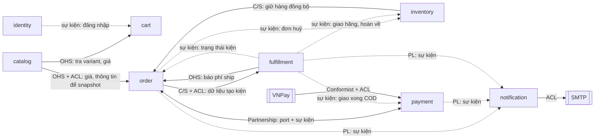

# Bước 2: Thiết kế chiến lược

> **Trạng thái:** Đã chốt (2026-11-17) · Thuộc [tài liệu thiết kế](../README.md) · Trước: [Bước 1](01-scope.md) · Sau: [Bước 3](03-tactical-design/README.md)

> Làm theo quy trình ở mục 2.2 của template. Chỉ xét các use case trong phạm vi GĐ1 (mục 1.5), nhưng ranh giới phải chừa chỗ cho GĐ2–3 (khuyến mãi, GHN thật, đổi trả) mà không phải vẽ lại.

## 2.1 Luồng giá trị

```
Đăng bán ─► Nhập kho ─► Khách chọn (giỏ) ─► Đặt hàng ─► Thanh toán ─► Xác nhận ─► Đóng gói ─► Giao hãng ─► Giao khách ─► (COD) Thu tiền
 catalog    inventory       cart            order        payment      order      fulfillment  fulfillment  fulfillment     payment
                                         ▲ giữ hàng                                           ▲ trừ kho thật
                                         ▲ snapshot đơn
```

Các trạm đổi chủ hoặc đổi vòng đời (ứng viên ranh giới):

| Trạm | Điều gì xảy ra | Vì sao là ranh giới |
|---|---|---|
| Đặt hàng | Giá, tên, ảnh, địa chỉ được **chụp lại** vào đơn | Sau thời điểm này đơn sống theo luật riêng, catalog đổi giá không ảnh hưởng (mục 2.2 bước 5 của template) |
| Giữ hàng | Số lượng được khoá cho một đơn, có thời hạn | Luật nhất quán mạnh nhất hệ thống (G2), khác nhịp với catalog |
| Thanh toán | Tiền đi qua hệ thống ngoài (VNPay), kết quả đến bất đồng bộ | Nguồn sự thật nằm ngoài; cần đối soát, idempotency |
| Giao hãng | Hàng rời kho, vận đơn do hãng quản lý | Đổi chủ vật lý; GĐ2 thay bằng GHN thật |

## 2.2 Event Storming

Ký hiệu: **sự kiện** (thì quá khứ) ← lệnh ← tác nhân. Cột "Đối tượng" là ứng viên aggregate, chốt ở bước 3.

### Catalog
| Sự kiện | Lệnh | Tác nhân | Đối tượng | Use case |
|---|---|---|---|---|
| Sản phẩm đã tạo · Colorway đã thêm · Variant đã thêm | Tạo/sửa sản phẩm | Admin | `Product` | CAT-05 |
| Ảnh colorway đã tải lên | Tải ảnh | Admin | `Product` (colorway) | CAT-05 |
| Sản phẩm đã hẹn giờ ra mắt · đã publish · đã archive | Publish / hẹn giờ / archive | Admin, Scheduler | `Product` | CAT-06 |
| Giá niêm yết đã đổi · Giá sale đã đặt (có hiệu lực từ–đến) | Đặt giá | Admin | `Product` (giá theo colorway) | CAT-07 |
| Category đã tạo · đã chuyển cha | Quản lý category | Admin | `Category` | CAT-08 |

### Inventory
| Sự kiện | Lệnh | Tác nhân | Đối tượng | Use case |
|---|---|---|---|---|
| Hàng đã nhập kho | Nhập kho | Staff | `StockItem` (theo SKU) | INV-01 |
| Tồn đã điều chỉnh (kèm lý do) | Điều chỉnh tồn | Staff | `StockItem` | INV-01 |
| Hàng đã giữ cho đơn · **Giữ hàng bị từ chối** (không đủ) | Giữ hàng cho cả đơn | Hệ thống (khi đặt hàng) | `StockItem` + `Reservation` | INV-02 |
| Hàng giữ đã nhả | Nhả hàng | Hệ thống (policy) | `Reservation` | INV-03 |
| Hàng đã trừ thật | Trừ kho | Hệ thống (policy) | `StockItem` | INV-04 |
| Hàng hoàn đã nhập lại | Nhập lại hàng hoàn | Hệ thống (policy) | `StockItem` | FUL-04 |

### Cart
| Sự kiện | Lệnh | Tác nhân | Đối tượng | Use case |
|---|---|---|---|---|
| Dòng giỏ đã thêm · đã đổi số lượng · đã xoá | Thêm/sửa/xoá dòng | Guest, Customer | `Cart` | CART-01 |
| Giỏ guest đã gộp vào giỏ tài khoản | Gộp giỏ | Hệ thống (policy khi đăng nhập) | `Cart` | CART-02 |
| (không phát sự kiện) Cảnh báo giỏ: hết hàng / đổi giá / ngừng bán | Đọc giỏ | Guest, Customer | `Cart` (read model) | CART-03 |

### Order
| Sự kiện | Lệnh | Tác nhân | Đối tượng | Use case |
|---|---|---|---|---|
| **Đơn đã đặt** (snapshot + idempotency key) · hoặc bị từ chối: giá đã đổi / hết hàng | Đặt hàng | Guest, Customer | `Order` | CHK-01, CHK-03, ORD-01 |
| Đơn đã xác nhận | Xác nhận đơn COD | Staff | `Order` | ORD-02 |
| Đơn đã xác nhận (tự động) | — | Hệ thống (policy khi đã thanh toán) | `Order` | ORD-01 |
| **Đơn đã huỷ** (lý do, người huỷ) | Huỷ đơn | Customer, Staff, Hệ thống | `Order` | ORD-03, ORD-04 |
| Trục fulfillment của đơn đã cập nhật | — | Hệ thống (policy từ fulfillment) | `Order` | FUL-02 |
| (không phát sự kiện) Xem đơn, tra cứu, timeline | Truy vấn | Customer, Guest, Staff | read model | ORD-05, ORD-06, ORD-07 |

### Payment
| Sự kiện | Lệnh | Tác nhân | Đối tượng | Use case |
|---|---|---|---|---|
| Thanh toán COD đã tạo | Khởi tạo thanh toán | Hệ thống (khi đặt hàng) | `Payment` | PAY-01 |
| Giao dịch VNPay đã tạo (URL có chữ ký, có hạn) | Khởi tạo thanh toán | Hệ thống (khi đặt hàng) | `Payment` | PAY-02 |
| **Thanh toán đã ghi nhận** · Thanh toán thất bại | Xử lý IPN | VNPay | `Payment` | PAY-03 |
| **Thanh toán đã hết hạn** | Quét quá hạn | Scheduler | `Payment` | PAY-05 |
| Thanh toán đã đối soát | Hỏi trạng thái VNPay | Scheduler | `Payment` | PAY-06 |
| **Tiền đến muộn đã ghi nhận** → Yêu cầu hoàn tiền đã tạo | Xử lý IPN | VNPay | `Payment`, `Refund` | PAY-07 |
| Hoàn tiền đã thực hiện (API) · đã ghi nhận thủ công | Hoàn tiền | Staff | `Refund` | PAY-08, PAY-09 |
| Tiền COD đã thu | — | Hệ thống (policy khi giao xong) | `Payment` | FUL-03 |

### Fulfillment
| Sự kiện | Lệnh | Tác nhân | Đối tượng | Use case |
|---|---|---|---|---|
| Phí ship đã báo (không lưu) | Báo phí | Hệ thống | `ShippingRateTable` | CHK-02 |
| Kiện đã tạo | Tạo kiện | Staff | `Shipment` | FUL-01 |
| Kiện đã đóng gói · **đã giao hãng** (mã vận đơn) · **đã giao** · giao thất bại · **đã hoàn về** | Cập nhật kiện | Staff (GĐ2: webhook GHN) | `Shipment` | FUL-02 |

### Identity & Notification
| Sự kiện | Lệnh | Tác nhân | Đối tượng | Use case |
|---|---|---|---|---|
| Tài khoản đã đăng ký · đã đăng nhập · đã đăng xuất | Đăng ký / đăng nhập / đăng xuất | Customer, Staff, Admin | `Account` | CUS-01 |
| Địa chỉ đã lưu | Lưu địa chỉ | Customer | `Account` (sổ địa chỉ) | CUS-02 |
| Email đã xác minh → Đơn guest đã gắn vào tài khoản | Xác minh email | Customer | `Account` | CUS-03 |
| Đặt lại mật khẩu đã yêu cầu · Mật khẩu đã đổi | Quên mật khẩu | Customer | `Account` | CUS-04 |
| Quyền đã cấp / thu hồi | Phân quyền | Admin | `Account` | CUS-05 |
| Email đã gửi · gửi lỗi (sự kiện kỹ thuật) | — | Hệ thống (policy) | `EmailMessage` | NOT-01 |

### Policy: "khi … thì …"

| # | Khi | Thì | Ở BC | Đồng bộ? |
|---|---|---|---|---|
| P1 | Đặt hàng | Giữ hàng cho cả đơn, all-or-nothing; thiếu một dòng thì từ chối cả đơn | order → inventory | **Đồng bộ** (khách cần kết quả ngay) |
| P2 | Đặt hàng | Khởi tạo thanh toán (COD hoặc URL VNPay) | order → payment | **Đồng bộ** (cần URL để chuyển hướng) |
| P3 | Thanh toán đã ghi nhận | Đơn chuyển "đã thanh toán"; đơn VNPay tự xác nhận | payment → order | Sự kiện |
| P4 | Thanh toán đã hết hạn | Huỷ đơn (lý do: hết hạn thanh toán) | payment → order | Sự kiện |
| P5 | Đơn đã huỷ | Nhả hàng giữ | order → inventory | Sự kiện |
| P6 | Đơn đã huỷ mà tiền đã nhận | Tạo yêu cầu hoàn tiền | order → payment | Sự kiện |
| P7 | Tiền đến muộn (đơn đã hết hạn/huỷ) | Ghi nhận tiền, tạo yêu cầu hoàn tiền; **không** hồi sinh đơn | payment | Trong BC |
| P8 | Kiện đã giao hãng | Trừ kho thật; đơn sang "đang giao" | fulfillment → inventory, order | Sự kiện |
| P9 | Kiện đã giao + đơn COD | Ghi nhận đã thu tiền COD | fulfillment → payment | Sự kiện |
| P10 | Kiện đã hoàn về | Huỷ đơn, nhập lại kho | fulfillment → order, inventory | Sự kiện |
| P11 | Đăng nhập thành công | Gộp giỏ guest vào giỏ tài khoản | identity → cart | Sự kiện |
| P12 | Đơn đã đặt · đã thanh toán · đã giao hãng · đã huỷ | Gửi email | → notification | Sự kiện, sau commit |
| P13 | Đến giờ ra mắt đã hẹn | Publish sản phẩm | catalog | Scheduler |

Sự kiện đi qua **transactional outbox** (đã nêu ở domain doc): ghi cùng giao dịch với thay đổi trạng thái, phát sau commit, listener idempotent.

## 2.3 Chỗ ngôn ngữ đổi nghĩa

Đây là bằng chứng chính cho ranh giới (bước 3 của quy trình).

| Từ ngoài đời | catalog | inventory | cart | order | payment | fulfillment |
|---|---|---|---|---|---|---|
| **Sản phẩm** | `Product` → `Colorway` → `Variant`: tên, mô tả, ảnh, giá, trạng thái publish | `StockItem`: SKU, on hand, reserved, safety stock. Không có tên, ảnh, giá | `CartLine`: variant id + số lượng. Giá chỉ để so, không phải sự thật | `OrderLine`: **bản chụp** tên, màu, size, ảnh, đơn giá lúc đặt | (không có) | `ShipmentItem`: SKU + số lượng |
| **Giá** | Giá niêm yết, giá sale có hiệu lực | (không có) | Giá lúc thêm, để phát hiện đổi giá | Đơn giá đã chốt, tổng tiền | Số tiền cần thu, phải khớp IPN | Giá trị thu hộ COD |
| **Khách** | (không có) | (không có) | Chủ giỏ: cookie hoặc account id | Người mua (liên hệ) + người nhận (địa chỉ) bản chụp | Người trả tiền | Người nhận: tên, SĐT, địa chỉ |
| **Địa chỉ** | — | (GĐ1: một `location` kho) | — | Bản chụp lúc đặt, không đổi theo sổ địa chỉ | — | Điểm giao |
| **Huỷ** | Archive: ngừng bán | Nhả hàng giữ | — | Đơn kết thúc, có lý do và người huỷ | Không thu nữa / hoàn tiền | Huỷ kiện trước khi giao hãng |
| **Trạng thái** | Draft / Scheduled / Published / Archived | (không có trạng thái, chỉ con số) | — | Trục **order** | Trục **payment** | Trục **fulfillment** |
| **Hết hạn** | Giá sale hết hiệu lực | Reservation quá TTL | — | — | Payment pending quá TTL | — |

Kết luận: không có lớp `Product` hay `Customer` dùng chung. Mỗi BC giữ đúng thuộc tính nó cần.

## 2.4 Bounded context và mức đầu tư

| BC | Loại | Vì sao | Mức đầu tư (template 2.5, 12) | Use case |
|---|---|---|---|---|
| `order` | **Core** | Snapshot, state machine, idempotency đặt hàng; sai là mất tiền/mất khách | Hexagon đầy đủ, aggregate giàu hành vi, test domain dày | CHK-01, CHK-03, ORD-01…07 |
| `inventory` | **Core** | Không bán quá số hàng (G2, N1) | Hexagon đầy đủ, test đồng thời | INV-01…05 |
| `payment` | **Core** | Tiền thật, hệ thống ngoài, bất đồng bộ (G3) | Hexagon đầy đủ, ACL cho VNPay | PAY-01…09 |
| `catalog` | Supporting | Cần cho mọi thứ, nhiều CRUD, ít luật (trừ hiệu lực giá, publish) | Hexagon rút gọn; read model cho PLP/PDP | CAT-01…08 |
| `cart` | Supporting | Luật ít: gộp giỏ, kiểm tra lại | Hexagon rút gọn | CART-01…03 |
| `fulfillment` | Supporting | GĐ1 giả lập; GĐ2 nối GHN qua cùng port | Hexagon đầy đủ ở port vận chuyển, phần còn lại mỏng | CHK-02, FUL-01…04 |
| `identity` | Generic | Ai cũng cần; dùng Spring Security, bcrypt/argon2 | Mỏng, dựa thư viện | CUS-01…05 |
| `notification` | Generic | Gửi email theo sự kiện | Mỏng, chỉ listener + adapter SMTP | NOT-01 |

Đủ 45/45 use case. **Shared kernel** (`common`) giữ thật nhỏ: `Money` (số nguyên VND), kiểu id, `Clock`, lớp nền domain event, lỗi chuẩn. Không chứa mô hình nghiệp vụ.

Giá nằm trong `catalog` ở GĐ1 vì chỉ có giá niêm yết + giá sale. Các BC khác hỏi giá qua port, nên GĐ2 có thể tách `pricing`/`promotion` ra mà không sửa người gọi.

## 2.5 Context map

Mũi tên: **upstream → downstream** (bên dưới phụ thuộc bên trên).



Nét liền: gọi đồng bộ qua port. Nét đứt: sự kiện qua outbox. `identity` cung cấp người dùng hiện tại và quyền cho mọi BC ở tầng API (Open Host), không vẽ để đỡ rối.

| Upstream | Downstream | Kiểu | Cơ chế | Ghi chú |
|---|---|---|---|---|
| catalog | cart | Customer–Supplier, OHS | Port `VariantLookup` (ACL ở cart) | Cart chỉ giữ variant id + số lượng |
| catalog | order | Customer–Supplier, OHS | Port `PricingAndProductInfo` (ACL ở order) | Order tính lại giá lúc đặt, rồi snapshot |
| fulfillment | order | OHS | Port `ShippingQuote` | GĐ2: GHN thay bảng phí, người gọi không đổi |
| inventory | order | Customer–Supplier | Port `StockReservation` đồng bộ | All-or-nothing cho cả đơn |
| order ↔ payment | | Partnership | Order gọi `PaymentInitiation`; payment phát sự kiện thanh toán; order phát "đơn huỷ" | Hai bên không đọc bảng của nhau |
| order | fulfillment | Customer–Supplier | Port `OrderForShipping` (ACL ở fulfillment), snapshot người nhận + dòng hàng vào kiện | |
| order, fulfillment | inventory | Published Language | Sự kiện: đơn huỷ, giao hãng, hoàn về | Inventory nghe, idempotent theo order id |
| VNPay | payment | Conformist + ACL | Adapter ký URL, xác thực chữ ký IPN, dịch mã lỗi | Mô hình VNPay không lọt vào domain |
| order, payment, fulfillment | notification | Published Language | Sự kiện | Notification chỉ dùng payload sự kiện, không gọi ngược |
| identity | cart | Published Language | Sự kiện đăng nhập | Gộp giỏ |
| notification | SMTP | ACL | Adapter gửi mail | GĐ1: SMTP dev (Mailpit) |

Không có vòng phụ thuộc đồng bộ. Cặp duy nhất phụ thuộc hai chiều là order ↔ payment, và chiều ngược lại chỉ đi qua sự kiện.

## 2.6 Bounded Context Canvas

### order (core)
| Mục | Nội dung |
|---|---|
| Mục đích | Biến giỏ hàng thành một cam kết bán hàng không đổi (đơn snapshot), và giữ trạng thái đơn đúng trong suốt vòng đời |
| Chịu trách nhiệm | Đặt hàng (checkout), mã đơn, snapshot, trục trạng thái order, huỷ đơn, timeline, xem/tra cứu đơn |
| Không chịu trách nhiệm | Tồn kho, thu tiền, vận chuyển, giá hiện hành |
| Ngôn ngữ | Đơn, dòng đơn, mã đơn, snapshot, người mua, người nhận, idempotency key, lý do huỷ |
| Aggregate (ứng viên) | `Order` (gồm `OrderLine`, địa chỉ snapshot, timeline) |
| Lệnh vào | PlaceOrder, ConfirmOrder, CancelOrder (khách / staff / hệ thống) |
| Truy vấn vào | Đơn của tôi, tra cứu guest, danh sách + chi tiết cho staff |
| Sự kiện phát | Đơn đã đặt, đã xác nhận, đã huỷ |
| Sự kiện nghe | Thanh toán đã ghi nhận / hết hạn; kiện đã giao hãng / đã giao / thất bại / hoàn về |
| Phụ thuộc | catalog (giá), inventory (giữ hàng), payment (khởi tạo), fulfillment (phí ship) |
| Nhất quán quan trọng | Một idempotency key → đúng một đơn; tổng tiền = tổng dòng + phí ship; chỉ huỷ khi chưa đóng gói (với khách) |

### inventory (core)
| Mục | Nội dung |
|---|---|
| Mục đích | Trả lời đúng "còn bán được bao nhiêu" và không bao giờ bán quá |
| Chịu trách nhiệm | Tồn theo SKU, giữ hàng có TTL, nhả, trừ thật, nhập lại, sổ cái biến động |
| Không chịu trách nhiệm | Giá, thông tin hiển thị sản phẩm, trạng thái đơn |
| Ngôn ngữ | SKU, on hand, reserved, safety stock, ATS = on hand − reserved − safety, reservation, ledger, location |
| Aggregate (ứng viên) | `StockItem` (theo SKU + location), `Reservation` (theo đơn) |
| Lệnh vào | ReceiveStock, AdjustStock, ReserveForOrder, ReleaseReservation, CommitStock, RestockReturn |
| Truy vấn vào | ATS theo variant (cho PLP/PDP/cart), tồn + lịch sử theo SKU |
| Sự kiện phát | Tồn đã thay đổi (cho read model catalog) |
| Sự kiện nghe | Đơn đã huỷ, kiện đã giao hãng, kiện đã hoàn về |
| Phụ thuộc | Không gọi BC nào (thượng nguồn thuần) |
| Nhất quán quan trọng | ATS ≥ 0 với mọi SKU tại mọi thời điểm; giữ hàng all-or-nothing; mọi thay đổi có dòng sổ cái |

### payment (core)
| Mục | Nội dung |
|---|---|
| Mục đích | Biết chắc đơn đã được trả tiền hay chưa, dù hệ thống ngoài trả lời muộn, trùng hoặc sai |
| Chịu trách nhiệm | Payment COD/VNPay, URL có chữ ký, IPN, hết hạn, đối soát, tiền đến muộn, hoàn tiền, thu tiền COD |
| Không chịu trách nhiệm | Tính tiền đơn (nhận số tiền từ order), trạng thái đơn |
| Ngôn ngữ | Payment, phương thức, pending/captured/failed/expired, IPN, mã giao dịch, đối soát, refund, COD collected |
| Aggregate (ứng viên) | `Payment`, `Refund` |
| Lệnh vào | InitiatePayment, HandleIpn, ExpirePayments, Reconcile, RecordManualRefund, RefundViaGateway, RecordCodCollected |
| Truy vấn vào | Trạng thái thanh toán của đơn (trang kết quả), hàng đợi hoàn tiền |
| Sự kiện phát | Thanh toán đã ghi nhận / thất bại / hết hạn; tiền đến muộn; hoàn tiền xong |
| Sự kiện nghe | Đơn đã huỷ (nếu đã trả → hoàn tiền); kiện đã giao (COD) |
| Phụ thuộc | VNPay (Conformist + ACL) |
| Nhất quán quan trọng | Một IPN xử lý đúng một lần; số tiền IPN phải khớp; hạn thanh toán ≤ TTL giữ hàng |

### catalog (supporting)
| Mục | Nội dung |
|---|---|
| Mục đích | Mô tả thứ đang bán và giá hiện hành, phục vụ đọc nhanh cho SEO |
| Chịu trách nhiệm | Product → Colorway → Variant, ảnh, category, publish/hẹn giờ/archive, giá niêm yết + sale, tìm kiếm, read model PLP/PDP |
| Không chịu trách nhiệm | Số tồn (chỉ hiển thị lại ATS từ inventory), giá trong đơn đã đặt |
| Ngôn ngữ | Product, colorway, variant, SKU, category, giá niêm yết, giá sale, hiệu lực, publish |
| Aggregate (ứng viên) | `Product`, `Category` |
| Lệnh vào | Tạo/sửa product, publish/archive/hẹn giờ, đặt giá, quản lý category |
| Truy vấn vào | PLP (lọc, facet), PDP, tìm kiếm, tra variant + giá (cho cart/order) |
| Sự kiện phát | Sản phẩm đã publish / archive, giá đã đổi |
| Sự kiện nghe | Tồn đã thay đổi (cập nhật cờ "còn size") |
| Phụ thuộc | Không gọi BC nào |
| Nhất quán quan trọng | SKU duy nhất; giá sale < giá niêm yết và có hiệu lực rõ; chỉ bán variant đã publish |

### cart (supporting)
| Mục | Nội dung |
|---|---|
| Mục đích | Giữ ý định mua của khách, và nói thật khi ý định đó không còn khả thi |
| Chịu trách nhiệm | Giỏ guest (cookie) và giỏ tài khoản, gộp giỏ, cảnh báo khi đọc |
| Không chịu trách nhiệm | Giữ hàng (giỏ không giữ hàng), giá cuối cùng |
| Ngôn ngữ | Giỏ, dòng giỏ, giá lúc thêm, cảnh báo |
| Aggregate (ứng viên) | `Cart` |
| Sự kiện nghe | Đăng nhập thành công |
| Phụ thuộc | catalog (variant, giá), inventory (ATS) qua port |
| Nhất quán quan trọng | Một variant xuất hiện một lần trong giỏ; số lượng ≥ 1 và có giới hạn |

### fulfillment (supporting)
| Mục | Nội dung |
|---|---|
| Mục đích | Đưa hàng từ kho tới tay người nhận và báo lại chuyện gì đã xảy ra |
| Chịu trách nhiệm | Bảng phí ship + freeship, kiện hàng, trạng thái kiện, mã vận đơn |
| Không chịu trách nhiệm | Trừ kho (chỉ phát sự kiện), thu tiền (chỉ báo "đã giao") |
| Ngôn ngữ | Kiện, người nhận, mã vận đơn, giao hãng, giao thất bại, hoàn về, phí ship |
| Aggregate (ứng viên) | `Shipment`, `ShippingRateTable` |
| Lệnh vào | CreateShipment, MarkPacked, HandOver, MarkDelivered, MarkFailed, MarkReturned |
| Sự kiện phát | Kiện đã giao hãng / đã giao / thất bại / hoàn về |
| Phụ thuộc | order (dữ liệu tạo kiện, qua ACL) |
| Nhất quán quan trọng | GĐ1 một đơn một kiện; trạng thái kiện chỉ đi tới theo state machine |

### identity (generic) và notification (generic)
| BC | Nội dung chính |
|---|---|
| identity | `Account` (customer/staff/admin), mật khẩu hash, phiên đăng nhập, sổ địa chỉ, quyền theo hành động, gắn đơn guest sau khi xác minh email. Phát "đã đăng nhập". Các BC khác chỉ thấy `UserId` + quyền |
| notification | Nghe sự kiện của order, payment, fulfillment; dựng email từ payload; gửi sau commit; lỗi gửi chỉ ghi log và thử lại, không chặn nghiệp vụ |

## 2.7 Điểm nóng cần quyết ở bước 3–4

| # | Vấn đề | Lựa chọn | Quyết ở |
|---|---|---|---|
| H1 | Đặt hàng chạm 3 BC (giữ hàng, tạo đơn, tạo payment). Một giao dịch DB hay saga có bù trừ? | (a) Một transaction vì là modular monolith cùng Postgres; (b) giữ hàng trước, lỗi sau thì nhả | ADR |
| H2 | Trục payment của đơn: order giữ bản sao (cập nhật qua sự kiện) hay hỏi payment khi đọc? | Bản sao giúp đọc nhanh và lọc danh sách staff | Bước 3 |
| H3 | Reservation: aggregate riêng theo đơn, hay nằm trong `StockItem`? | Ảnh hưởng cách khoá khi tranh chấp (G2) | Bước 3 |
| H4 | Khoá khi giữ hàng: `SELECT … FOR UPDATE`, update có điều kiện, hay version lạc quan? | Đo bằng test đồng thời N1 | ADR |
| H5 | Đơn COD chưa xác nhận giữ hàng bao lâu? Hết hạn thì sao? | TTL riêng cho COD hay giữ tới khi staff xử lý | Bước 3 |
| H6 | Trừ kho thật lúc đóng gói hay lúc giao hãng? | Hiện chọn giao hãng (P8) | Bước 3 |
| H7 | Giỏ guest lưu server (id trong cookie) hay toàn bộ ở cookie? | Server-side dễ kiểm tra lại và gộp | ADR |
| H8 | Tra cứu đơn guest bằng mã + email/SĐT: chống dò mã | Mã đơn không đoán được + rate limit (N5) | Bước 3 |

