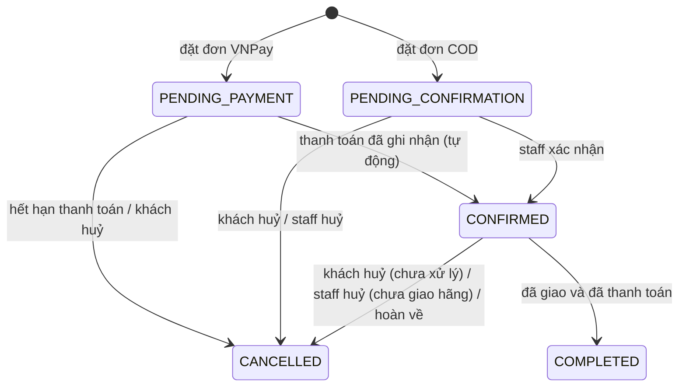

# 3.2 order (core)

> **Trạng thái:** Đã chốt (2026-11-17) · Thuộc [Bước 3: Thiết kế chiến thuật](README.md)

## Aggregate `Order`

```
Order (root)
 ├─ id (UUID), orderNumber (OrderNumber), version
 ├─ buyer: Buyer                  (accountId? | guest; email, phone)  ← snapshot
 ├─ shippingAddress: Address      (tên, SĐT, tỉnh/thành, phường/xã, số nhà + đường, ghi chú) ← snapshot
 ├─ shippingMethod: ShippingSnapshot (mã, tên, phí đã báo)
 ├─ paymentMethod: COD | VNPAY
 ├─ lines: OrderLine[1..n]
 │    variantId, sku, productName, colorName, size, imageKey   ← snapshot
 │    unitListPrice, unitPrice (giá sau sale), quantity, lineTotal
 ├─ totals: subtotal, shippingFee, grandTotal  (đã gồm VAT 10%; vatAmount tính để hiển thị)
 ├─ status: OrderStatus           (trục order: nguồn sự thật ở đây)
 ├─ paymentStatus: OrderPaymentStatus       (bản sao từ payment, xem H2)
 ├─ fulfillmentStatus: OrderFulfillmentStatus (bản sao từ fulfillment)
 ├─ cancellation?: (lý do, ai huỷ, lúc nào)
 ├─ idempotencyKey, placedAt
 └─ activities: OrderActivity[]   (timeline chỉ thêm, không sửa: ai, lúc nào, làm gì, lý do)
```

Value object: `OrderNumber`, `Buyer`, `Address`, `ShippingSnapshot`, `Money`, `Totals`, `CancellationReason`.

## Bất biến

| # | Bất biến |
|---|---|
| O1 | Đơn có ít nhất 1 dòng; mỗi dòng quantity 1–10; một variant chỉ xuất hiện một lần |
| O2 | `lineTotal = unitPrice × quantity`; `subtotal = Σ lineTotal`; `grandTotal = subtotal + shippingFee`. Tính trong constructor, không nhận từ ngoài |
| O3 | Snapshot (dòng, địa chỉ, phí ship, tổng tiền) **không đổi** sau khi tạo. GĐ1 không có lệnh sửa đơn |
| O4 | Một `idempotencyKey` ứng với đúng một đơn (ràng buộc unique ở DB) |
| O5 | Chuyển trạng thái chỉ theo state machine 3.2.1; trạng thái cuối (`COMPLETED`, `CANCELLED`) không chuyển tiếp |
| O6 | Khách chỉ huỷ được khi `fulfillmentStatus = UNFULFILLED`; staff huỷ được khi chưa `SHIPPED` |
| O7 | Mỗi lần chuyển trạng thái thêm đúng một `OrderActivity` |
| O8 | `orderNumber` duy nhất và không đoán được (H8) |

## 3.2.1 State machine trục order



| Lệnh | Từ | Đến | Ai | Điều kiện chặn |
|---|---|---|---|---|
| `confirm` | PENDING_CONFIRMATION | CONFIRMED | Staff | Chỉ đơn COD |
| `markPaid` | PENDING_PAYMENT | CONFIRMED | Hệ thống (sự kiện thanh toán) | Số tiền khớp `grandTotal` |
| `markPaid` | CONFIRMED (COD) | (giữ nguyên) | Hệ thống (thu COD) | Chỉ đổi `paymentStatus` |
| `cancel` | PENDING_PAYMENT, PENDING_CONFIRMATION, CONFIRMED | CANCELLED | Khách / Staff / Hệ thống | O6; bắt buộc lý do với staff |
| `complete` | CONFIRMED | COMPLETED | Hệ thống | `fulfillmentStatus = DELIVERED` và `paymentStatus = PAID` |

GĐ1 chưa có đổi trả nên `COMPLETED` đến ngay khi đã giao và đã thanh toán. GĐ2 thêm thời hạn đổi trả trước khi hoàn tất.

## 3.2.2 Trục payment và fulfillment trên đơn (bản sao)

| Trục | Giá trị | Cập nhật khi |
|---|---|---|
| `paymentStatus` | `UNPAID` → `PAID` → `REFUND_PENDING` → `REFUNDED` | Sự kiện từ payment: đã ghi nhận / đã thu COD / yêu cầu hoàn / hoàn xong |
| `fulfillmentStatus` | `UNFULFILLED` → `PROCESSING` → `SHIPPED` → `DELIVERED`; nhánh `RETURNED` | `PROCESSING`: lệnh đồng bộ khi staff tạo kiện (3.7). Còn lại: sự kiện từ fulfillment |

**H2, quyết định:** đơn giữ **bản sao** hai trục này. Nguồn sự thật vẫn là `payment` và `fulfillment`; bản sao giúp lọc danh sách đơn cho staff và kiểm tra điều kiện huỷ mà không gọi sang BC khác.

**Tranh chấp "khách huỷ đúng lúc staff bắt đầu đóng gói":** khi staff tạo kiện, `fulfillment` gọi đồng bộ `order.startFulfillment()`. Lệnh này chuyển `fulfillmentStatus` sang `PROCESSING` và thất bại nếu đơn đã huỷ. Hai lệnh cùng sửa một `Order` nên `version` bảo đảm chỉ một bên thắng.

## H8, quyết định: mã đơn và tra cứu guest
- Mã đơn dạng `CD-251117-7KQ2MX`: ngày đặt + 6 ký tự ngẫu nhiên (bảng chữ không có O/0/I/1). Không dùng số tăng dần.
- **Trùng mã** (bổ sung 2026-11-17): 6 ký tự từ bảng 32 chữ cho khoảng 1 tỷ mã mỗi ngày, nên trùng rất hiếm nhưng vẫn có thể. Ràng buộc unique ở DB là chốt chặn (O8). Khi lưu đơn gặp lỗi trùng `orderNumber`, sinh mã mới và thử lại, tối đa 3 lần, rồi mới báo lỗi. Không để lỗi unique biến thành lỗi 500 lúc đặt hàng.
- Tra cứu cần **mã đơn + (email hoặc SĐT)** khớp đơn. Không tìm thấy và sai thông tin trả **cùng một thông báo**.
- Rate limit: 10 lần / 15 phút / IP cho tra cứu.


## Use case chi tiết

### UC CHK-03: Đặt hàng

| Mục | Nội dung |
|---|---|
| Tác nhân | Guest, Customer |
| Tiền điều kiện | Giỏ có ít nhất 1 dòng; client gửi `Idempotency-Key` (UUID) và **tổng tiền khách đang thấy** |
| Đầu vào | cartId, liên hệ (email, SĐT), địa chỉ, phương thức giao, phương thức thanh toán, tổng tiền khách thấy |

**Luồng chính**
1. Kiểm tra idempotency: key đã xử lý → trả lại đúng kết quả cũ (bước 1 luôn chạy trước mọi thứ).
2. Kiểm tra đầu vào: email, SĐT 10 số bắt đầu bằng 0, tỉnh/thành và phường/xã hợp lệ theo danh mục 2025.
3. Đọc dòng giỏ từ `cart`.
4. Hỏi `catalog` giá hiện hành và trạng thái bán của từng variant.
5. Hỏi `fulfillment` phí ship cho phương thức và địa chỉ.
6. Tính tổng (O2). Khác tổng khách thấy → dừng, trả `PRICE_CHANGED` kèm tổng mới. **Chưa có gì bị thay đổi.**
7. Giữ hàng cả đơn (I2–I4).
8. Tạo `Order`: COD → `PENDING_CONFIRMATION`, VNPay → `PENDING_PAYMENT`.
9. Tạo `Payment` `PENDING`. VNPay: `expiresAt = now + 15 phút`, trả URL thanh toán có chữ ký.
10. Lưu kết quả cho idempotency key; ghi sự kiện "Đơn đã đặt" vào outbox. Listener của `cart` xoá giỏ.

**Luồng lỗi**

| Mã lỗi | Khi | Hệ thống làm gì | Khách thấy |
|---|---|---|---|
| `VALIDATION_ERROR` | Bước 2 | Không thay đổi gì | Lỗi theo từng ô |
| `CART_EMPTY` | Bước 3 | Không thay đổi gì | Quay về giỏ |
| `PRODUCT_UNAVAILABLE` | Bước 4: variant ngừng bán | Không thay đổi gì | Dòng nào, gợi ý xoá khỏi giỏ |
| `PRICE_CHANGED` | Bước 6 | Không thay đổi gì | Tổng mới, bấm đặt lại |
| `OUT_OF_STOCK` | Bước 7 | Không giữ dòng nào | SKU nào thiếu, còn bao nhiêu |
| `IDEMPOTENCY_CONFLICT` | Bước 1: cùng key, khác nội dung | Không thay đổi gì | Lỗi chung, tải lại trang |
| `RATE_LIMITED` | Trước bước 1 | Không thay đổi gì | Thử lại sau |
| Lỗi hệ thống sau bước 7 | Bước 8–10 lỗi | Không để lại hàng giữ mà không có đơn (cách làm: H1, ADR) | Lỗi chung, giỏ còn nguyên |

**Tiêu chí chấp nhận**
- Gửi cùng một yêu cầu 5 lần với cùng key → đúng 1 đơn, 1 reservation, 1 payment; 5 phản hồi giống nhau.
- 200 yêu cầu đồng thời tranh 10 đôi cuối → đúng 10 đơn, 190 `OUT_OF_STOCK`, `ats` cuối = 0 (N1).
- Admin đổi giá giữa lúc khách xem và lúc đặt → `PRICE_CHANGED`, không có reservation nào được tạo.
- Đơn 3 dòng, dòng thứ 3 hết hàng → không SKU nào bị giữ.
- Sau khi đặt, đổi giá trong catalog không làm đổi giá trên đơn (O3).

### UC ORD-03 + ORD-04: Huỷ đơn

| Ai | Được huỷ khi | Bắt buộc | Sau khi huỷ |
|---|---|---|---|
| Khách (đơn của mình; guest qua tra cứu) | `PENDING_PAYMENT`, `PENDING_CONFIRMATION`, hoặc `CONFIRMED` + `UNFULFILLED` | Lý do chọn từ danh sách | Nhả hàng; Payment `PENDING` → `VOIDED`; đã trả → `Refund` |
| Staff | Mọi trạng thái chưa cuối, `fulfillmentStatus` chưa `SHIPPED` | Lý do (văn bản) | Như trên; kiện chưa giao hãng bị huỷ theo |
| Hệ thống | Hết hạn thanh toán; hoàn về | — | Như trên; hoàn về thì nhập lại kho (FUL-04) |

Nếu kiện đã được giao cho hãng ngay trước khi sự kiện huỷ tới (hiếm, chỉ với staff huỷ), `fulfillment` không huỷ kiện mà tạo cảnh báo cho staff xử lý tay. Đây là rủi ro chấp nhận ở GĐ1.

**Tiêu chí chấp nhận:** huỷ đơn đã trả → có đúng 1 `Refund`, `paymentStatus = REFUND_PENDING`. Khách huỷ khi `PROCESSING` → bị từ chối với thông báo rõ. Huỷ hai lần → lần hai không có tác dụng.

### UC ORD-02: Staff xác nhận đơn COD
Chỉ với đơn `PENDING_CONFIRMATION`. Ghi ai xác nhận và ghi chú (ví dụ "đã gọi, khách xác nhận"). Danh sách chờ xác nhận sắp xếp theo thời gian đặt, đơn quá 24 giờ được làm nổi.

