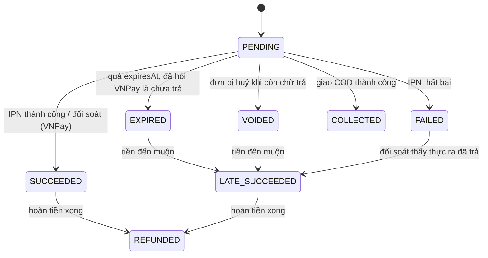

# 3.4 payment (core)

> **Trạng thái:** Đã chốt (2026-11-17) · Thuộc [Bước 3: Thiết kế chiến thuật](README.md)

## Aggregate

```
Payment (root) — mỗi lần thử thanh toán là một Payment
 ├─ id, orderId, method (COD | VNPAY), amount (Money), version
 ├─ txnRef (unique, gửi sang VNPay), expiresAt (VNPay)
 ├─ status: PaymentStatus
 ├─ gatewayTxnNo?, bankCode?, paidAt?
 └─ (log thô mọi IPN lưu ở bảng riêng, không thuộc aggregate)

Refund (root)
 ├─ id, paymentId, orderId, amount, reason
 ├─ method: GATEWAY_API | MANUAL_TRANSFER
 └─ status: REQUESTED → COMPLETED | FAILED (FAILED → làm lại bằng MANUAL)
```

## 3.4.1 State machine Payment



`COLLECTED → SETTLED` (tiền COD về tài khoản) thuộc GĐ3, cần đối soát với hãng.

## Bất biến

| # | Bất biến |
|---|---|
| P1 | Một đơn có tối đa **một** Payment `PENDING` cùng lúc. Thanh toán VNPay thất bại thì khách được thử lại (Payment mới) trong thời hạn còn lại của đơn |
| P2 | `amount` của Payment = `grandTotal` của đơn; IPN có số tiền khác → không ghi nhận, cảnh báo |
| P3 | IPN chỉ có tác dụng **một lần** theo `txnRef`; Payment ở trạng thái cuối nhận IPN lặp → trả "đã xác nhận", không làm gì |
| P4 | Chỉ IPN đã xác thực chữ ký hoặc kết quả đối soát được đổi trạng thái. Return URL không bao giờ đổi trạng thái |
| P5 | `expiresAt` của Payment mới ≤ hạn ban đầu của đơn (thử lại không kéo dài thời gian giữ hàng) |
| P6 | Tiền đến muộn (`LATE_SUCCEEDED`) **luôn** tạo `Refund`; không hồi sinh đơn |
| P7 | Đơn có hơn một Payment thành công (trả hai lần) → mọi Payment thừa đều tạo `Refund` |
| P8 | Tổng tiền các `Refund` của một Payment ≤ `amount` |
| P9 | URL thanh toán gửi `expiresAt` sang VNPay (`vnp_ExpireDate`), để chính VNPay từ chối thanh toán sau hạn. Job chỉ cho hết hạn sau `expiresAt + 3 phút` ân hạn (bổ sung 2026-11-17) |


## Use case chi tiết

### UC PAY-03: Xử lý IPN VNPay

| Bước | Kiểm tra | Không đạt thì |
|---|---|---|
| 1 | Lưu log thô của IPN | (luôn làm) |
| 2 | Xác thực chữ ký HMAC | Trả mã "sai chữ ký" |
| 3 | Tìm Payment theo `txnRef` | Trả mã "không tìm thấy" |
| 4 | Số tiền khớp `amount` (P2) | Trả mã "sai số tiền", cảnh báo |
| 5 | Payment đã ở trạng thái cuối (P3) | Trả mã "đã xác nhận" |
| 6 | Áp kết quả theo bảng dưới, ghi outbox cùng transaction | — |
| 7 | Trả mã thành công theo format VNPay | — |

| Trạng thái Payment hiện tại | IPN báo | Payment thành | Sự kiện |
|---|---|---|---|
| PENDING | thành công | SUCCEEDED | Thanh toán đã ghi nhận → đơn `CONFIRMED`, `PAID` |
| PENDING | thất bại | FAILED | Thanh toán thất bại (đơn vẫn chờ, khách có thể thử lại tới hết hạn) |
| EXPIRED / VOIDED | thành công | LATE_SUCCEEDED | Tiền đến muộn → tạo `Refund` (P6) |

Mã phản hồi cụ thể lấy theo tài liệu VNPay khi tích hợp (bước 6 của dự án), adapter dịch qua lại; domain không biết các mã này.

**Tiêu chí chấp nhận:** IPN gửi 3 lần → 1 lần đổi trạng thái, 1 sự kiện. IPN sai chữ ký hoặc sai số tiền → trạng thái không đổi. Gọi Return URL giả với tham số "thành công" → đơn vẫn chờ thanh toán.

### UC PAY-05 + PAY-06: Hết hạn và đối soát

1. Mỗi phút, lấy các Payment VNPay `PENDING` có `expiresAt + 3 phút < now` (ân hạn, P9), khoá từng dòng kiểu `SKIP LOCKED` để chạy nhiều instance không xử lý trùng.

   Vì sao có ân hạn: khách có thể đang nhập OTP ở trang ngân hàng đúng lúc hết hạn. Không có ân hạn thì job nhả hàng, vài giây sau tiền về thành `LATE_SUCCEEDED` và phải hoàn tiền: tiền vẫn an toàn nhưng khách mất đơn. Gửi `vnp_ExpireDate` cho VNPay cộng với ân hạn ở đây làm ca này gần như không xảy ra. Hàng bị giữ lâu hơn tối đa 3 phút, chấp nhận được.
2. Với mỗi Payment, **hỏi VNPay trước** (API truy vấn giao dịch):
   - đã trả → `SUCCEEDED` (như IPN thành công);
   - chưa trả hoặc thất bại → `EXPIRED`, phát "Thanh toán đã hết hạn" → đơn huỷ → nhả hàng;
   - VNPay lỗi hoặc không trả lời → bỏ qua, lần chạy sau thử lại; quá 3 lần → cảnh báo cho staff.
3. Đối soát (PAY-06) dùng cùng cách hỏi cho Payment `PENDING` quá 10 phút chưa có IPN, và cho `FAILED` trong 24 giờ gần nhất.

**Tiêu chí chấp nhận:** khách trả tiền nhưng IPN không tới → đến hạn, job ghi nhận `SUCCEEDED`, không huỷ đơn. Khách trả xong ở phút 16 (trong ân hạn) → đơn được xác nhận bình thường, không hoàn tiền. IPN thành công tới sau khi đơn đã huỷ → `LATE_SUCCEEDED` + `Refund`, hàng **không** bị giữ lại.

Đối soát ở GĐ1 chỉ hỏi các giao dịch mình **chưa biết** kết quả (`PENDING`, `FAILED` gần đây). Đối soát toàn bộ với báo cáo của cổng (bắt các ca lệch "mình ghi đã trả, cổng ghi thất bại" và ngược lại, chuyển cho người xem) để ở GĐ2–3, xem mục 1.7.

