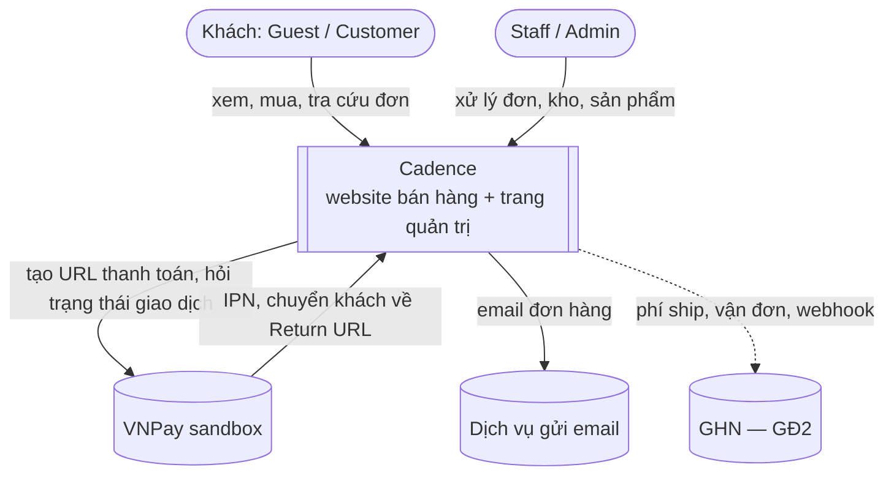
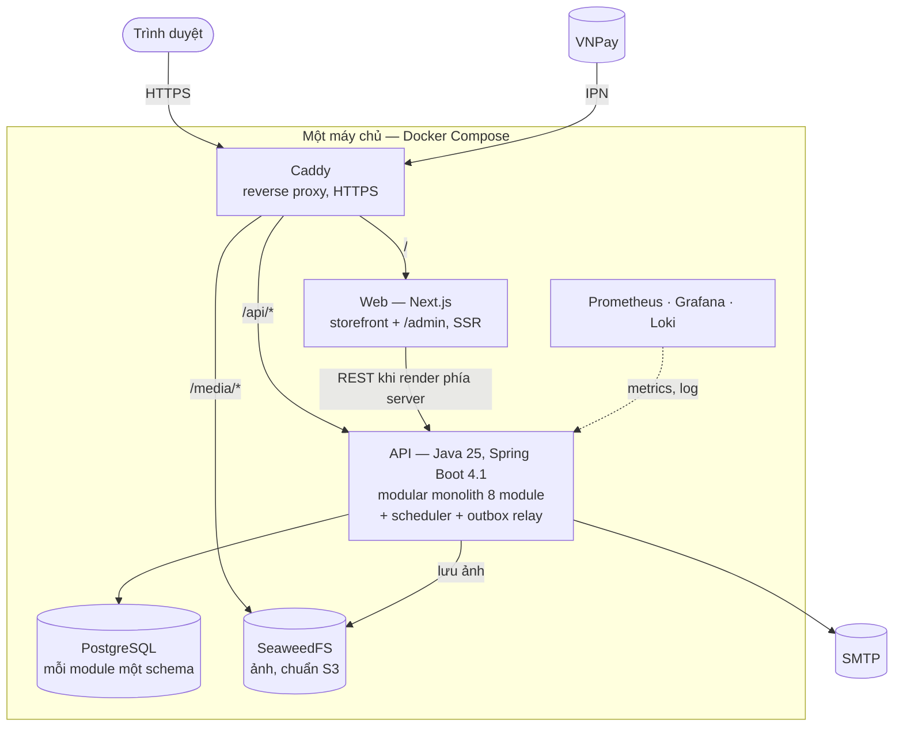

# Bước 4: Kiến trúc và ADR

> **Trạng thái:** Đã chốt (2026-11-17) · Thuộc [tài liệu thiết kế](../../README.md) · Trước: [Bước 3](../03-tactical-design/README.md) · Sau: [Bước 5](../05-database/README.md)

Bước này trả lời: hệ thống gồm những **khối chạy** nào, chúng nói chuyện với nhau ra sao, và **vì sao** chọn như vậy. Sơ đồ theo mô hình [C4](https://c4model.com/) (mức 1 và 2); mỗi lựa chọn quan trọng có một ADR trong [adr/](adr/).

## 4.1 Sơ đồ ngữ cảnh hệ thống (C4 mức 1)



| Hệ thống ngoài | Vai trò | Ghi chú |
|---|---|---|
| VNPay sandbox | Thanh toán online | IPN cần **địa chỉ công khai** (xem 4.4) |
| Dịch vụ email | Gửi email giao dịch | Máy dev: Mailpit (bắt mail, không gửi thật). Staging: SMTP của một dịch vụ có gói miễn phí |
| GHN | Vận chuyển | GĐ2; GĐ1 giả lập trong `fulfillment` |

## 4.2 Sơ đồ container (C4 mức 2)



| Container | Công nghệ | Trách nhiệm | ADR |
|---|---|---|---|
| Caddy | Caddy 2 | HTTPS tự động, chia đường dẫn: `/` → web, `/api` → api, `/media` → ảnh. Trình duyệt chỉ thấy **một tên miền** nên không cần CORS | [0006](adr/0006-api-and-session-auth.md), [0008](adr/0008-deploy-single-vps-docker-compose.md) |
| Web | Next.js (App Router) | Trang bán hàng render phía server cho SEO (G7); trang quản trị ở `/admin` trong cùng app | [0006](adr/0006-api-and-session-auth.md) |
| API | Java 25 (LTS), Spring Boot 4.1, Maven | Toàn bộ nghiệp vụ, 8 module theo bounded context. Scheduler (hết hạn thanh toán, đối soát, hẹn giờ ra mắt) và outbox relay chạy **trong cùng tiến trình** | [0001](adr/0001-modular-monolith.md), [0005](adr/0005-outbox-in-process-events.md) |
| PostgreSQL | PostgreSQL 18 | Một database, **mỗi module một schema**, không module nào đọc schema của module khác | [0001](adr/0001-modular-monolith.md) |
| SeaweedFS | SeaweedFS (API chuẩn S3) | Lưu ảnh sản phẩm tự host. Code chỉ biết API S3 nên đổi sang SeaweedFS khác, Cloudflare R2 hay AWS S3 đều không phải sửa code | [0007](adr/0007-image-storage.md) |
| Quan sát | Prometheus, Grafana, Loki | Metrics nghiệp vụ và kỹ thuật, log tập trung, cảnh báo (N6) | [0010](adr/0010-observability.md) |

## 4.3 Luồng quan trọng nhất: đặt hàng VNPay

```mermaid
sequenceDiagram
  participant B as Trình duyệt
  participant W as Web (Next.js)
  participant A as API
  participant D as PostgreSQL
  participant V as VNPay
  B->>A: POST /api/checkout/orders (Idempotency-Key)
  A->>D: 1 transaction: giữ hàng + tạo đơn + tạo payment + outbox (ADR-0002, 0003)
  A-->>B: URL thanh toán VNPay (ký HMAC, không gọi mạng)
  B->>V: Khách thanh toán
  V->>A: IPN (qua Caddy, địa chỉ công khai)
  A->>D: Payment SUCCEEDED + outbox "Thanh toán đã ghi nhận"
  A-->>V: Mã phản hồi theo format VNPay
  V-->>B: Chuyển về Return URL
  B->>W: /checkout/result
  W->>A: Đọc trạng thái đơn (chỉ đọc)
  Note over A,D: Outbox relay giao sự kiện cho module order → đơn CONFIRMED; notification → gửi email
```

## 4.4 Môi trường

| Môi trường | Ở đâu | Dùng để | Ghi chú |
|---|---|---|---|
| Local | Máy của bạn, `docker compose up` | Code và test hằng ngày | Mailpit thay SMTP. Test IPN VNPay trên máy cần đường hầm tạm (Cloudflare Tunnel hoặc ngrok) |
| CI | GitHub Actions | Build, test, ArchUnit, Testcontainers, đóng gói image | [ADR-0009](adr/0009-ci-cd-github-actions.md) |
| Staging | 1 VPS | Link demo cho người review; VNPay sandbox gọi IPN vào đây | [ADR-0008](adr/0008-deploy-single-vps-docker-compose.md). Đây cũng là "production" của dự án portfolio |

**Deploy sớm, không đợi làm xong sản phẩm.** Staging được dựng ở bước 6 (walking skeleton), khi app mới có một trang "hello". Sau đó mỗi lát dọc tự động lên staging. Lý do: lỗi môi trường (thiếu RAM, cấu hình HTTPS, migration, biến môi trường) lộ ra khi còn ít code; VNPay cần địa chỉ công khai ngay từ lát thanh toán; và đây là cách CI/CD được làm trong thực tế.

## 4.5 Danh sách ADR

| ADR | Quyết định | Trạng thái | Nguồn |
|---|---|---|---|
| [0001](adr/0001-modular-monolith.md) | Modular monolith, một module mỗi BC, ép ranh giới bằng ArchUnit, mỗi module một schema | Đã chấp nhận | Template, bước 2 |
| [0002](adr/0002-place-order-single-transaction.md) | Đặt hàng: một transaction DB cho giữ hàng + đơn + payment | Đã chấp nhận | H1 |
| [0003](adr/0003-stock-reservation-conditional-update.md) | Giữ hàng bằng UPDATE có điều kiện, theo thứ tự SKU | Đã chấp nhận | H4 |
| [0004](adr/0004-guest-cart-server-side.md) | Giỏ guest lưu ở server, cookie chỉ giữ mã giỏ | Đã chấp nhận | H7 |
| [0005](adr/0005-outbox-in-process-events.md) | Outbox + inbox tự viết, giao sự kiện trong cùng tiến trình | Đã chấp nhận | Bước 3 |
| [0006](adr/0006-api-and-session-auth.md) | REST + OpenAPI, cùng tên miền qua Caddy, đăng nhập bằng session cookie | Đã chấp nhận | N4, N5 |
| [0007](adr/0007-image-storage.md) | Ảnh trong SeaweedFS (chuẩn S3, thay MinIO đã ngừng phát triển), resize bằng Next.js Image | Đã chấp nhận | Q2 |
| [0008](adr/0008-deploy-single-vps-docker-compose.md) | Deploy: 1 VPS + Docker Compose + Caddy | Đã chấp nhận | Q3 |
| [0009](adr/0009-ci-cd-github-actions.md) | CI/CD bằng GitHub Actions, image trên GHCR, migration bằng Flyway | Đã chấp nhận | N8 |
| [0010](adr/0010-observability.md) | Log JSON + correlation id, Prometheus + Grafana + Loki | Đã chấp nhận | N6 |
| [0011](adr/0011-persistence-spring-data-jpa.md) | Spring Data JPA, entity JPA tách khỏi domain model, Flyway quản lý schema | Đã chấp nhận | Bạn chọn |
| [0012](adr/0012-payment-gateway-vnpay-sandbox.md) | Thanh toán online GĐ1: VNPay sandbox; PayOS là ứng viên adapter GĐ2 | Đã chấp nhận | G3 |
| [0013](adr/0013-no-redis-or-broker-in-phase-1.md) | GĐ1 không Redis, không message broker; PostgreSQL làm cả hàng đợi; ghi sẵn khi nào thêm | Đã chấp nhận | N3, N5 |
| [0014](adr/0014-single-db-user-schema-boundary-by-tests.md) | Một DB user cho ứng dụng, ranh giới schema ép bằng test; thay một phần ADR-0001 (phát hiện ở bước 5) | Đã chấp nhận | ADR-0001 vs ADR-0002 |
| [0015](adr/0015-iam-in-house-spring-security.md) | IAM tự làm bằng Spring Security, port `CurrentUser`, kiểm quyền không kiểm vai trò; điều kiện chuyển sang Keycloak | Đã chấp nhận | CUS-01…05, N5 |
| [0016](adr/0016-frontend-nextjs-tailwind-cache-components.md) | Frontend: Next.js 16 + Tailwind; Cache Components bật (dữ liệu động trong Suspense, build không cần backend); React Compiler chưa bật | Đã chấp nhận | S7, G7, N3 |

## 4.6 Lộ trình DevOps (bạn tự làm, học theo dự án)

Theo thứ tự; mỗi mục xong là một kỹ năng có thể nói trong phỏng vấn.

| # | Việc | Khi nào | ADR |
|---|---|---|---|
| D1 | Viết Dockerfile cho API và Web (multi-stage, image nhỏ, chạy user không phải root) | Bước 6 | 0008 |
| D2 | `docker-compose.yml` cho local: Postgres, SeaweedFS, Mailpit, API, Web | Bước 6 | 0008 |
| D3 | GitHub Actions CI: build, unit test, ArchUnit, Testcontainers | Bước 6 | 0009 |
| D4 | Dựng VPS: SSH key, tắt đăng nhập mật khẩu, firewall, user deploy riêng | Bước 6 | 0008 |
| D5 | Caddy + tên miền + HTTPS | Bước 6 | 0008 |
| D6 | CD: build image → GHCR → SSH vào VPS → `docker compose pull && up -d` → smoke test | Bước 6 | 0009 |
| D7 | Backup Postgres mỗi đêm ra ngoài VPS + **thử khôi phục** một lần | Lát 1 | 0008 |
| D8 | Prometheus + Grafana + Loki, dashboard nghiệp vụ, cảnh báo cơ bản | Lát 2 (thiếu giờ thì bỏ Loki trước) | 0010 |
| D9 | (GĐ2) Hạ tầng dạng code: Terraform tạo VPS, Ansible cấu hình | GĐ2 | — |
| D10 | (GĐ2) Deploy không gián đoạn (blue-green / rolling) | GĐ2 | — |
