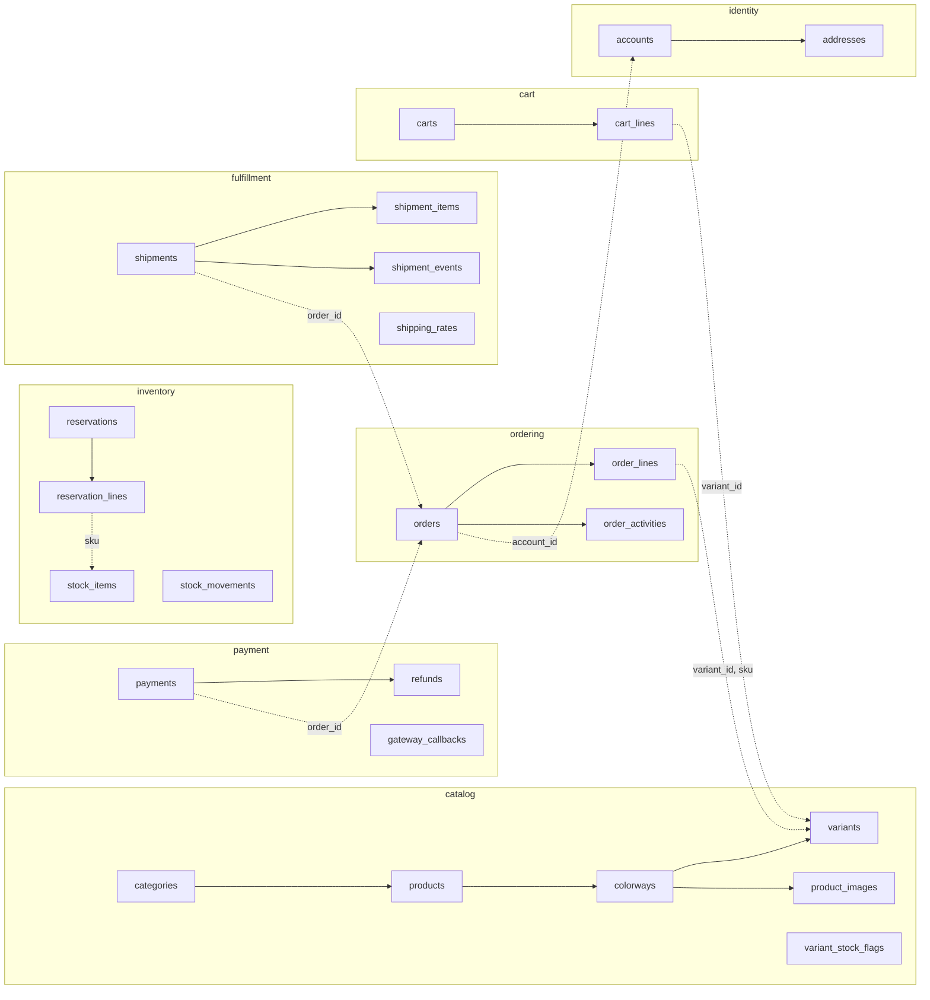

# Bước 5: Thiết kế database

> **Trạng thái:** Đã chốt (2026-11-17) · Thuộc [tài liệu thiết kế](../../README.md) · Trước: [Bước 4](../04-architecture/README.md) · Sau: [Bước 6](../06-walking-skeleton.md)

Database là cách **lưu** mô hình ở bước 3, không phải nơi nghĩ ra mô hình. Vì vậy mỗi bảng và mỗi cột quan trọng đều ghi **vì sao có**, truy về use case (`CHK-03`…), bất biến (`O1`, `I2`, `P1`…) hoặc ADR. Cột nào không trả lời được "vì sao" thì không thêm.

## Các tài liệu của bước này

| Tài liệu | Nội dung |
|---|---|
| README (trang này) | 5.1 quy ước · 5.2 schema và chủ sở hữu · 5.3 bảng dùng chung · 5.4 tổng quan · 5.5 migration và dữ liệu mẫu · 5.6 điều chỉnh |
| [ordering.md](ordering.md) | 5.7 · module `order`: đơn, dòng đơn, timeline |
| [inventory.md](inventory.md) | 5.8 · module `inventory`: tồn theo SKU, reservation, sổ cái |
| [payment.md](payment.md) | 5.9 · module `payment`: payment, refund, log IPN |
| [supporting.md](supporting.md) | 5.10 · catalog, cart, fulfillment, identity, notification |

## 5.1 Quy ước

| Quy ước | Chọn | Vì sao |
|---|---|---|
| Hệ quản trị | PostgreSQL 18 | ADR-0001; có `SKIP LOCKED`, partial index, `jsonb`, full-text search |
| Tên | `snake_case`, bảng số nhiều (`orders`, `order_lines`) | Số nhiều tránh từ khoá SQL (`order`, `user`) |
| Khoá chính | `uuid`, sinh trong Java theo **UUIDv7** | Sinh được trước khi lưu (aggregate có id ngay khi tạo); v7 tăng theo thời gian nên index B-tree không bị phân mảnh như UUIDv4 |
| Tiền | `bigint`, đơn vị đồng, `CHECK (>= 0)` | VND không có số lẻ; số nguyên không có lỗi làm tròn (N10). Không dùng `numeric`/`double` |
| Thời gian | `timestamptz`, lưu UTC | N10. `timestamp` không có múi giờ dễ lệch 7 tiếng |
| Trạng thái | `text` + `CHECK (status IN (...))` | Kiểu `enum` của Postgres khó sửa (thêm/bớt giá trị cần migration đặc biệt). State machine thật nằm trong domain; CHECK chỉ là chốt chặn |
| Optimistic lock | Cột `version bigint` trên bảng gốc của aggregate | Bước 3 nguyên tắc 5; ánh xạ `@Version` (ADR-0011) |
| Khoá ngoại | **Chỉ trong cùng schema.** Sang module khác chỉ lưu id, không FK | Ranh giới module (ADR-0001); bước 3 nguyên tắc 1. Tách service sau này không phải gỡ FK |
| Dữ liệu bán cấu trúc | `jsonb` cho thứ không lọc/không ràng buộc (thông số sản phẩm, payload sự kiện, log IPN) | Thứ cần lọc, tìm, ràng buộc thì làm cột thường |
| Thời điểm tạo/sửa | `created_at`, `updated_at` trên mọi bảng gốc | Truy vết, sắp xếp |
| Xoá | Không xoá cứng dữ liệu nghiệp vụ; dùng trạng thái (`ARCHIVED`, `CANCELLED`) | Đơn, tiền, tồn kho phải truy vết được. Chỉ dữ liệu tạm (giỏ bỏ dở, token hết hạn, outbox đã xử lý) bị dọn |

## 5.2 Schema và chủ sở hữu

| Schema | Module | Bảng | Ghi chú |
|---|---|---|---|
| `catalog` | catalog | categories, products, colorways, variants, product_images, variant_stock_flags | |
| `inventory` | inventory | stock_locations, stock_items, reservations, reservation_lines, stock_movements | |
| `ordering` | order | orders, order_lines, order_activities | Không đặt tên schema là `order` vì là từ khoá SQL. Package Java vẫn là `order` |
| `payment` | payment | payments, refunds, gateway_callbacks | |
| `cart` | cart | carts, cart_lines | |
| `fulfillment` | fulfillment | shipping_rates, shipments, shipment_items, shipment_events | |
| `identity` | identity | accounts, addresses, password_reset_tokens, email_verification_tokens, auth_events, bảng session của Spring Session | |
| `notification` | notification | email_messages | |
| `messaging` | dùng chung (hạ tầng) | outbox_events, processed_events | 5.3 |
| `reference` | dùng chung (chỉ đọc) | provinces, wards | 5.3 |

**Luật:** module chỉ đọc/ghi schema của mình, cộng `messaging` (qua thư viện outbox chung) và đọc `reference`. Cách ép luật này: [ADR-0014](../04-architecture/adr/0014-single-db-user-schema-boundary-by-tests.md) (xem 5.6).

## 5.3 Bảng dùng chung

### `messaging.outbox_events` (ADR-0005)

| Cột | Kiểu | Ràng buộc | Vì sao |
|---|---|---|---|
| id | uuid | PK | Chính là `eventId`; listener dùng để chống xử lý trùng |
| source_module | text | not null | Biết sự kiện từ đâu khi điều tra |
| type, type_version | text, int | not null | Hợp đồng sự kiện có phiên bản ([events.md](../03-tactical-design/events.md)) |
| aggregate_id | uuid | not null | Truy theo đơn/payment |
| payload | jsonb | not null | Nội dung sự kiện; không lọc theo nó |
| correlation_id | text | | Nối log từ request gốc sang listener (ADR-0010) |
| occurred_at | timestamptz | not null | Thứ tự xử lý gần đúng |
| status | text | `NEW`, `DONE`, `DEAD` | Relay chỉ lấy `NEW`; `DEAD` hiện trên metrics |
| attempts, next_attempt_at, last_error | int, timestamptz, text | | Thử lại có giãn cách; quá 10 lần → `DEAD` |

Index: `(next_attempt_at) WHERE status = 'NEW'`, nhỏ và đúng với câu relay chạy mỗi giây (`… ORDER BY next_attempt_at FOR UPDATE SKIP LOCKED LIMIT 100`).

### `messaging.processed_events` (inbox)

| Cột | Kiểu | Ràng buộc | Vì sao |
|---|---|---|---|
| event_id | uuid | PK (cùng `listener`) | Một sự kiện, một listener, chỉ xử lý một lần |
| listener | text | PK | Một sự kiện có nhiều listener; listener A thành công, B lỗi thì lần sau chỉ B chạy lại |
| processed_at | timestamptz | not null | Dọn sau 30 ngày |

Listener ghi dòng này **trong cùng transaction** với việc nó làm. Insert trùng khoá → biết là đã xử lý, bỏ qua.

### `reference.provinces`, `reference.wards`

Danh mục hành chính sau sắp xếp 2025 (34 tỉnh/thành, không còn quận/huyện). Dùng chung cho checkout (`order`), sổ địa chỉ (`identity`), bảng phí ship (`fulfillment`). Chỉ đọc, nạp bằng migration. Đơn hàng vẫn **chép tên** tỉnh/phường vào snapshot, vì danh mục có thể đổi tên sau này (O3).

| Bảng | Cột |
|---|---|
| provinces | code (PK), name, region (`NORTH`/`CENTRAL`/`SOUTH`, dùng cho phí ship) |
| wards | code (PK), province_code (FK), name, name_unaccented (tìm không dấu) |

## 5.4 Tổng quan

Nét liền: khoá ngoại thật trong cùng schema. Nét đứt: chỉ lưu id, **không có khoá ngoại** (khác module).

Quy mô dự kiến GĐ1: vài chục sản phẩm, vài trăm SKU, vài nghìn đơn khi demo. Mọi bảng đều nhỏ; không cần partition hay sharding. Index được chọn theo **câu truy vấn thật** của từng use case, ghi trong file của từng module.

## 5.5 Migration và dữ liệu mẫu

- **Flyway** (ADR-0009), một lịch sử migration, thư mục theo module: `db/migration/catalog`, `db/migration/inventory`…
- Tên file theo thời điểm để hai module không tranh số: `V20261201_1030__inventory_create_stock_items.sql`.
- Chỉ **thêm** migration mới, không sửa file đã chạy. Thay đổi phá vỡ làm theo expand → migrate → contract (ADR-0009).
- `reference.*` nạp bằng migration (dữ liệu thật, ít đổi).
- Dữ liệu mẫu (~30 sản phẩm × vài colorway × size, N9; tồn kho; vài tài khoản staff/admin) là **seed riêng**, chỉ chạy ở local và staging, không nằm trong migration. Ảnh mẫu được tải vào SeaweedFS cùng lúc (ADR-0007).

## 5.6 Điều chỉnh phát hiện ở bước này

**ADR-0001 nói "mỗi module một DB user, chỉ có quyền trên schema của mình". Điều này mâu thuẫn với ADR-0002** (đặt hàng một transaction): một transaction chỉ chạy trên **một kết nối**, mà một kết nối chỉ có một user. Ba module mà ba user thì không thể chung một transaction.

Xử lý bằng [ADR-0014](../04-architecture/adr/0014-single-db-user-schema-boundary-by-tests.md) (thay thế đúng phần đó của ADR-0001): ứng dụng dùng **một DB user**; ranh giới schema được ép bằng **test** thay vì quyền DB. ADR-0001 giữ nguyên phần còn lại.
