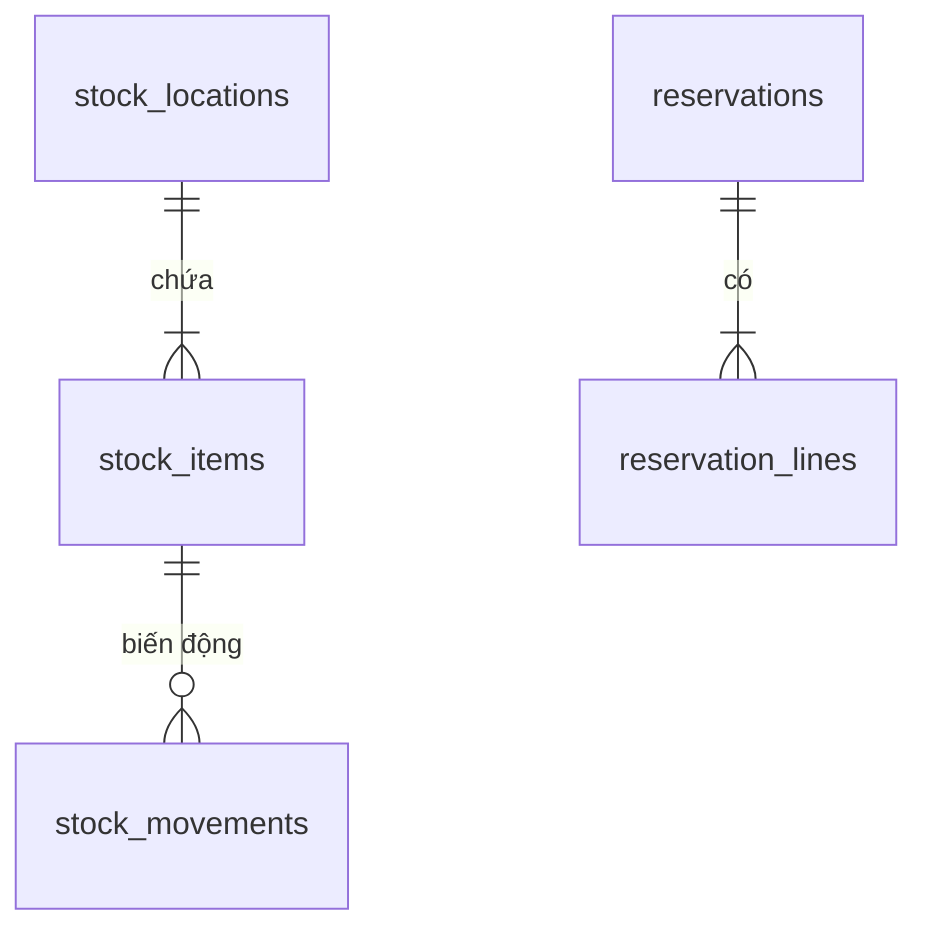

# 5.8 Schema `inventory`

> **Trạng thái:** Đã chốt (2026-11-17) · Thuộc [Bước 5: Thiết kế database](README.md) · Mô hình: [inventory.md](../03-tactical-design/inventory.md)



Inventory dùng **SKU (text)** làm khoá, không dùng `variant_id`. SKU là mã nghiệp vụ ổn định mà kho, đơn và kiện đều dùng; inventory không cần biết khái niệm variant của catalog.

## `stock_locations`

| Cột | Kiểu | Ràng buộc | Vì sao |
|---|---|---|---|
| id | uuid | PK | |
| code | text | unique | GĐ1 chỉ có một dòng `MAIN`. Có bảng này để nhiều kho ở sau không phải đổi khoá của `stock_items` (mục 1.5, INV ghi chú) |
| name | text | not null | |

## `stock_items` — gốc của aggregate `StockItem`

| Cột | Kiểu | Ràng buộc | Vì sao |
|---|---|---|---|
| sku | text | PK (cùng location_id) | |
| location_id | uuid | PK, FK → stock_locations | |
| on_hand | int | `>= 0` | Số thực có trong kho (I1) |
| reserved | int | `>= 0`, `CHECK (reserved <= on_hand)` | Đã giữ cho đơn chưa xuất (I1). `reserved <= on_hand` là chốt chặn cho I6: điều chỉnh giảm không được làm tồn thực nhỏ hơn số đang giữ |
| safety_stock | int | `>= 0` | Giữ lại, không bán online |
| version | bigint | not null | Cho các thao tác của staff (nhập, điều chỉnh) |
| updated_at | timestamptz | not null | |

**Không lưu cột ATS.** ATS = `on_hand − reserved − safety_stock` luôn tính khi cần, để không bao giờ có hai nguồn sự thật lệch nhau.

**Giữ hàng (ADR-0003)** chạy trực tiếp trên bảng này, trong transaction đặt hàng (ADR-0002), theo thứ tự SKU tăng dần:

```sql
UPDATE inventory.stock_items
   SET reserved = reserved + :qty, updated_at = now()
 WHERE sku = :sku AND location_id = :loc
   AND on_hand - reserved - safety_stock >= :qty;
-- 0 dòng bị ảnh hưởng → OUT_OF_STOCK, rollback cả đơn
```

Câu này không tăng `version`: khoá dòng của chính câu UPDATE đã đủ an toàn, và nếu tăng version thì staff đang mở màn hình điều chỉnh sẽ bị lỗi xung đột liên tục khi có người mua.

## `reservations` — gốc của aggregate `Reservation`

| Cột | Kiểu | Ràng buộc | Vì sao |
|---|---|---|---|
| id | uuid | PK | |
| order_id | uuid | not null, **unique** | Mỗi đơn tối đa một reservation (I4); giữ lại lần hai bị chặn. Không FK sang `ordering` |
| status | text | `ACTIVE`, `RELEASED`, `COMMITTED` | Nhả/trừ chỉ một lần (I5) |
| created_at, updated_at | timestamptz | not null | |
| version | bigint | not null | |

## `reservation_lines`

| Cột | Kiểu | Ràng buộc | Vì sao |
|---|---|---|---|
| reservation_id | uuid | PK, FK → reservations | |
| sku | text | PK | |
| location_id | uuid | not null | Nhả/trừ đúng kho đã giữ |
| quantity | int | `> 0` | Nhả hoặc trừ đúng số đã giữ, chỉ cần `order_id` (H3) |

## `stock_movements` — sổ cái (chỉ thêm)

| Cột | Kiểu | Ràng buộc | Vì sao |
|---|---|---|---|
| id | uuid | PK | |
| sku, location_id | text, uuid | not null | |
| type | text | `RECEIVE`, `ADJUST`, `RESERVE`, `RELEASE`, `COMMIT`, `RETURN_RESTOCK` | I7 |
| delta_on_hand | int | not null | Thay đổi của `on_hand` (có dấu) |
| delta_reserved | int | not null | Thay đổi của `reserved` (có dấu) |
| reason | text | `CHECK (type <> 'ADJUST' OR reason IS NOT NULL)` | Điều chỉnh bắt buộc có lý do (I7, INV-01) |
| ref_type, ref_id | text, uuid | null | Liên kết tới đơn, reservation, phiếu điều chỉnh |
| actor_type, actor_id | text, uuid | not null / null | Ai làm (staff hoặc hệ thống) |
| occurred_at | timestamptz | not null | |

**Vì sao tách hai cột delta thay vì một cột `quantity`:** để đối chiếu I8 chỉ bằng phép cộng. Với mỗi SKU: `Σ delta_on_hand = on_hand` và `Σ delta_reserved = reserved`. Job kiểm tra và test chạy đúng câu này; lệch là có bug.

| Loại | delta_on_hand | delta_reserved |
|---|---|---|
| RECEIVE | +q | 0 |
| ADJUST | ±q | 0 |
| RESERVE | 0 | +q |
| RELEASE | 0 | −q |
| COMMIT | −q | −q |
| RETURN_RESTOCK | +q | 0 |

Index: `(sku, occurred_at DESC)` cho màn hình lịch sử theo SKU (INV-05); `(ref_type, ref_id)` để xem đơn đã làm gì với kho.
