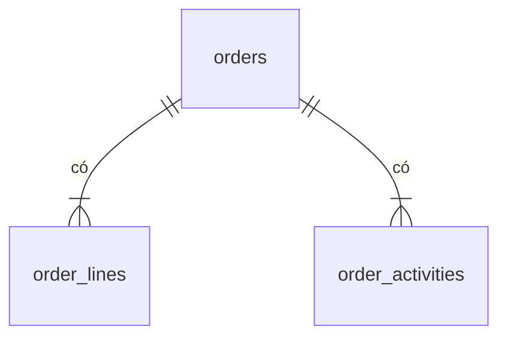

# 5.7 Schema `ordering` (module order)

> **Trạng thái:** Đã chốt (2026-11-17) · Thuộc [Bước 5: Thiết kế database](README.md) · Mô hình: [order.md](../03-tactical-design/order.md)

## `orders` — gốc của aggregate `Order`

| Cột | Kiểu | Ràng buộc | Vì sao |
|---|---|---|---|
| id | uuid | PK | |
| order_number | text | not null, **unique** | Mã cho người đọc, không đoán được (O8, H8). Trùng thì sinh lại (order.md) |
| idempotency_key | uuid | not null, **unique** | Một key → đúng một đơn (O4). Hai request cùng key chạy song song: request sau bị chặn ở ràng buộc unique, chờ request trước commit rồi đọc lại đơn |
| request_hash | text | not null | Cùng key mà khác nội dung → `IDEMPOTENCY_CONFLICT` (CHK-03) |
| account_id | uuid | null | Có khi khách đăng nhập; null với guest. Không FK sang `identity` |
| buyer_email, buyer_phone | text | not null | Liên hệ + tra cứu đơn guest (ORD-07, H8) + staff tìm theo SĐT (ORD-06) |
| ship_name, ship_phone | text | not null | Người nhận có thể khác người mua |
| ship_province_code, ship_province_name | text | not null | Lưu **cả mã và tên**: mã để thống kê, tên để in đúng như lúc đặt dù danh mục đổi (O3) |
| ship_ward_code, ship_ward_name | text | not null | Như trên; không còn quận/huyện (sắp xếp 2025) |
| ship_street, ship_note | text | street not null | |
| shipping_method_code, shipping_method_name | text | not null | Snapshot phương thức giao |
| shipping_fee | bigint | `>= 0` | Phí **đã báo cho khách**, không phải phí hãng thu (domain 8.4) |
| payment_method | text | `COD`, `VNPAY` | Quyết định trạng thái đầu và luồng xác nhận |
| subtotal, grand_total | bigint | `>= 0`; `CHECK (grand_total = subtotal + shipping_fee)` | O2: tổng tiền không thể sai lệch kể cả khi có bug trong code |
| vat_amount | bigint | `>= 0` | Giá đã gồm VAT 10%; lưu số tiền thuế để hiển thị và xuất hoá đơn sau này |
| status | text | `PENDING_PAYMENT`, `PENDING_CONFIRMATION`, `CONFIRMED`, `COMPLETED`, `CANCELLED` | Trục order (state machine 3.2.1) |
| payment_status | text | `UNPAID`, `PAID`, `REFUND_PENDING`, `REFUNDED` | Bản sao trục payment (H2) để lọc danh sách và kiểm tra điều kiện huỷ |
| fulfillment_status | text | `UNFULFILLED`, `PROCESSING`, `SHIPPED`, `DELIVERED`, `RETURNED` | Bản sao trục fulfillment; chặn khách huỷ khi đã xử lý (O6) |
| cancel_reason, cancelled_by_type, cancelled_by_id, cancelled_at | text, text, uuid, timestamptz | null; `CHECK ((status = 'CANCELLED') = (cancelled_at IS NOT NULL))` | Đơn huỷ luôn có lý do và người huỷ (ORD-03/04) |
| placed_at, updated_at | timestamptz | not null | |
| version | bigint | not null | Optimistic lock: chặn tranh chấp "khách huỷ / staff bắt đầu đóng gói" (3.2.2) |

**Vì sao địa chỉ là các cột thường, không phải `jsonb`:** staff cần tìm theo SĐT, và tra cứu guest so khớp email/SĐT. Phần không ai lọc (ghi chú) vẫn là cột text cho đơn giản.

### Index

| Index | Phục vụ câu truy vấn |
|---|---|
| `(status, placed_at DESC)` | Danh sách đơn cho staff, lọc theo trạng thái (ORD-06) |
| `(buyer_phone)` | Staff tìm theo SĐT; tra cứu guest |
| `(lower(buyer_email))` | Tra cứu guest theo email, không phân biệt hoa thường |
| `(account_id, placed_at DESC) WHERE account_id IS NOT NULL` | "Đơn của tôi" (ORD-07) |
| `(placed_at) WHERE status = 'PENDING_CONFIRMATION'` | Đơn COD chờ xác nhận, làm nổi đơn quá 24 giờ (H5) |

## `order_lines` — dòng đơn (snapshot)

| Cột | Kiểu | Ràng buộc | Vì sao |
|---|---|---|---|
| order_id | uuid | FK → orders, PK (cùng line_no) | |
| line_no | smallint | PK | Thứ tự hiển thị ổn định |
| variant_id | uuid | not null; `UNIQUE (order_id, variant_id)` | Một variant chỉ một dòng (O1). Không FK sang `catalog` |
| sku | text | not null | Khoá để `inventory` nhả/trừ hàng và `fulfillment` lấy hàng |
| product_name, color_name, size, image_key | text | not null (image_key null được) | **Snapshot**: catalog đổi tên/ảnh không làm đổi đơn (O3) |
| unit_list_price | bigint | `>= 0` | Giá gốc lúc đặt, để hiện "đã giảm bao nhiêu" |
| unit_price | bigint | `>= 0`, `<= unit_list_price` | Giá thực bán (sau sale) |
| quantity | int | `BETWEEN 1 AND 10` | O1 |
| line_total | bigint | `CHECK (line_total = unit_price * quantity)` | O2 ở mức dòng |

GĐ2 (khuyến mãi) sẽ thêm bảng phân bổ giảm giá theo dòng; mô hình hiện tại đã chừa chỗ vì `unit_price` và `line_total` tách khỏi giá niêm yết.

## `order_activities` — timeline (chỉ thêm)

| Cột | Kiểu | Ràng buộc | Vì sao |
|---|---|---|---|
| id | uuid | PK | |
| order_id | uuid | FK → orders | |
| occurred_at | timestamptz | not null | |
| actor_type, actor_id | text, uuid | `CUSTOMER`, `GUEST`, `STAFF`, `SYSTEM` | Ai làm (ORD-05) |
| action | text | not null | Ví dụ `PLACED`, `CONFIRMED`, `CANCELLED`, `PAYMENT_SUCCEEDED`, `SHIPPED` |
| from_status, to_status | text | null | Chuyển trạng thái nào (O7) |
| note | text | null | Lý do huỷ, ghi chú khi xác nhận ("đã gọi, khách xác nhận") |

Index: `(order_id, occurred_at)`. Ứng dụng không bao giờ UPDATE/DELETE bảng này (O7).

## Không có bảng idempotency riêng

`orders.idempotency_key` (unique) + `request_hash` là đủ:
- **Đặt thành công:** gửi lại cùng key → tìm thấy đơn → dựng lại đúng phản hồi cũ (kể cả URL VNPay, dựng lại từ payment đang chờ).
- **Đặt thất bại** (`PRICE_CHANGED`, `OUT_OF_STOCK`…): không có gì được ghi (CHK-03), nên gửi lại chỉ là chạy lại kiểm tra, vô hại.

Một bảng riêng chỉ cần khi có thao tác tạo tác dụng phụ mà không tạo đơn; GĐ1 không có.
