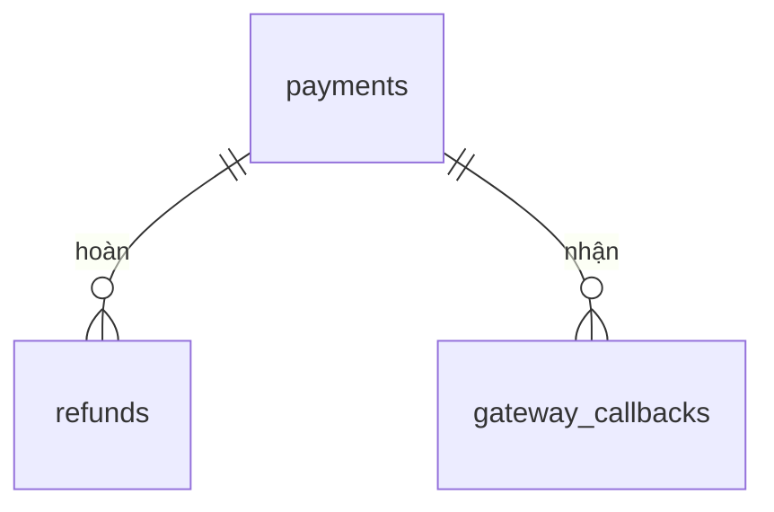

# 5.9 Schema `payment`

> **Trạng thái:** Đã chốt (2026-11-17) · Thuộc [Bước 5: Thiết kế database](README.md) · Mô hình: [payment.md](../03-tactical-design/payment.md)

## `payments` — gốc của aggregate `Payment`

| Cột | Kiểu | Ràng buộc | Vì sao |
|---|---|---|---|
| id | uuid | PK | |
| order_id | uuid | not null | Không FK sang `ordering` |
| method | text | `COD`, `VNPAY` | |
| amount | bigint | `> 0` | Phải bằng `grand_total` của đơn; IPN khác số tiền bị từ chối (P2) |
| status | text | `PENDING`, `SUCCEEDED`, `FAILED`, `EXPIRED`, `VOIDED`, `LATE_SUCCEEDED`, `COLLECTED`, `REFUNDED` | State machine 3.4.1 |
| txn_ref | text | **unique**, null với COD | Mã gửi sang VNPay (`vnp_TxnRef`); IPN tìm Payment theo mã này và chỉ có tác dụng một lần (P3) |
| expires_at | timestamptz | null với COD | Gửi sang VNPay làm `vnp_ExpireDate`; job hết hạn dùng `expires_at + 3 phút` (P9) |
| order_deadline_at | timestamptz | null với COD | Hạn ban đầu của đơn; Payment thử lại không được vượt (P5) |
| gateway_txn_no, bank_code, paid_at | text, text, timestamptz | null | Thông tin từ VNPay khi thành công; cần cho tra cứu và hoàn tiền |
| created_at, updated_at | timestamptz | not null | |
| version | bigint | not null | IPN và job hết hạn có thể chạm cùng Payment cùng lúc; chỉ một bên thắng |

### Ràng buộc và index

| Ràng buộc / index | Vì sao |
|---|---|
| `UNIQUE (order_id) WHERE status = 'PENDING'` (partial unique index) | **P1 được ép ngay ở DB**: một đơn không thể có hai Payment đang chờ, kể cả khi hai request "thử lại thanh toán" chạy song song |
| `CHECK ((method = 'VNPAY') = (txn_ref IS NOT NULL AND expires_at IS NOT NULL))` | Payment VNPay luôn có mã giao dịch và hạn; COD thì không |
| `(expires_at) WHERE status = 'PENDING' AND method = 'VNPAY'` | Job hết hạn chạy mỗi phút (PAY-05): index chỉ chứa các payment đang chờ nên rất nhỏ |
| `(order_id)` | Trang kết quả và order đọc trạng thái thanh toán của một đơn |
| `(status, updated_at) WHERE status = 'FAILED'` | Đối soát các payment thất bại trong 24 giờ (PAY-06) |

**Job hết hạn** khoá từng dòng bằng `FOR UPDATE SKIP LOCKED` (nhiều instance không xử lý trùng), rồi hỏi VNPay trước khi đổi trạng thái (PAY-05).

## `refunds` — gốc của aggregate `Refund`

| Cột | Kiểu | Ràng buộc | Vì sao |
|---|---|---|---|
| id | uuid | PK | |
| payment_id | uuid | FK → payments | Cùng module nên có FK |
| order_id | uuid | not null | Staff xem hàng đợi hoàn tiền theo đơn |
| amount | bigint | `> 0` | |
| reason | text | not null | `ORDER_CANCELLED`, `LATE_PAYMENT`, `DUPLICATE_PAYMENT` (P6, P7) |
| method | text | `GATEWAY_API`, `MANUAL_TRANSFER` | PAY-08 / PAY-09 |
| status | text | `REQUESTED`, `COMPLETED`, `FAILED` | |
| gateway_ref, note | text | null | Mã hoàn tiền của VNPay, hoặc ghi chú chuyển khoản tay |
| requested_at, completed_at | timestamptz | | |
| created_by, completed_by | uuid | null | Staff nào ghi nhận |
| version | bigint | not null | |

Index: `(status, requested_at) WHERE status = 'REQUESTED'` cho hàng đợi hoàn tiền.

**P8 (tổng hoàn ≤ số tiền đã trả)** liên quan nhiều dòng nên CHECK không làm được. Ứng dụng tạo `Refund` sau khi khoá dòng payment (`SELECT … FOR UPDATE` trên `payments`), cộng các refund chưa thất bại rồi mới so. Test tích hợp kiểm tra hai yêu cầu hoàn tiền song song.

## `gateway_callbacks` — log thô (chỉ thêm)

| Cột | Kiểu | Ràng buộc | Vì sao |
|---|---|---|---|
| id | uuid | PK | |
| received_at | timestamptz | not null | |
| kind | text | `IPN`, `RETURN`, `QUERY_RESULT`, `REFUND_RESULT` | Lưu mọi lần nói chuyện với VNPay, kể cả Return URL (chỉ để điều tra, không đổi trạng thái) |
| txn_ref | text | null | Có thể null nếu payload hỏng |
| raw_payload | jsonb | not null | Bước 1 của PAY-03: lưu trước mọi kiểm tra, để điều tra tranh chấp |
| signature_valid | boolean | not null | |
| outcome | text | null | Kết quả xử lý: `APPLIED`, `DUPLICATE`, `AMOUNT_MISMATCH`, `NOT_FOUND`, `INVALID_SIGNATURE` |

Index: `(txn_ref, received_at)`. Payload chứa thông tin ngân hàng ở dạng VNPay gửi (không có số thẻ đầy đủ); giữ 12 tháng rồi dọn.
