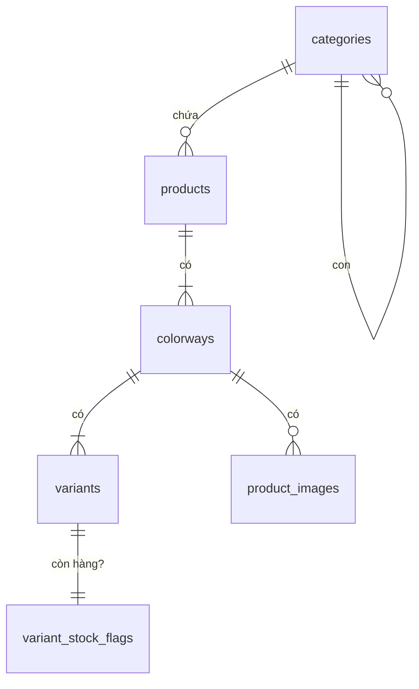

# 5.10 Schema của các module supporting và generic

> **Trạng thái:** Đã chốt (2026-11-17) · Thuộc [Bước 5: Thiết kế database](README.md) · Mô hình: [supporting-contexts.md](../03-tactical-design/supporting-contexts.md)

Các module này chủ yếu là CRUD (đã thống nhất: data-first cho phần phụ). Mỗi bảng chỉ ghi cột chính, ràng buộc và lý do; cột `created_at`, `updated_at`, `version` có trên mọi bảng gốc theo quy ước 5.1 nên không nhắc lại.

## `catalog`

| Bảng | Cột chính | Ràng buộc | Vì sao |
|---|---|---|---|
| categories | id, parent_id, slug, name, depth, position | `slug` unique; `depth BETWEEN 1 AND 3`; FK parent_id → categories | Cây tối đa 3 cấp (CAT-08). Không có vòng: ứng dụng kiểm tra khi chuyển cha; `depth` giúp chặn cây quá sâu ngay ở DB |
| products | id, slug, name, description, type, gender, sport, category_id, status, publish_at, specs (jsonb), search_vector (tsvector) | `slug` unique; `status IN (DRAFT, SCHEDULED, PUBLISHED, ARCHIVED)`; `CHECK (status <> 'SCHEDULED' OR publish_at IS NOT NULL)` | `slug` cho URL thân thiện SEO (G7). `specs` là jsonb vì mỗi loại sản phẩm có thông số khác nhau và không ai lọc theo nó. Hẹn giờ ra mắt cần `publish_at` (CAT-06) |
| colorways | id, product_id, name, color_family, list_price, sale_price, sale_starts_at, sale_ends_at, position | `UNIQUE (product_id, name)`; `list_price > 0`; `CHECK (sale_price IS NULL OR sale_price < list_price)`; `CHECK (sale_starts_at < sale_ends_at)` | Giá theo **colorway** (bước 3). Giá sale có hiệu lực từ–đến (CAT-07). `color_family` cho bộ lọc màu |
| variants | id, colorway_id, sku, size, size_order | `sku` unique; `UNIQUE (colorway_id, size)` | SKU duy nhất toàn hệ thống. `size_order` để sắp size đúng (XS, S, M… hoặc 38, 39, 40…) |
| product_images | id, colorway_id, storage_key, alt, width, height, position, source, source_credit | `storage_key` unique; `alt` not null | ADR-0007: chỉ lưu khoá, không lưu URL. `width`/`height` để trang không nhảy khi ảnh tải. `alt` bắt buộc (truy cập, SEO). `source_credit` ghi tác giả Unsplash |
| variant_stock_flags | variant_id (PK), sku, in_stock, updated_at | | **Bản sao** cờ còn hàng, cập nhật từ sự kiện `StockChanged` của inventory. Bộ lọc "size còn hàng" (CAT-02) chạy trong catalog mà không đọc chéo schema `inventory` |

**Tìm kiếm không dấu (CAT-04):** `search_vector` dựng từ tên, mô tả, tên màu sau khi bỏ dấu (`unaccent`), cập nhật bằng trigger hoặc ứng dụng khi sản phẩm đổi. Index GIN trên `search_vector`. Nếu chưa làm CAT-04 (mục cắt đầu tiên khi trễ) thì cột này chưa cần.

**Index cho PLP:** `products (status, category_id)`, `colorways (product_id)`, `variants (colorway_id)`, `variant_stock_flags (in_stock) WHERE in_stock`. Đo bằng k6 (N3) trước khi thêm index khác.

## `cart`

| Bảng | Cột chính | Ràng buộc | Vì sao |
|---|---|---|---|
| carts | id, guest_token_hash, account_id, last_active_at | `guest_token_hash` unique; `account_id` unique; `CHECK ((guest_token_hash IS NULL) <> (account_id IS NULL))` | Giỏ thuộc **đúng một** chủ: guest hoặc tài khoản (ADR-0004). Lưu **hash** của mã giỏ, không lưu mã gốc: mã trong cookie giống mật khẩu, lộ DB không được lộ giỏ người khác |
| cart_lines | cart_id, variant_id, quantity, price_at_add, added_at | PK `(cart_id, variant_id)`; `quantity BETWEEN 1 AND 10` | Một variant một dòng; số lượng có giới hạn. `price_at_add` để cảnh báo đổi giá (CART-03) |

Index: `carts (last_active_at) WHERE guest_token_hash IS NOT NULL` cho job dọn giỏ guest quá 30 ngày.

## `fulfillment`

| Bảng | Cột chính | Ràng buộc | Vì sao |
|---|---|---|---|
| shipping_rates | code (PK), name, fee, free_threshold, eta_text, active | `fee >= 0` | Bảng phí cố định (CHK-02); GĐ2 thay bằng GHN qua cùng port |
| shipments | id, order_id, order_number, recipient_name, recipient_phone, province_name, ward_name, street, cod_amount, carrier, tracking_code, status, delivery_attempts | `order_id` unique (GĐ1 một đơn một kiện); `tracking_code` unique khi không null; `status IN (CREATED, PACKED, HANDED_OVER, DELIVERY_FAILED, DELIVERED, RETURNED, CANCELLED)`; `cod_amount >= 0` | Người nhận là **snapshot** lấy qua `startFulfillment` (A2). `cod_amount` là số shipper phải thu. `carrier = MANUAL` ở GĐ1 |
| shipment_items | shipment_id, sku, product_name, size, quantity | PK `(shipment_id, sku)`; `quantity > 0` | In phiếu đóng gói; payload cho sự kiện giao hãng / hoàn về để inventory trừ / nhập lại |
| shipment_events | id, shipment_id, status, occurred_at, actor_id, note | | Lịch sử kiện. GĐ2 webhook GHN ghi vào đây; giúp bỏ qua trạng thái đến sai thứ tự |

Index: `shipments (status, updated_at)` cho danh sách việc của staff.

**Bỏ `UNIQUE (order_id)` ở GĐ2** khi một đơn có nhiều kiện.

## `identity`

| Bảng | Cột chính | Ràng buộc | Vì sao |
|---|---|---|---|
| accounts | id, email, password_hash, full_name, phone, role, status, email_verified_at, last_login_at | unique index trên `lower(email)`; `role IN (CUSTOMER, STAFF, ADMIN)`; `status IN (ACTIVE, LOCKED)` | Email không phân biệt hoa thường. Mật khẩu chỉ lưu hash argon2id (N5, AC6). Ánh xạ vai trò → quyền nằm trong code ([access-control.md](../03-tactical-design/access-control.md)); 3 vai trò cố định nên chưa cần bảng quyền |
| addresses | id, account_id, recipient_name, phone, province_code, ward_code, street, is_default | FK → accounts; unique `(account_id) WHERE is_default` | Mỗi tài khoản tối đa một địa chỉ mặc định (CUS-02). Lưu **mã** tỉnh/phường, tên lấy từ `reference` khi hiển thị |
| password_reset_tokens | id, account_id, token_hash, expires_at, used_at | `token_hash` unique | Lưu hash, hạn 30 phút, dùng một lần (CUS-04) |
| email_verification_tokens | id, account_id, token_hash, expires_at, used_at | `token_hash` unique | Xác minh email trước khi gắn đơn guest vào tài khoản (CUS-03) |
| spring_session, spring_session_attributes | (theo Spring Session JDBC) | | Session phía server (ADR-0006); xoá phiên là thu hồi quyền ngay. Cột `principal_name` cho phép tìm và huỷ **mọi phiên** của một tài khoản (AC3) |
| auth_events | id, account_id, email_attempted, type, ip, user_agent, occurred_at, detail (jsonb) | `type IN (LOGIN_SUCCEEDED, LOGIN_FAILED, LOGOUT, PASSWORD_CHANGED, PASSWORD_RESET_REQUESTED, ROLE_CHANGED, ACCOUNT_LOCKED, ACCOUNT_UNLOCKED)`; chỉ thêm | Truy vết tài khoản (AC8, ADR-0015). `account_id` null khi đăng nhập sai bằng email không tồn tại. Không bao giờ ghi mật khẩu. Index `(account_id, occurred_at DESC)`; giữ 12 tháng |

Gắn đơn guest vào tài khoản (CUS-03) **không** sửa bảng của `ordering` từ đây: `identity` phát sự kiện "email đã xác minh", `order` tự cập nhật `account_id` cho các đơn guest cùng email.

## `notification`

| Bảng | Cột chính | Ràng buộc | Vì sao |
|---|---|---|---|
| email_messages | id, dedupe_key, template, to_email, subject, payload (jsonb), status, attempts, next_attempt_at, last_error, sent_at | `dedupe_key` unique (= eventId + mẫu email); `status IN (PENDING, SENT, FAILED)` | Mỗi sự kiện chỉ sinh một email dù sự kiện được giao nhiều lần. Thử lại 3 lần có giãn cách; lỗi gửi không ảnh hưởng nghiệp vụ (NOT-01) |

Index: `(next_attempt_at) WHERE status = 'PENDING'`.
