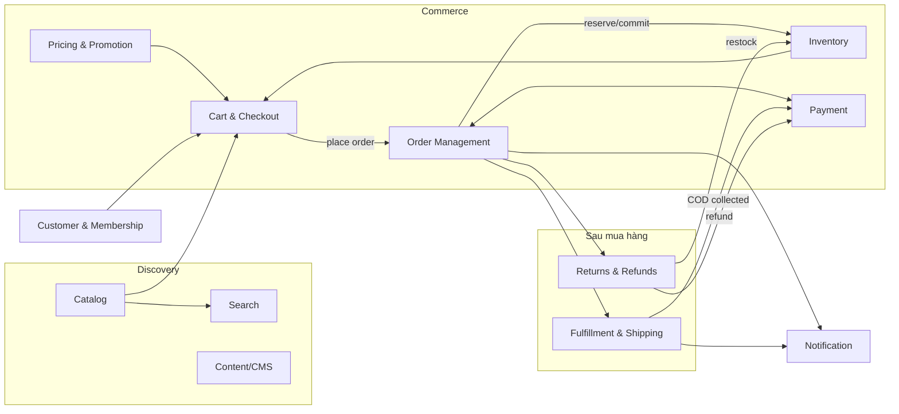
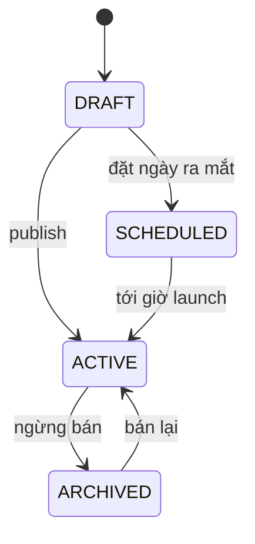
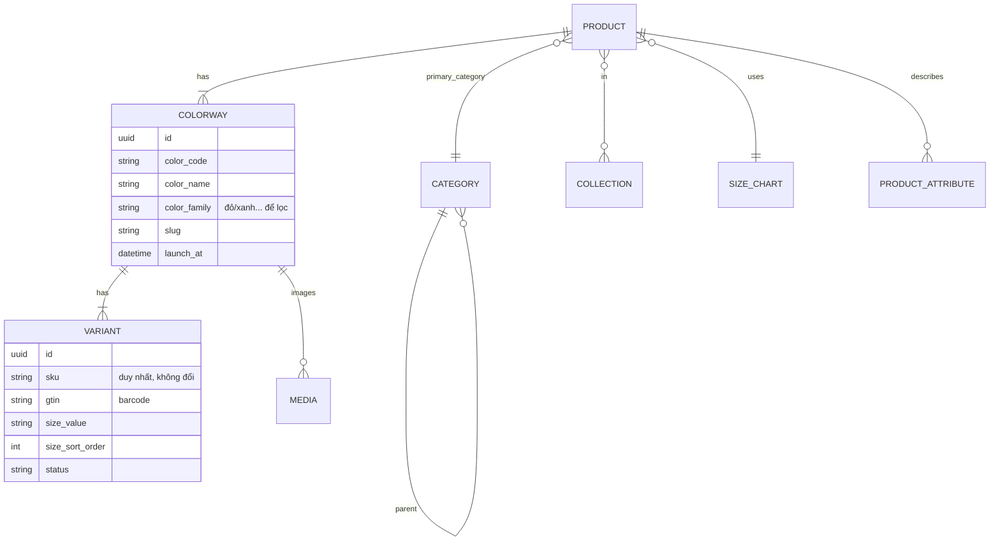
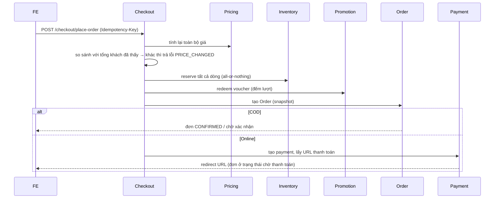
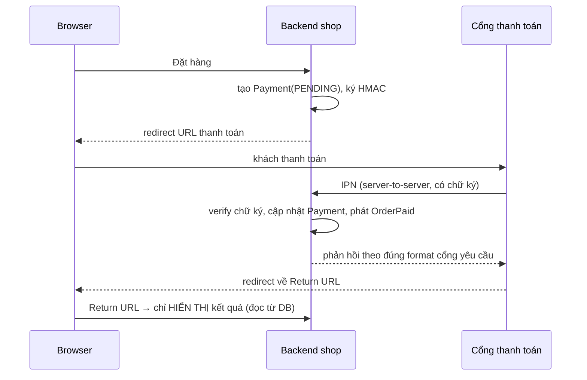
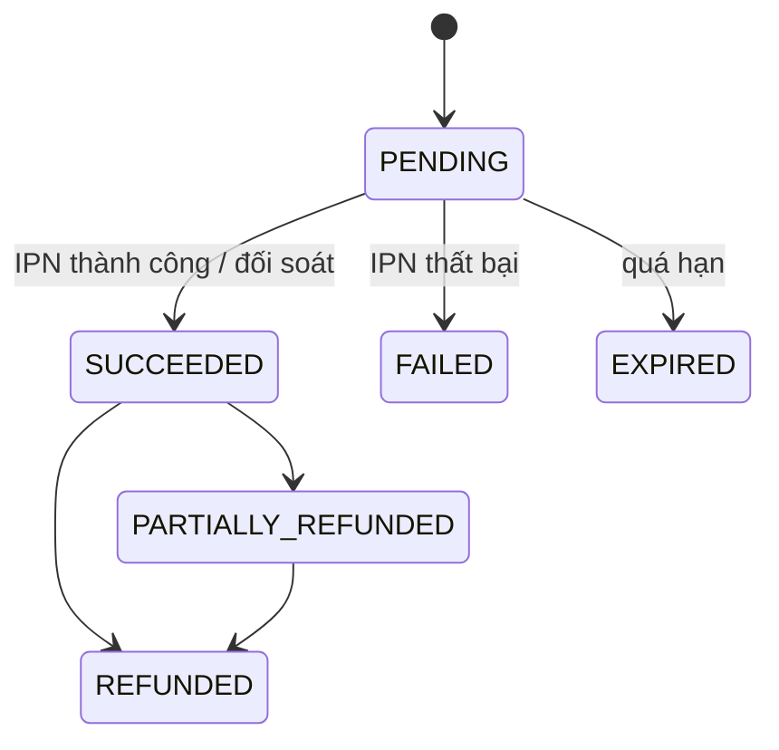
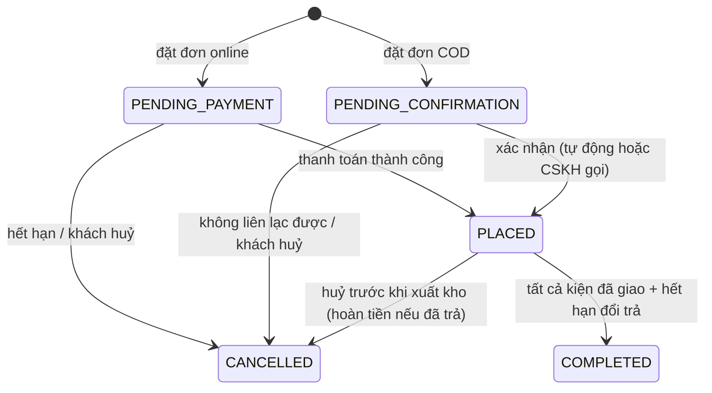
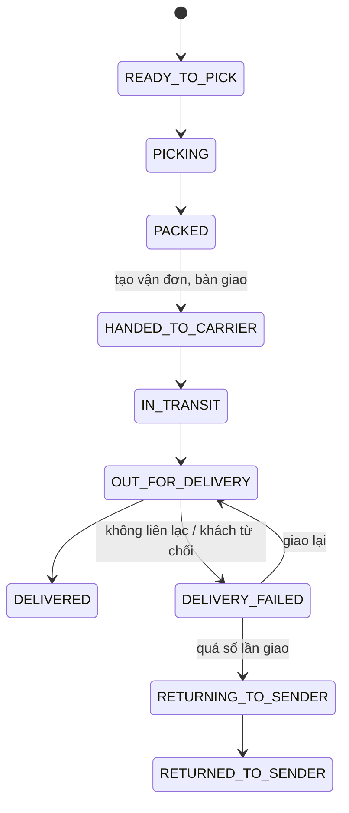
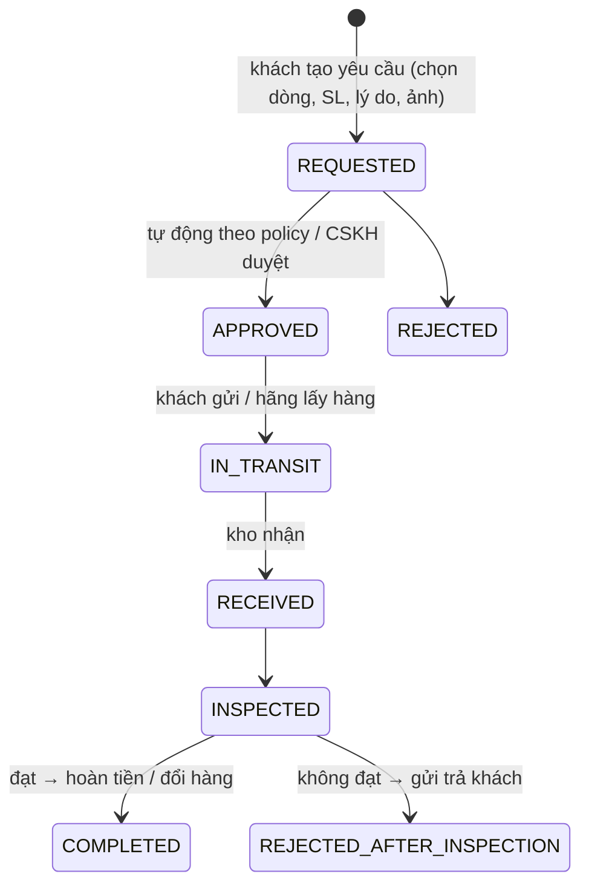

# Domain E-commerce thời trang thể thao (D2C) — Thị trường Việt Nam

> Tài liệu nghiên cứu domain e-commerce của các thương hiệu thời trang thể thao bán trực tiếp (kiểu Nike / adidas / Puma), bối cảnh thị trường Việt Nam.
> Mục tiêu: hiểu domain vận hành thế nào, các khái niệm, quy tắc nghiệp vụ và những bài toán khó của nó.
> Mỗi phần kết thúc bằng **Tự kiểm tra**. Câu nào chưa trả lời được thì nên đọc lại phần đó.

> ⚠️ Các mục pháp lý (thuế, khuyến mại, dữ liệu cá nhân, TMĐT) chỉ để **nhận diện vấn đề**. Văn bản luật VN thay đổi thường xuyên, nên luôn kiểm tra bản hiện hành trước khi trích dẫn.

---

## Mục lục

0. [Vì sao học domain trước](#0-vì-sao-học-domain-trước)
1. [Tổng quan kinh doanh & hành trình khách](#1-tổng-quan-kinh-doanh--hành-trình-khách)
2. [Catalog: Product, Colorway, SKU](#2-catalog-product-colorway-sku)
3. [Giá, khuyến mãi, thuế](#3-giá-khuyến-mãi-thuế)
4. [Tồn kho](#4-tồn-kho-inventory)
5. [Giỏ hàng & Checkout](#5-giỏ-hàng--checkout)
6. [Thanh toán tại VN](#6-thanh-toán-tại-vn)
7. [Quản lý đơn hàng (OMS)](#7-quản-lý-đơn-hàng-oms)
8. [Giao hàng & COD](#8-giao-hàng--cod)
9. [Đổi trả & hoàn tiền](#9-đổi-trả--hoàn-tiền)
10. [Khách hàng & Membership](#10-khách-hàng--membership)
11. [Tìm kiếm, nội dung, Launch/Drop](#11-tìm-kiếm-nội-dung-launchdrop)
12. [Vấn đề xuyên suốt](#12-vấn-đề-xuyên-suốt-cross-cutting)
13. [Một đơn hàng đi qua toàn hệ thống](#13-một-đơn-hàng-đi-qua-toàn-hệ-thống)
14. [Nghiên cứu sâu hơn](#14-nghiên-cứu-sâu-hơn)
15. [Glossary](#15-glossary)
16. [Đáp án Tự kiểm tra & câu hỏi mở](#16-đáp-án-tự-kiểm-tra--câu-hỏi-mở)

---

## 0. Vì sao học domain trước

Phần lớn bug "đắt tiền" trong e-commerce không đến từ framework mà từ **mô hình sai**:

| Mô hình sai | Hậu quả thật |
|---|---|
| Coi "sản phẩm" = "thứ có tồn kho" | Không biểu diễn được size/màu, tồn kho sai |
| Đơn hàng tham chiếu giá hiện tại của sản phẩm | Đổi giá → tổng tiền của đơn cũ bị thay đổi |
| Một cột `status` duy nhất cho đơn | Không biểu diễn được "đã thanh toán nhưng mới giao 1/2 kiện" |
| Tin `returnUrl` của cổng thanh toán | Khách sửa URL → đơn "đã thanh toán" miễn phí |
| Trừ kho bằng `đọc → kiểm tra → ghi` | Flash sale bán 120 đôi khi kho chỉ có 100 |
| Không phân bổ giảm giá xuống từng dòng | Trả 1 món trong đơn có voucher → không biết hoàn bao nhiêu tiền |
| Dùng `double` cho tiền | Lệch 1 đồng khi đối soát, cộng dồn thành sai số lớn |

### 6 nguyên tắc xuyên suốt (thuộc lòng)

1. **Tiền là số nguyên.** VND không có đơn vị lẻ → `long` (đồng). Không bao giờ `double`/`float`.
2. **Đơn hàng là bản chụp (snapshot).** Tên, giá, ảnh, khuyến mãi, địa chỉ được *chép* vào đơn tại thời điểm đặt.
3. **Server tính lại mọi thứ.** Không tin giá, tổng tiền, trạng thái thanh toán gửi từ client.
4. **Tách các trục trạng thái.** Đơn hàng ≠ thanh toán ≠ giao hàng ≠ đổi trả.
5. **Mọi thao tác liên quan tới tiền/hàng phải idempotent và có audit log.**
6. **Eventual consistency ở phía đọc** (search, hiển thị "còn hàng" trên PLP), **strong consistency ở phía ghi** (trừ kho, ghi nhận thanh toán).

---

## 1. Tổng quan kinh doanh & hành trình khách

### 1.1 Loại hình

| | **D2C brand** (Nike, adidas) | **Marketplace** (Shopee, Tiki) | **Multi-brand retailer** (JD Sports, Supersports) |
|---|---|---|---|
| Người bán | 1 (chính thương hiệu) | Nhiều seller | 1 retailer, nhiều thương hiệu |
| Lợi thế cạnh tranh | Thương hiệu, nội dung, membership, sản phẩm độc quyền | Giá, độ phủ | Lựa chọn đa dạng |
| Độ khó kỹ thuật | Biến thể, tồn kho, launch hàng hot, nội dung | Seller onboarding, chia tiền, đối soát seller | Đồng bộ catalog từ nhiều nguồn |

Tài liệu này tập trung vào **D2C**. Các thương hiệu lớn còn chạy **omnichannel** (online + cửa hàng: mua online nhận tại cửa hàng, trả hàng online tại cửa hàng). Đó là lý do tồn kho của họ luôn được quản lý **theo địa điểm (location)**, không phải một con số chung.

### 1.2 Các tác nhân (actors)

**Phía khách (storefront):**
- **Guest**: mua không cần tài khoản (rất quan trọng ở VN, khách ngại đăng ký).
- **Member**: có tài khoản, hưởng quyền lợi hội viên.

**Phía vận hành (back office). Đây là nửa còn lại của hệ thống, khách không nhìn thấy nhưng khối lượng nghiệp vụ rất lớn:**

| Vai trò | Việc làm |
|---|---|
| Merchandiser | Tạo/sửa sản phẩm, giá, collection, sắp xếp thứ tự hiển thị |
| Marketing | Tạo khuyến mãi, voucher, banner, landing page |
| CSKH (Customer Service) | Tra đơn, huỷ đơn, xử lý đổi trả, hoàn tiền (có giới hạn quyền) |
| Kho (Warehouse) | Nhặt hàng, đóng gói, bàn giao vận chuyển, nhận hàng trả |
| Kế toán (Finance) | Đối soát thanh toán, đối soát COD, hoá đơn điện tử |
| Admin | Phân quyền, cấu hình |

**Hệ thống bên ngoài:** cổng thanh toán (VNPay, MoMo, ZaloPay), hãng vận chuyển (GHN, GHTK, Viettel Post, J&T), nhà cung cấp hoá đơn điện tử (MISA, VNPT, Viettel…), email/SMS/Zalo ZNS, search engine, CDN.

### 1.3 Hành trình khách (customer journey)

```
Khám phá  →  PLP  →  PDP  →  Giỏ hàng  →  Checkout  →  Thanh toán  →  Xác nhận
(home,       (danh   (chi    (cart)       (địa chỉ,    (COD/VNPay/    (email,
 campaign,    sách)   tiết,                 ship,        MoMo)          Zalo)
 search)              chọn size)            voucher)
                                                              ↓
Mua lại  ←  Review  ←  Đổi trả?  ←  Nhận hàng  ←  Vận chuyển  ←  Xử lý kho
```

Mỗi mũi tên là một chỗ khách có thể **rời đi**. Mục tiêu kinh doanh là giảm rơi rụng ở từng bước.

### 1.4 Chỉ số kinh doanh (KPI) cần biết

| KPI | Ý nghĩa | Ảnh hưởng tới thiết kế |
|---|---|---|
| Conversion rate | % phiên truy cập ra đơn | Checkout nhanh, ít bước, guest checkout |
| AOV (Average Order Value) | Giá trị trung bình mỗi đơn | Free ship theo ngưỡng, gợi ý mua kèm |
| Cart abandonment | % giỏ bị bỏ | Lưu giỏ, nhắc giỏ bỏ quên |
| GMV vs Net revenue | Tổng giá trị đặt hàng vs doanh thu thật sau huỷ/trả/giảm giá | Báo cáo phải tách rõ hai con số này |
| Return rate | % hàng bị trả | Size guide tốt, luồng đổi size dễ |
| Tỷ lệ "bom hàng" COD | % đơn COD khách không nhận | Xác nhận đơn, chấm điểm rủi ro |
| Sell-through rate | % hàng đã bán trên lượng nhập | Markdown (giảm giá xả hàng) cuối mùa |
| Stock-out rate | % SKU hết hàng | Back-in-stock notification |

### 1.5 Bản đồ ngữ cảnh (Context Map)



Mỗi khung là một **bounded context**, tức một vùng mà thuật ngữ có nghĩa nhất quán. Cùng từ "Product" nhưng trong Catalog là "bài mô tả + biến thể", trong Order là "dòng hàng đã chụp lại", trong Inventory chỉ là "SKU + số lượng". Trong hệ thống thật, mỗi context thường do một đội/một module/một service riêng phụ trách.

### Tự kiểm tra
- D2C khác marketplace ở điểm nào khiến mô hình dữ liệu khác nhau?
- Vì sao back office là "nửa hệ thống"? Liệt kê 3 thao tác CSKH cần làm.
- GMV và net revenue khác nhau thế nào? Một đơn bị trả hàng ảnh hưởng con số nào?

---

## 2. Catalog: Product, Colorway, SKU

### 2.1 Mô hình 3 tầng (quan trọng nhất của cả domain)

```
Product / Style       "Ultraboost 1.0"            → mô tả, chất liệu, công nghệ, category, giới tính, môn thể thao
 └─ Colorway          "Core Black / Cloud White"   → mã màu, bộ ảnh riêng, giá (thường ở tầng này), ngày ra mắt
     └─ Variant / SKU "EU 42"                       → mã SKU, barcode (GTIN/EAN), tồn kho, thứ thực sự được bán
```

- Ví dụ mã sản phẩm dạng `DD1391-100`: phần đầu là **style**, phần sau là **color code**. Ghép thêm size ra SKU.
- **Trên PLP, mỗi colorway thường là một "ô sản phẩm" riêng.** Khách lọc "màu đỏ" thì thấy colorway đỏ, không phải cả style.
- **Khách thêm vào giỏ một SKU** (style + màu + size), không phải một "product".
- **Tồn kho chỉ tồn tại ở tầng SKU.**

Nhiều hệ thống (Shopify, commercetools) chỉ có 2 tầng: Product → Variant, với màu và size cùng là "option". Với hàng thời trang thì **tầng colorway rất đáng tách riêng** vì ảnh, giá, ngày ra mắt và URL SEO đều gắn với màu.

### 2.2 Thuộc tính (attribute)

| Loại | Ví dụ | Đặc điểm |
|---|---|---|
| **Thuộc tính định nghĩa biến thể** (variant-defining) | Màu, Size | Tổ hợp phải duy nhất. Size phải có **thứ tự sắp xếp** riêng (không sort theo chữ: "S, M, L, XL", không phải "L, M, S, XL") |
| **Thuộc tính mô tả** (descriptive) | Chất liệu, công nghệ đế, kiểu cổ giày, môn thể thao | Dùng để lọc (facet) và hiển thị |
| **Thuộc tính phân loại** | Giới tính (Nam/Nữ/Unisex/Trẻ em), franchise (Ultraboost, Air Max) | Dùng cho điều hướng, SEO |

### 2.3 Category, Collection, Tag: ba khái niệm khác nhau

| | Category | Collection | Tag |
|---|---|---|---|
| Cấu trúc | Cây phân cấp cố định | Danh sách phẳng | Nhãn tự do |
| Ví dụ | Nam → Giày → Chạy bộ | "Back to School", "Collab X", "Sale cuối năm" | "bestseller", "new" |
| Ai quản lý | Merchandiser, ít thay đổi | Marketing, thay đổi theo chiến dịch | Ai cũng gắn được |
| Quan hệ | Sản phẩm thuộc 1 category chính (+ phụ) | Thủ công hoặc theo **rule** (vd: "tất cả giày chạy bộ giá < 2tr") | Nhiều-nhiều |

### 2.4 Size

- **Hệ size**: EU, US, UK, cm (giày); S/M/L/XL (quần áo); size trẻ em riêng.
- **Size chart** (bảng quy đổi) gắn theo *category × giới tính*, không gắn theo từng sản phẩm.
- Ở VN khách quen size EU cho giày. Nên lưu một hệ size gốc và quy đổi khi hiển thị.
- **Size guide** (bảng đo + gợi ý "form rộng, nên chọn nhỏ hơn 1 size") giúp giảm tỷ lệ đổi trả, tức tiết kiệm chi phí vận chuyển 2 chiều và xử lý hàng trả.

### 2.5 Vòng đời sản phẩm



- **Không bao giờ xoá cứng** SKU đã từng có trong đơn hàng, chỉ ARCHIVE.
- Tách **visibility** (có hiện trên PLP/search không) khỏi **purchasability** (có mua được không). Ví dụ: sản phẩm chỉ dành cho hội viên thì ẩn với guest nhưng member mua được qua link.
- Đổi slug URL → phải tạo **redirect 301** từ slug cũ (để giữ thứ hạng SEO).

### 2.6 Sơ đồ quan hệ



### 2.7 Quy tắc bất biến (invariants)
- Trong một colorway, mỗi size xuất hiện **đúng một lần**.
- `sku` duy nhất toàn hệ thống và **không đổi** sau khi tạo (kho, hãng vận chuyển, kế toán đều tham chiếu nó).
- Colorway ACTIVE phải có ≥ 1 ảnh và ≥ 1 variant.

### 2.8 Tình huống khó
- Một size bị lỗi lô hàng cần ngừng bán ngay → khoá **một variant**, không ảnh hưởng các size khác.
- Merchandiser sửa tên sản phẩm khi đang có 50 đơn chưa giao → đơn **không** đổi tên (nhờ snapshot).
- Cùng một style nhưng colorway collab có giá cao hơn → giá đặt ở tầng colorway.

### Tự kiểm tra
- Khách thêm "Ultraboost đen size 42" vào giỏ. Thực thể nào được tham chiếu? Vì sao không phải Product?
- Vì sao size cần `sort_order`?
- Category và collection khác nhau thế nào? Cho ví dụ một collection theo rule.

---

## 3. Giá, khuyến mãi, thuế

### 3.1 Tiền (Money)
- Lưu **số nguyên, đơn vị đồng**. Tiền luôn đi kèm đơn vị tiền tệ (`amount` + `currency`), kể cả khi chỉ bán bằng VND.
- Phép chia (phần trăm, phân bổ) **phải có quy tắc làm tròn rõ ràng** và **tổng sau làm tròn phải khớp**.

### 3.2 Các tầng giá

| Khái niệm | Ý nghĩa |
|---|---|
| **List price / giá niêm yết** | Giá gốc |
| **Sale price / markdown** | Giá giảm do merchandiser đặt (xả hàng cuối mùa), có thời gian bắt đầu/kết thúc |
| **Compare-at price** | Giá gạch ngang hiển thị cho khách ("~~2.500.000~~ 1.990.000") |
| **Member price** | Giá riêng cho hội viên (nếu có) |
| **Promotion** | Giảm thêm do chương trình khuyến mãi/voucher, tính lúc checkout, **không** phải thuộc tính sản phẩm |

**Markdown ≠ Promotion.** Markdown thay đổi *giá bán* của sản phẩm (hiện trên PLP). Promotion là *quy tắc giảm* áp lên giỏ hàng khi thoả điều kiện.

Nên lưu **lịch sử giá** (price history), vì cần chứng minh "giá trước khi giảm" là giá thật đã bán, và cần cho báo cáo.

### 3.3 Thuế (VAT) ở VN
- Giá bán lẻ cho người tiêu dùng **đã bao gồm VAT**. Khách thấy 2.000.000đ là trả 2.000.000đ.
- Thuế suất phổ thông 10%; có giai đoạn Nhà nước giảm còn 8% cho một số nhóm hàng (kiểm tra quy định hiện hành).
- Khi xuất hoá đơn cần **tách thuế** ra khỏi giá:
  `giá chưa thuế = 2.000.000 / 1,1 = 1.818.181,8 → 1.818.182` · `VAT = 2.000.000 − 1.818.182 = 181.818`
- **Lưu thuế suất vào từng dòng đơn hàng (snapshot)**, vì thuế suất có thể đổi theo thời gian.

### 3.4 Promotion engine

Một khuyến mãi gồm:

| Thành phần | Ví dụ |
|---|---|
| **Điều kiện (condition)** | Tổng giỏ ≥ 1.500.000đ · Giỏ chứa sản phẩm thuộc collection X · Khách là member · Đơn đầu tiên |
| **Hành động (action)** | Giảm 10% (tối đa 200k) · Giảm cố định 100k · Freeship · Mua 2 tặng 1 · Món thứ 2 giảm 50% |
| **Đối tượng (target)** | Cả đơn · Một số dòng · Phí ship |
| **Cách kích hoạt** | Tự động · Nhập mã (coupon) |
| **Giới hạn** | Tổng lượt dùng · Lượt/khách · Ngân sách · Thời gian hiệu lực |
| **Quan hệ với KM khác** | Ưu tiên (priority) · Cộng dồn (stackable) hay độc quyền (exclusive) |
| **Loại trừ** | Không áp cho hàng launch, hàng đang markdown, gift card |

**Coupon:** loại *mã chung* ("SALE10", ai cũng dùng được) và loại *mã duy nhất* (mỗi mã dùng 1 lần, phát qua email). Đây là 2 mô hình dữ liệu khác nhau: một bên là `Promotion`, bên kia là `Promotion` + nhiều `CouponCode`.

### 3.5 Thứ tự tính giá (pricing pipeline)

```
1. Giá cơ sở mỗi dòng (list hoặc sale price đang hiệu lực) × số lượng
2. Khuyến mãi cấp dòng (món thứ 2 giảm 50%, mua X tặng Y)
3. Khuyến mãi cấp đơn (voucher 10% toàn đơn)
4. Phí vận chuyển → khuyến mãi phí ship (freeship)
5. Tổng = Σ dòng − giảm cấp đơn + ship − giảm ship
6. Phân bổ (allocation) mọi giảm giá cấp đơn xuống từng dòng / từng đơn vị
```

Thứ tự này **phải cố định và có test**. Đổi thứ tự là ra con số khác.

### 3.6 Phân bổ giảm giá (discount allocation): cực kỳ quan trọng

Giỏ: Giày A 2.000.000 × 1, Áo B 500.000 × 2. Subtotal = 3.000.000.
Voucher giảm 10% tối đa 200.000 → giảm = min(300.000, 200.000) = **200.000**.

Phân bổ theo tỷ lệ giá trị:
- A: 200.000 × 2.000.000/3.000.000 = 133.333,33
- B: 200.000 × 1.000.000/3.000.000 = 66.666,67

Làm tròn xuống → 133.333 + 66.666 = 199.999, **thiếu 1 đồng**. Dùng phương pháp **largest remainder**: dồn phần thiếu cho phần dư lớn nhất (B: 0,67) → **A = 133.333, B = 66.667**, tổng = 200.000 ✓.

Áo B có 2 cái, phân bổ tiếp xuống **từng đơn vị**: 33.334 + 33.333.

Nếu khách **trả 1 áo B**, số tiền hoàn = 500.000 − 33.334 = **466.666** (hoặc 466.667, tuỳ quy tắc chọn đơn vị trả trước, miễn là **xác định và nhất quán**).

> Không phân bổ thì không thể hoàn tiền đúng khi trả một phần, và kế toán không tính được doanh thu thật của từng sản phẩm.

### 3.7 Đếm lượt dùng voucher (concurrency)
- Voucher còn 1 lượt, 2 người đặt cùng lúc → chỉ 1 người được dùng. Cần **cập nhật có điều kiện, nguyên tử**:
  `UPDATE promotion SET used = used + 1 WHERE id = ? AND used < usage_limit` → kiểm tra số dòng bị ảnh hưởng.
- Ghi nhận lượt dùng (`redemption`) **khi đặt hàng**, **trả lại** khi đơn bị huỷ/hết hạn thanh toán.

### 3.8 Pháp lý khuyến mại ở VN (nhận diện)
Luật Thương mại và Nghị định về khuyến mại (hiện là Nghị định 81/2018/NĐ-CP, kiểm tra bản sửa đổi) có quy định về **mức giảm tối đa**, **tổng thời gian khuyến mại giảm giá trong năm**, và **thủ tục thông báo**. Vì vậy hệ thống khuyến mãi của doanh nghiệp thật thường có *giới hạn % giảm tối đa* và *báo cáo thời gian khuyến mãi theo sản phẩm*.

### Tự kiểm tra
- Markdown và promotion khác nhau thế nào? Cái nào hiện trên PLP?
- Tự tính lại ví dụ 3.6 với voucher giảm cố định 150.000.
- Hai khách dùng voucher còn 1 lượt cùng lúc. SQL nào ngăn dùng vượt?
- Vì sao phải snapshot thuế suất vào dòng đơn?

---

## 4. Tồn kho (Inventory)

### 4.1 Mô hình

```
StockLocation (kho HCM, kho HN, cửa hàng Q1…)
InventoryItem  = (SKU, Location)
   on_hand      : số lượng thực có trong kho
   reserved     : đã giữ cho đơn chưa xuất kho
   safety_stock : số lượng giữ lại, không bán online (đề phòng lệch số)

ATS (Available To Sell) = on_hand − reserved − safety_stock
```

### 4.2 Sổ cái tồn kho (stock ledger)
Đừng chỉ `UPDATE quantity`. Ghi **mọi biến động** thành bản ghi bất biến:

| Loại movement | Ảnh hưởng |
|---|---|
| `RECEIVE` (nhập hàng) | on_hand + |
| `RESERVE` (giữ cho đơn) | reserved + |
| `RELEASE` (huỷ giữ: đơn huỷ/hết hạn) | reserved − |
| `SHIP` / `COMMIT` (xuất kho) | on_hand −, reserved − |
| `RETURN_RESTOCK` (nhận lại hàng trả còn bán được) | on_hand + |
| `ADJUST` (kiểm kê lệch) | on_hand ± (bắt buộc ghi lý do) |
| `TRANSFER` (chuyển kho) | − nơi đi, + nơi đến |

Số dư (`on_hand`, `reserved`) vẫn được lưu để đọc nhanh, nhưng phải **luôn đối chiếu được** với ledger. Điều này cho phép trả lời "vì sao SKU này âm kho?".

### 4.3 Khi nào giữ hàng (reservation strategy)?

| Thời điểm | Ưu | Nhược |
|---|---|---|
| Khi thêm vào giỏ | Khách chắc chắn mua được | Giỏ bỏ quên giữ hàng ảo, đối thủ/bot có thể "khoá" hết kho |
| **Khi đặt hàng (place order)** | Cân bằng; phổ biến nhất | Có thể hết hàng ngay lúc bấm "Đặt hàng" → cần báo lỗi rõ ràng |
| Khi thanh toán thành công | Không bao giờ giữ ảo | Khách đã trả tiền nhưng hết hàng → phải hoàn tiền (trải nghiệm tệ) |

**Khuyến nghị:** giữ hàng **khi đặt hàng**, kèm **TTL** cho đơn thanh toán online (ví dụ 15 phút; quá hạn chưa trả → huỷ đơn, `RELEASE`). Đơn COD: giữ tới khi xuất kho hoặc huỷ.

### 4.4 Chống bán quá (oversell) khi nhiều người mua cùng lúc

❌ Sai (race condition):
```
ats = SELECT ... ; if (ats >= qty) UPDATE inventory SET reserved = reserved + qty
```

✅ Đúng: **điều kiện nằm trong câu UPDATE** (nguyên tử ở DB):
```sql
UPDATE inventory_item
SET reserved = reserved + :qty
WHERE sku = :sku AND location_id = :loc
  AND on_hand - reserved - safety_stock >= :qty;
-- 0 dòng bị ảnh hưởng ⇒ hết hàng
```

Các lựa chọn khác:
- **Optimistic locking** (`version`): hợp khi tranh chấp thấp.
- **Pessimistic lock** (`SELECT … FOR UPDATE`): đơn giản nhưng nghẽn khi tranh chấp cao.
- **Redis `DECRBY`** cho SKU cực "nóng" (launch): nhanh, nhưng phải có cơ chế đồng bộ/đối soát về DB.

Đơn nhiều dòng: giữ **tất cả hoặc không gì cả** (một transaction). Nên **khoá theo thứ tự SKU cố định** để tránh deadlock.

### 4.5 Nhiều kho (sourcing)
Đơn gồm 2 món, kho HCM có món 1, kho HN có món 2 → tách 2 kiện (tốn phí ship gấp đôi) hay chuyển kho? Quy tắc chọn kho thường là: *ưu tiên kho đáp ứng đủ cả đơn → gần khách nhất → kho tồn nhiều nhất*. Shop nhỏ chỉ có 1 kho thì không có bài toán này, nhưng mô hình vẫn gắn tồn kho với location.

### 4.6 Các tình huống khác
- **Pre-order:** bán trước khi có hàng, giới hạn số lượng; hàng về thì chuyển sang xử lý.
- **Backorder:** cho đặt khi hết hàng (thời trang ít dùng).
- **Back-in-stock notification:** khách đăng ký nhận báo khi có hàng lại (theo SKU/size).
- **Low stock display:** "Chỉ còn 2 sản phẩm", đọc từ số liệu có thể trễ vài giây (eventual), chấp nhận được.
- **Kiểm kê lệch:** thực tế 9 nhưng hệ thống 10 → `ADJUST −1`, nếu đang có đơn giữ hàng thì có thể phải huỷ đơn (oversell thật) → quy trình xin lỗi + voucher bồi thường.

### Tự kiểm tra
- Viết công thức ATS. Vì sao cần safety stock?
- 100 người cùng mua SKU còn 1 chiếc. Giải thích vì sao câu UPDATE có điều kiện giải quyết được.
- Đơn VNPay đặt lúc 10:00, TTL 15 phút, khách trả tiền lúc 10:17. Chuyện gì xảy ra? (gợi ý: xem mục 6.5)
- Liệt kê movement xảy ra cho 1 đôi giày: nhập kho → bán → khách trả → bán lại.

---

## 5. Giỏ hàng & Checkout

### 5.1 Giỏ hàng (Cart)
- **Guest cart**: định danh bằng token trong cookie. **Customer cart**: gắn với tài khoản.
- **Gộp giỏ (merge)** khi guest đăng nhập: cộng số lượng, giới hạn theo tồn kho và giới hạn/khách.
- Dòng giỏ chỉ lưu `variant_id + quantity` (có thể kèm giá lúc thêm để báo "giá đã thay đổi"). **Giá trong giỏ không phải nguồn sự thật.**
- Giỏ hết hạn sau N ngày không hoạt động.
- Mỗi lần đọc giỏ cần **kiểm tra lại**: variant còn bán? còn hàng? giá đổi? voucher còn hiệu lực? → trả về danh sách cảnh báo cho FE.

### 5.2 Các bước Checkout

```
1. Định danh       email / SĐT (guest) hoặc đăng nhập
2. Địa chỉ giao    tên, SĐT, tỉnh/thành, phường/xã, địa chỉ chi tiết
3. Vận chuyển      tiêu chuẩn / nhanh / hoả tốc nội thành → phí ship
4. Khuyến mãi      nhập voucher, xem giảm giá
5. Thanh toán      COD / VNPay / MoMo / ZaloPay / chuyển khoản
6. Hoá đơn (tuỳ)   thông tin xuất hoá đơn công ty (MST)
7. Xem lại & Đặt hàng
```

**Địa chỉ VN:** từ 1/7/2025 VN sắp xếp lại đơn vị hành chính (34 tỉnh/thành, bỏ cấp quận/huyện). Dữ liệu địa chỉ và API hãng vận chuyển có thể còn dùng mã cũ hoặc chạy song song → thiết kế **bảng mapping mã địa chỉ nội bộ ↔ mã của từng hãng**, đừng dùng thẳng mã của một hãng làm khoá chính.

### 5.3 Hợp đồng tính tổng (totals)

```
subtotal            = Σ (đơn giá hiệu lực × SL)
line_discounts      = Σ giảm cấp dòng
order_discounts     = Σ giảm cấp đơn
shipping_fee        = phí ship
shipping_discount   = giảm phí ship
grand_total         = subtotal − line_discounts − order_discounts + shipping_fee − shipping_discount
vat_included        = phần VAT nằm trong grand_total (để hiển thị/hoá đơn)
```

FE **chỉ hiển thị** con số BE trả về, không tự tính.

### 5.4 Đặt hàng (Place Order): thao tác quan trọng nhất



Yêu cầu bắt buộc:
- **Idempotency key**: khách bấm "Đặt hàng" 2 lần, mạng chập chờn retry → **chỉ 1 đơn** được tạo; lần 2 trả về kết quả lần 1.
- **Bù trừ (compensation)** nếu bước sau lỗi: reserve xong mà tạo đơn lỗi → release kho, trả lượt voucher.
- Trả lỗi có **mã lỗi nghiệp vụ** rõ ràng (`OUT_OF_STOCK` kèm SKU nào, `PRICE_CHANGED`, `PROMOTION_EXPIRED`), không chỉ "500".

**Tạo đơn trước hay sau khi thanh toán?** Có hai trường phái:
- *Tạo đơn trước* (trạng thái chờ thanh toán) → đơn giản, dễ tra cứu, dễ cho CSKH. **Khuyến nghị.**
- *Chỉ tạo đơn sau khi thanh toán* (checkout session) → ít đơn rác, nhưng phức tạp hơn khi webhook đến chậm.

### 5.5 Chống lạm dụng
- Rate limit API đặt hàng.
- COD: xác minh SĐT bằng OTP với khách mới, giới hạn số đơn COD đang mở/SĐT, danh sách đen SĐT hay "bom hàng".

### Tự kiểm tra
- Vì sao giá trong giỏ không phải nguồn sự thật?
- Mô tả chính xác điều gì xảy ra khi khách bấm "Đặt hàng" 2 lần trong 1 giây.
- Reserve kho thành công nhưng tạo Order lỗi. Hệ thống phải làm gì?

---

## 6. Thanh toán tại VN

### 6.1 Phương thức

| Phương thức | Cách hoạt động | Ghi chú |
|---|---|---|
| **COD** | Shipper thu tiền mặt khi giao | Rất phổ biến ở VN; tiền về shop qua **đối soát COD** với hãng vận chuyển |
| **VNPay** | Redirect sang cổng → QR ngân hàng / thẻ ATM nội địa / thẻ quốc tế | Có sandbox; ký HMAC; IPN + Return URL |
| **MoMo / ZaloPay** | Redirect / deeplink sang ví | Có sandbox; ký HMAC; IPN/callback |
| **Chuyển khoản VietQR** | Hiển thị QR với nội dung chứa mã đơn | Cần dịch vụ theo dõi biến động số dư để tự xác nhận; dễ sai do khách ghi sai nội dung |
| **Thẻ quốc tế** | Qua cổng (VNPay, OnePay, Stripe…) | **Không bao giờ** tự nhận/lưu số thẻ → nằm ngoài phạm vi PCI-DSS |

### 6.2 Mô hình
- `Payment` = **một lần thử thanh toán** (attempt). Một đơn có thể có nhiều Payment (VNPay thất bại → thử MoMo).
- Trường quan trọng: `order_id`, `method`, `amount`, `status`, `provider`, `provider_txn_ref` (mã giao dịch phía cổng), `merchant_txn_ref` (mã mình gửi đi, **duy nhất cho mỗi attempt**), `expires_at`, dữ liệu thô request/response (để điều tra).
- `Refund` là thực thể riêng, tham chiếu Payment.

### 6.3 Luồng redirect + IPN (VNPay/MoMo/ZaloPay đều tương tự)



> **Quy tắc vàng:** **IPN (đã xác thực chữ ký) là nguồn sự thật. Return URL chỉ để hiển thị.** Khách có thể tự gõ Return URL giả; trình duyệt có thể đóng trước khi redirect.

### 6.4 Checklist xử lý IPN
1. **Xác thực chữ ký** (HMAC với secret). Sai → từ chối.
2. Tìm Payment theo `merchant_txn_ref`. Không thấy → báo lỗi theo format cổng.
3. **Kiểm tra số tiền khớp** với Payment. Không khớp → không ghi nhận, cảnh báo.
4. **Idempotent:** Payment đã ở trạng thái cuối (SUCCEEDED/FAILED) → trả "đã xử lý", không làm lại.
5. Cập nhật Payment + ghi event `PaymentSucceeded` vào **outbox** trong **cùng transaction**.
6. Phản hồi đúng format cổng yêu cầu (nếu không, cổng sẽ gọi lại nhiều lần).
7. Lưu log thô của mọi IPN nhận được.

### 6.5 Tình huống khó
- **IPN không bao giờ tới** (mạng lỗi): job **đối soát (reconciliation)** định kỳ gọi API *truy vấn giao dịch* của cổng cho các Payment PENDING quá N phút.
- **Thanh toán thành công SAU khi đơn đã hết hạn và bị huỷ** (khách trả lúc 10:17, TTL 10:15): hoặc *hồi sinh đơn* nếu còn hàng, hoặc *tự động hoàn tiền*. Phải chọn chính sách và cài đặt; **không được lờ đi**.
- **Khách thanh toán 2 lần** cho cùng đơn (mở 2 tab): một Payment thừa → hoàn tiền tự động.
- **IPN đến trước khi transaction tạo Payment commit xong** (hiếm nhưng có): trả lỗi tạm để cổng retry.

### 6.6 Máy trạng thái Payment



Với **COD**: Payment ở `PENDING` tới khi hãng vận chuyển báo *giao thành công* → `COLLECTED` (shipper đã thu) → `SETTLED` (tiền đã về tài khoản shop sau đối soát). **"Đã thu" khác "tiền đã về"**, kế toán quan tâm cả hai.

### 6.7 Hoàn tiền
- Online: gọi **API hoàn tiền** của cổng (toàn phần/một phần). Hoàn tiền cũng là bất đồng bộ, cũng cần idempotent và đối soát.
- COD: không có "đường về" tự động → hoàn bằng **chuyển khoản** (cần thu thông tin ngân hàng của khách, quy trình duyệt bởi kế toán) hoặc **store credit**.

### Tự kiểm tra
- Vì sao không được cập nhật trạng thái đơn dựa trên Return URL?
- Viết 7 bước xử lý IPN theo trí nhớ.
- Phân biệt `COLLECTED` và `SETTLED` cho COD.
- IPN không đến. Hệ thống phát hiện và xử lý bằng cách nào?

---

## 7. Quản lý đơn hàng (OMS)

### 7.1 Aggregate Order (snapshot)

```
Order
 ├─ order_number        "VN-251116-000123"  (cho người đọc; tách khỏi id kỹ thuật UUID)
 ├─ customer_id | guest (email, SĐT)
 ├─ shipping_address    (chép lại, không tham chiếu sổ địa chỉ)
 ├─ billing / invoice info (nếu xuất hoá đơn công ty)
 ├─ shipping_method     (tên, phí đã chép)
 ├─ applied_promotions  (mã, tên, số tiền đã chép)
 ├─ totals              (subtotal, discount, shipping, grand_total, vat)
 ├─ status axes         (xem 7.2)
 └─ lines[]
     ├─ variant_id, sku
     ├─ product_name, color_name, size, image_url   ← snapshot
     ├─ unit_list_price, unit_sale_price            ← snapshot
     ├─ quantity
     ├─ discount_allocations[]                      ← từ mục 3.6
     ├─ tax_rate                                    ← snapshot
     └─ line_total
```

### 7.2 Tách các trục trạng thái

| Trục | Giá trị |
|---|---|
| **Order status** | `PENDING_PAYMENT` → `PLACED` (đã xác nhận) → `COMPLETED` / `CANCELLED` |
| **Payment status** | `UNPAID` → `PAID` → `PARTIALLY_REFUNDED` / `REFUNDED` (COD: `UNPAID` tới lúc giao) |
| **Fulfillment status** | `UNFULFILLED` → `PARTIALLY_FULFILLED` → `FULFILLED` (đã giao cho hãng) → `DELIVERED` |
| **Return status** | `NONE` → `RETURN_REQUESTED` → `PARTIALLY_RETURNED` / `RETURNED` |

Ví dụ một đơn thực tế: *Order = PLACED, Payment = PAID, Fulfillment = PARTIALLY_FULFILLED, Return = NONE*. **Một cột `status` không biểu diễn nổi.**

FE (trang "Đơn của tôi") hiển thị một **trạng thái tổng hợp thân thiện** ("Đang giao 1/2 kiện") được *suy ra* từ các trục trên.

### 7.3 Máy trạng thái Order



Bước **"chờ xác nhận" cho COD** rất phổ biến ở VN (gọi điện/Zalo/SMS xác nhận) để giảm bom hàng.

### 7.4 Quy tắc nghiệp vụ
- **Huỷ:** khách tự huỷ được khi chưa đóng gói; sau khi đã giao cho hãng → chỉ còn cách **đổi trả**.
- **Huỷ một phần:** huỷ 1 dòng → release kho dòng đó, tính lại khuyến mãi (có thể đơn không còn đủ ngưỡng voucher! → chính sách).
- **Sửa đơn:** cho sửa địa chỉ/SĐT trước khi xuất kho; có audit.
- **Mọi chuyển trạng thái** đi qua phương thức của aggregate (`order.markPaid(...)`, `order.cancel(reason)`), không `setStatus()` tuỳ tiện. Chuyển trạng thái không hợp lệ → exception.

### 7.5 Timeline & sự kiện
- **Order timeline** (bảng `order_event`): ai, lúc nào, làm gì, lý do. CSKH cần thứ này để trả lời khách.
- **Domain events** cho module khác lắng nghe: `OrderPlaced`, `OrderPaid`, `OrderCancelled`, `ShipmentDispatched`, `ShipmentDelivered`, `ReturnRequested`, `RefundIssued`.

### 7.6 Hoá đơn điện tử
Doanh nghiệp ở VN phải xuất **hoá đơn điện tử** theo quy định (kiểm tra nghị định hiện hành), thường qua nhà cung cấp (MISA, VNPT, Viettel…). Thiết kế: thu thông tin xuất hoá đơn (tên công ty, MST, địa chỉ, email) ở checkout → xuất hoá đơn khi đơn đủ điều kiện → lưu số hoá đơn và link tra cứu. Hoàn/trả hàng → hoá đơn điều chỉnh.

### Tự kiểm tra
- Liệt kê 4 trục trạng thái và một ví dụ tổ hợp hợp lệ.
- Vì sao `order_number` tách khỏi `id`?
- Sản phẩm đổi giá sau khi đặt. Đơn cũ hiển thị giá nào? Vì sao?
- Huỷ 1 dòng làm đơn rơi xuống dưới ngưỡng voucher. Bạn chọn chính sách gì?

---

## 8. Giao hàng & COD

### 8.1 Mô hình
- **Shipment (kiện hàng)**: xuất từ một `location`, chứa một số dòng + số lượng, có `carrier`, `tracking_code`, phí ship thực tế, trạng thái.
- Một đơn có **1..n shipment** (tách kho, hàng pre-order về sau).

### 8.2 Luồng



### 8.3 Tích hợp hãng vận chuyển
- Hãng VN: **GHN, GHTK, Viettel Post, J&T**; hoả tốc nội thành: Ahamove, Grab Express…
- Các API cần dùng: **tính phí**, **tạo vận đơn**, **huỷ vận đơn**, **in nhãn**, **webhook trạng thái**.
- Mỗi hãng có bộ trạng thái riêng (vd GHN: `ready_to_pick`, `delivering`, `delivered`, `delivery_fail`, `returned`…). Dùng **Anti-Corruption Layer**: một adapter cho mỗi hãng, ánh xạ về **trạng thái nội bộ** ở 8.2. Domain không biết tên trạng thái của GHN.
- Webhook hãng vận chuyển cũng cần: xác thực, idempotent, chịu được thứ tự đến sai (đã `DELIVERED` rồi mà nhận `IN_TRANSIT` → bỏ qua).

### 8.4 Phí vận chuyển
- **Phí khách trả** (theo bảng/ngưỡng freeship) ≠ **phí thực tế shop trả hãng**. Chênh lệch là chi phí/lợi nhuận, kế toán cần báo cáo.
- Freeship cho đơn ≥ X là công cụ tăng AOV phổ biến.

### 8.5 COD và "bom hàng"
- Giao thất bại sau nhiều lần → hàng **hoàn về** shop; shop **chịu phí ship 2 chiều**. Đây là chi phí lớn ở VN.
- Giảm rủi ro: xác nhận đơn trước khi gửi, chấm điểm rủi ro theo SĐT/địa chỉ/lịch sử, yêu cầu đặt cọc hoặc thanh toán trước với đơn rủi ro cao.
- Hàng hoàn về: kiểm tra → `RETURN_RESTOCK` → đơn chuyển `CANCELLED` (lý do: giao thất bại).

### 8.6 Đối soát COD
Shipper thu tiền → hãng giữ → **chuyển cho shop theo chu kỳ** (trừ phí ship, phí thu hộ). Kế toán nhận **bảng đối soát** (file/API), khớp theo `tracking_code`:
- Khớp → Payment COD `SETTLED`.
- Lệch tiền / thiếu đơn / đơn lạ → hàng đợi xử lý ngoại lệ.

Ở doanh nghiệp có nhiều đơn COD, việc này được tự động hoá (job đối soát + màn hình xử lý chênh lệch), vì làm tay trên Excel rất dễ sót tiền.

### Tự kiểm tra
- Vì sao cần Anti-Corruption Layer khi tích hợp nhiều hãng vận chuyển?
- Webhook `IN_TRANSIT` đến sau `DELIVERED`. Xử lý thế nào?
- Mô tả toàn bộ dòng tiền của 1 đơn COD từ lúc khách trả tới lúc tiền về tài khoản shop.

---

## 9. Đổi trả & hoàn tiền

### 9.1 Chính sách (policy) là cấu hình
- Thời hạn đổi trả (vd 7 / 15 / 30 ngày kể từ **ngày giao**, không phải ngày đặt).
- Điều kiện: chưa sử dụng, còn tem mác, hộp nguyên vẹn.
- Hàng không áp dụng: đồ lót, tất, hàng "final sale".
- Ai trả phí ship trả hàng: lỗi nhà sản xuất → shop; đổi ý → khách (hoặc miễn phí cho member).

### 9.2 Luồng RMA (Return Merchandise Authorization)



**Lý do trả (reason code)** là dữ liệu quý: "quá nhỏ", "quá rộng", "khác ảnh", "lỗi". Thống kê theo sản phẩm sẽ giúp sửa size guide.

### 9.3 Tính tiền hoàn
```
hoàn = Σ (giá thực trả của từng đơn vị bị trả)   ← nhờ phân bổ giảm giá ở mục 3.6
     + phí ship (chỉ khi lỗi do shop, theo policy)
     − phí trả hàng (nếu policy thu)
```
Tình huống chính sách cần quyết định:
- Trả hàng làm đơn rơi dưới ngưỡng voucher → **thu hồi** phần giảm hay **không**? (Nhiều shop lớn chọn không thu hồi cho đơn giản.)
- Đơn "mua 2 tặng 1", khách trả món mua → món tặng xử lý sao?
- Điểm thưởng đã cộng cho đơn → **trừ lại** phần tương ứng.

### 9.4 Đổi hàng (exchange): phổ biến nhất là đổi size
- Kiểm tra và **giữ hàng size mới ngay** khi duyệt đổi (tránh hết hàng trong lúc chờ nhận hàng cũ).
- Tạo **đơn đổi** (giá trị 0đ hoặc chênh lệch) tham chiếu đơn gốc → đi qua luồng fulfillment bình thường.

### 9.5 Xử lý hàng nhận về (disposition)
`RESTOCK` (bán lại được → `RETURN_RESTOCK`) · `DAMAGED` (huỷ/thanh lý, ghi giảm kho) · `RETURN_TO_VENDOR`.

### 9.6 Hoàn tiền về đâu
- Về phương thức gốc (VNPay/MoMo → API refund).
- COD → chuyển khoản (có bước duyệt) hoặc **store credit** (số dư trong tài khoản, là một ledger riêng).

### Tự kiểm tra
- Tính tiền hoàn khi trả 1 áo B trong ví dụ mục 3.6.
- Vì sao giữ hàng size mới ngay khi duyệt đổi?
- Liệt kê những module bị ảnh hưởng khi một yêu cầu trả hàng hoàn tất.

---

## 10. Khách hàng & Membership

### 10.1 Danh tính
- Ở VN **SĐT quan trọng ngang email** (đăng nhập OTP, liên hệ giao hàng, Zalo).
- Đăng nhập: email/mật khẩu (hash bằng bcrypt/argon2), OTP SĐT, social login (Google…).
- **Guest checkout** bắt buộc phải có; tra cứu đơn guest bằng *mã đơn + SĐT/email*; khi guest đăng ký sau → **gắn các đơn cũ** vào tài khoản (xác minh qua OTP/email).

### 10.2 Dữ liệu khách
- Sổ địa chỉ (nhiều địa chỉ, 1 mặc định). Đơn hàng **chép** địa chỉ, không tham chiếu.
- Wishlist (thường ở cấp colorway), sản phẩm đã xem, size ưa thích (gợi ý size trên PDP).

### 10.3 Membership & loyalty
- **Membership miễn phí** (kiểu Nike/adidas): quyền lợi như freeship, sản phẩm chỉ dành cho hội viên, mua sớm khi launch, voucher sinh nhật.
- **Hạng (tier)** theo chi tiêu 12 tháng.
- **Điểm thưởng** là một **ledger** (giống tồn kho):
  - `EARN` khi đơn **đã giao / qua hạn đổi trả**, **không phải** khi đặt.
  - `REVERSE` khi trả hàng.
  - `REDEEM` khi dùng điểm (điểm → giảm giá ở checkout, coi như một loại promotion).
  - `EXPIRE` theo hạn.
  - Số dư = tổng ledger; không cho âm.

### 10.4 Quyền riêng tư (nhận diện)
VN có khung pháp lý về bảo vệ dữ liệu cá nhân (Nghị định 13/2023/NĐ-CP và Luật Bảo vệ dữ liệu cá nhân, kiểm tra hiệu lực hiện hành). Thiết kế:
- **Consent tách bạch**: đồng ý điều khoản ≠ đồng ý nhận marketing.
- Quyền **xem/xuất/xoá** dữ liệu: xoá tài khoản ⇒ **ẩn danh hoá** dữ liệu cá nhân nhưng **giữ đơn hàng** cho kế toán.
- Chỉ thu thập dữ liệu cần thiết; mã hoá dữ liệu nhạy cảm; log không chứa PII.

### 10.5 Phân quyền back office (RBAC)
CSKH được huỷ đơn nhưng hoàn tiền > X cần kế toán duyệt; nhân viên kho không thấy SĐT đầy đủ… Phân quyền theo **hành động**, không chỉ theo màn hình.

### Tự kiểm tra
- Khi nào cộng điểm thưởng? Vì sao không cộng lúc đặt hàng?
- Khách yêu cầu xoá tài khoản nhưng có 10 đơn cũ. Bạn làm gì với dữ liệu?
- Guest đặt 2 đơn rồi đăng ký. Làm sao gắn đơn cũ an toàn?

---

## 11. Tìm kiếm, nội dung, Launch/Drop

### 11.1 PLP (Product Listing Page)
- Mỗi ô = **một colorway**.
- **Facet (bộ lọc)**: size *còn hàng*, nhóm màu, khoảng giá, giới tính, môn thể thao, category; kèm **số lượng** mỗi facet.
- Sắp xếp: nổi bật (merchandising), mới nhất, giá, bán chạy.
- Hàng hết: ẩn, đẩy xuống cuối, hoặc hiện "Hết hàng". Đây là quyết định kinh doanh, nên để cấu hình được.

### 11.2 Tìm kiếm
- **Tiếng Việt không dấu**: "giay chay bo" phải ra "giày chạy bộ" (ASCII folding).
- **Đồng nghĩa**: "sneaker" ≈ "giày thể thao", "áo phông" ≈ "áo thun".
- Chịu lỗi gõ (typo tolerance), gợi ý khi gõ (autocomplete).
- Công cụ: **OpenSearch/Elasticsearch**, Meilisearch, Typesense.
- Index được cập nhật **qua sự kiện** từ Catalog/Pricing/Inventory → **eventual consistency**. Search chỉ để *hiển thị*; quyết định còn hàng/giá cuối cùng luôn hỏi lại module gốc.

### 11.3 Merchandising
Ghim sản phẩm lên đầu category, boost hàng mới, chôn hàng sắp hết. Đây là công cụ của merchandiser, khác với thuật toán relevance.

### 11.4 PDP (Product Detail Page)
Chuyển colorway (đổi ảnh/giá/URL), chọn size (disable size hết hàng), size guide, review, gợi ý ("Phối cùng", "Tương tự"), thông báo khi có hàng lại.

### 11.5 Nội dung (CMS) & SEO
- Các thương hiệu này **đầu tư rất nặng vào nội dung**: landing page chiến dịch, câu chuyện công nghệ, lookbook. Thường dùng **headless CMS** (Strapi, Sanity, Payload…), nội dung tham chiếu sản phẩm bằng ID.
- SEO: trang sản phẩm phải được render phía server (để công cụ tìm kiếm đọc được), structured data `schema.org/Product` (giá, còn hàng), canonical URL cho mỗi colorway, sitemap, redirect khi đổi slug.

### 11.6 Launch / Drop: đặc sản của Nike/adidas
Sản phẩm giới hạn (sneaker collab), cầu >> cung, lưu lượng tăng đột biến đúng giờ mở bán.

| Hình thức | Cách hoạt động | Ưu / nhược |
|---|---|---|
| **FCFS** (ai nhanh người đó được) | Mở bán đúng giờ, có **hàng đợi (waiting room)** | Đơn giản; bot lợi thế; tải cực cao |
| **Draw / Raffle** (bốc thăm) | Đăng ký trong khung giờ → bốc thăm → người trúng có **khung thời gian giới hạn** để thanh toán | Công bằng hơn, tải dàn đều; quy trình phức tạp hơn |
| **Exclusive access** | Chỉ member/hạng cao được mua | Gắn với membership |

Vấn đề kỹ thuật:
- **Giới hạn mỗi khách** (1 đôi/tài khoản/SĐT/địa chỉ/thẻ). Bot dùng nhiều tài khoản nên phải kiểm tra trùng trên nhiều thuộc tính.
- **Tồn kho nóng**: tách "pool" hàng launch, dùng Redis để trừ nhanh + đối soát về DB.
- **Chịu tải**: PDP tĩnh qua CDN, waiting room trước checkout, rate limit, autoscale.
- **Chống bot**: rate limit, device fingerprint, xác minh tài khoản, phát hiện hành vi bất thường.
- **Công bằng & minh bạch**: bốc thăm phải ngẫu nhiên, có thể kiểm chứng, có log.

> Launch là nơi mọi vấn đề ở các phần trước (tồn kho, đồng thời, thanh toán, chịu tải) xảy ra **cùng lúc**: 10.000 người tranh 100 đôi, hệ thống phải tạo đúng 100 đơn, không hơn.

### Tự kiểm tra
- Vì sao search không được dùng để quyết định còn hàng lúc đặt?
- So sánh FCFS và Draw về tải hệ thống và công bằng.
- Liệt kê 4 thuộc tính dùng để giới hạn "mỗi người 1 đôi".

---

## 12. Vấn đề xuyên suốt (cross-cutting)

### 12.1 Nhất quán dữ liệu giữa các module
- **Trong một module**: một transaction DB.
- **Giữa các module**: sự kiện qua **Transactional Outbox**: ghi thay đổi + ghi event vào bảng `outbox` trong **cùng transaction** → tiến trình khác đọc outbox và phát đi. Tránh lỗi "lưu DB xong nhưng gửi event thất bại" (hoặc ngược lại).
- **Saga** cho quy trình nhiều bước có bù trừ: checkout (reserve → redeem → tạo đơn → thanh toán; lỗi → release/unredeem/cancel).
- Consumer phải **idempotent** (event có thể đến 2 lần).

### 12.2 Idempotency ở khắp nơi
Đặt hàng (Idempotency-Key header), IPN thanh toán, webhook vận chuyển, gọi refund, consumer event. Mẫu chung: bảng `processed_request(key, result, created_at)` với unique constraint.

### 12.3 Đồng thời (concurrency)
- Optimistic locking (cột `version`) cho aggregate (Order, Promotion).
- Cập nhật có điều kiện nguyên tử cho bộ đếm nóng (tồn kho, lượt voucher).
- Khoá theo thứ tự cố định để tránh deadlock.

### 12.4 Thời gian
- Lưu **UTC** (`Instant`), hiển thị theo `Asia/Ho_Chi_Minh`.
- Khuyến mãi, launch định nghĩa theo **giờ VN** ("0h ngày 11/11") → chuyển sang UTC cẩn thận.
- Nhiều quy tắc phụ thuộc thời gian (hết hạn thanh toán, hết hạn đổi trả, khung giờ khuyến mãi), nên "thời gian hiện tại" phải là thứ có thể giả lập được khi kiểm thử.

### 12.5 Định danh
UUID/ULID cho khoá kỹ thuật; mã đọc được cho người dùng (`order_number`, `return_number`); SKU là mã nghiệp vụ.

### 12.6 Audit
Mọi thay đổi giá, khuyến mãi, tồn kho thủ công, trạng thái đơn, hoàn tiền: **ai, lúc nào, giá trị cũ/mới, lý do**.

### 12.7 Thông báo
- **Giao dịch** (xác nhận đơn, đã giao, hoàn tiền): bắt buộc gửi, không cần consent marketing.
- **Marketing** (khuyến mãi, giỏ bỏ quên): cần consent, có unsubscribe.
- Kênh VN: email, SMS, **Zalo ZNS**. Gửi bất đồng bộ qua event; có template; có retry.

### 12.8 Observability
- Kỹ thuật: log có cấu trúc + correlation ID, metrics, tracing.
- **Nghiệp vụ**: số đơn/phút, tỷ lệ thanh toán thành công theo cổng, số Payment PENDING quá hạn, độ trễ IPN, số oversell, chênh lệch đối soát. **Cảnh báo theo chỉ số nghiệp vụ** là dấu hiệu của hệ thống production.

### 12.9 Bảo mật
OWASP Top 10, rate limit, secret management (không commit key cổng thanh toán), HMAC webhook, mã hoá PII, phân quyền theo hành động, không log dữ liệu nhạy cảm.

### 12.10 Pháp lý TMĐT VN (nhận diện)
Website bán hàng TMĐT phải **thông báo với Bộ Công Thương**, công bố chính sách đổi trả/bảo mật/vận chuyển, thông tin doanh nghiệp; tuân thủ luật bảo vệ quyền lợi người tiêu dùng, quy định khuyến mại, hoá đơn điện tử, dữ liệu cá nhân. Đó là lý do mọi site TMĐT chính thống ở VN đều có các trang chính sách và logo "Đã thông báo Bộ Công Thương" ở chân trang.

---

## 13. Một đơn hàng đi qua toàn hệ thống

> Đọc phần này sau cùng. Nếu bạn giải thích được từng bước "module nào, dữ liệu gì, trạng thái gì", bạn đã nắm domain.

1. Khách tìm "giay chay bo nam" → **Search** (không dấu) trả về các colorway.
2. Mở PDP Ultraboost đen → **Catalog** trả về colorway + size; **Inventory** (qua cache/search) cho biết size 41 hết.
3. Thêm size 42 vào giỏ guest → **Cart** lưu `variant_id`, `qty=1`.
4. Thêm áo, nhập voucher `SALE10` → **Pricing/Promotion** tính: giảm 10%, tối đa 200k, phân bổ xuống từng dòng.
5. Checkout: nhập SĐT, địa chỉ (phường/xã mới), chọn giao tiêu chuẩn → **Shipping** gọi API GHN tính phí 30k; đơn ≥ 1tr5 → freeship.
6. Chọn VNPay, bấm "Đặt hàng" (Idempotency-Key) → tính lại giá ✓ → **Inventory** reserve 2 SKU ✓ → **Promotion** redeem ✓ → **Order** `PENDING_PAYMENT`, TTL 15' → **Payment** `PENDING`, redirect.
7. Khách quét QR. VNPay gọi **IPN** → verify chữ ký, khớp số tiền → Payment `SUCCEEDED` + outbox `PaymentSucceeded`.
8. **Order** nghe sự kiện → `PLACED`, Payment status `PAID` → **Notification** gửi email/Zalo xác nhận; **Invoice** chờ xuất.
9. Kho nhặt, đóng gói → **Fulfillment** tạo vận đơn GHN → `HANDED_TO_CARRIER`; **Inventory** `SHIP` (on_hand −1, reserved −1).
10. Webhook GHN `delivered` → ACL ánh xạ → `DELIVERED` → Order fulfillment `DELIVERED`; bắt đầu tính hạn đổi trả 30 ngày.
11. Áo bị chật → khách tạo **Return** đổi size → duyệt tự động, giữ size L → hãng lấy hàng → kho nhận, kiểm tra đạt → `RETURN_RESTOCK` size M; tạo đơn đổi 0đ cho size L.
12. Hết hạn đổi trả → Order `COMPLETED` → **Loyalty** `EARN` điểm cho phần không bị trả.
13. Cuối tháng **Finance** đối soát giao dịch VNPay với báo cáo cổng → khớp.

---

## 14. Nghiên cứu sâu hơn

### 14.1 Quan sát site thật (với vai trò khách hàng)
Đi hết các luồng trên site chính thức của vài thương hiệu (Nike, adidas, Puma) và một retailer VN (vd Supersports), ghi lại:
- **PLP/PDP:** mỗi ô là style hay colorway? Lọc theo size có ẩn size hết hàng không? URL đổi thế nào khi đổi màu?
- **Giỏ & checkout:** có guest checkout không? Có bao nhiêu bước? Phí ship hiện ở bước nào? Voucher nhập ở đâu? Có COD không?
- **Chính sách:** đọc kỹ trang đổi trả, vận chuyển, bảo mật, điều khoản membership. Đây là tài liệu nghiệp vụ miễn phí và rất cụ thể (thời hạn, điều kiện, ai trả phí ship).
- **Sau mua:** email/SMS nào được gửi, trang tra cứu đơn hiển thị những trạng thái nào.

So sánh các site với nhau và với mô hình trong tài liệu này: chỗ nào giống, chỗ nào họ làm khác, và đoán vì sao.

### 14.2 Đọc mô hình của các nền tảng
- **Shopify Admin API**: `Product`/`ProductVariant`, `Order` (các trường `financial_status`, `fulfillment_status`), `Fulfillment`, `Refund`, `InventoryLevel`.
- **commercetools docs**: Product/ProductVariant, Cart, Cart Discount vs Product Discount, Order, State machine tuỳ biến.
- **Saleor, Medusa** (mã nguồn mở): đọc thẳng schema database, xem họ tách bảng thế nào.
- **Tài liệu tích hợp VNPay, MoMo, ZaloPay, GHN, GHTK**: luồng sandbox, IPN/webhook, bảng mã trạng thái và mã lỗi.

Câu hỏi khi đọc: *họ đặt giá ở tầng nào? giảm giá cấp đơn có được phân bổ xuống dòng không? trạng thái đơn có tách trục không?*

### 14.3 Bài tập tự làm
1. **Event Storming** luồng "đặt hàng → giao hàng → đổi trả": liệt kê mọi sự kiện nghiệp vụ theo thời gian, rồi gom thành bounded context. Làm không nhìn tài liệu, xong mới đối chiếu.
2. **Viết lại glossary** bằng lời của bạn, thêm những thuật ngữ bạn gặp khi quan sát site thật.
3. **Vẽ ERD** cho Catalog + Order chỉ từ những gì đã học.
4. **Tính tay** các ví dụ tiền: phân bổ voucher, tách VAT, tiền hoàn khi trả một phần, với vài bộ số khác nhau.
5. **Liệt kê câu hỏi còn bỏ ngỏ** (xem 14.4) và tìm câu trả lời từ chính sách/tài liệu của doanh nghiệp thật.

### 14.4 Câu hỏi mở để tự nghiên cứu
- Khi trả hàng làm đơn không còn đủ ngưỡng voucher, các thương hiệu lớn xử lý thế nào?
- Thời hạn giữ hàng cho đơn thanh toán online thường bao lâu? Cổng thanh toán cho phép link sống bao lâu?
- Các shop lớn ở VN xác nhận đơn COD bằng cách nào (tự động hay gọi điện)?
- Điểm thưởng được cộng khi nào, hết hạn khi nào, theo điều khoản membership thật?
- Một đợt launch giới hạn được công bố, đăng ký và bốc thăm ra sao trên app/site của hãng?

---

## 15. Glossary

| Thuật ngữ | Tiếng Việt / giải thích |
|---|---|
| **D2C** (Direct-to-Consumer) | Thương hiệu bán trực tiếp cho người tiêu dùng |
| **Bounded Context** | Ranh giới mà trong đó một mô hình/thuật ngữ có nghĩa nhất quán |
| **Aggregate** | Cụm đối tượng được thay đổi như một khối, bảo vệ invariant (vd Order + OrderLines) |
| **Product / Style** | Mẫu sản phẩm (Ultraboost 1.0) |
| **Colorway** | Phiên bản màu của một style |
| **Variant / SKU** | Đơn vị bán cụ thể (style + màu + size); SKU là mã định danh |
| **GTIN / EAN** | Mã vạch quốc tế của SKU |
| **PLP / PDP** | Trang danh sách sản phẩm / trang chi tiết sản phẩm |
| **Facet** | Bộ lọc kèm số lượng trên PLP |
| **Merchandising** | Sắp xếp, trưng bày sản phẩm để tối ưu bán hàng |
| **List price / Sale price / Compare-at** | Giá niêm yết / giá bán đang áp dụng / giá gạch ngang |
| **Markdown** | Giảm giá trực tiếp lên sản phẩm (xả hàng) |
| **Promotion / Coupon / Voucher** | Chương trình khuyến mãi / mã giảm giá |
| **Stacking** | Cộng dồn nhiều khuyến mãi |
| **Discount allocation (proration)** | Phân bổ giảm giá cấp đơn xuống từng dòng/đơn vị |
| **AOV** | Giá trị đơn trung bình |
| **GMV** | Tổng giá trị hàng hoá đặt mua (trước huỷ/trả) |
| **On-hand / Reserved / ATS** | Tồn thực tế / đang giữ / có thể bán |
| **Safety stock** | Tồn kho an toàn, không mở bán |
| **Reservation (TTL)** | Giữ hàng cho đơn, có thời hạn |
| **Oversell** | Bán vượt quá số hàng có |
| **Stock ledger / movement** | Sổ cái biến động kho |
| **Sourcing** | Chọn kho xuất hàng cho đơn |
| **Pre-order / Backorder** | Đặt trước khi có hàng / đặt khi đã hết hàng |
| **Checkout** | Quy trình từ giỏ hàng tới đặt hàng |
| **Idempotency key** | Khoá giúp một yêu cầu lặp lại chỉ có tác dụng một lần |
| **Payment attempt** | Một lần thử thanh toán |
| **Authorize / Capture** | Giữ tiền / thu tiền thật (thẻ quốc tế) |
| **IPN** (Instant Payment Notification) | Thông báo server-to-server từ cổng thanh toán |
| **Return URL** | URL trình duyệt quay về sau thanh toán (chỉ để hiển thị) |
| **Reconciliation** | Đối soát dữ liệu nội bộ với bên ngoài (cổng, hãng vận chuyển) |
| **COD** | Thanh toán khi nhận hàng |
| **COD remittance / settlement** | Hãng vận chuyển chuyển tiền thu hộ về shop |
| **"Bom hàng"** | Khách không nhận hàng COD |
| **OMS** | Hệ thống quản lý đơn hàng |
| **Snapshot** | Bản chụp dữ liệu tại thời điểm đặt đơn |
| **Fulfillment / Shipment** | Xử lý đơn để giao / một kiện hàng |
| **Pick / Pack / Ship** | Nhặt hàng / đóng gói / bàn giao |
| **Carrier / Tracking code** | Hãng vận chuyển / mã vận đơn |
| **Anti-Corruption Layer (ACL)** | Lớp chuyển đổi mô hình bên ngoài về mô hình nội bộ |
| **RMA** | Yêu cầu đổi trả được cấp phép |
| **Disposition** | Cách xử lý hàng trả về (bán lại, huỷ, trả NCC) |
| **Store credit** | Số dư tiền trong tài khoản shop |
| **Exchange** | Đổi hàng (thường đổi size) |
| **Tier / Points ledger** | Hạng hội viên / sổ cái điểm thưởng |
| **Launch / Drop / Draw / FCFS** | Ra mắt sản phẩm / đợt mở bán / bốc thăm / ai nhanh được trước |
| **Waiting room** | Hàng đợi ảo trước khi vào mua |
| **Transactional Outbox** | Ghi event cùng transaction với dữ liệu để phát tin cậy |
| **Saga** | Quy trình nhiều bước có bước bù trừ khi lỗi |
| **Eventual consistency** | Dữ liệu sẽ nhất quán sau một khoảng trễ |
| **ADR** | Tài liệu ghi lại một quyết định kiến trúc và lý do |
| **Event Storming** | Workshop khám phá domain bằng các sự kiện nghiệp vụ |

---

## 16. Đáp án Tự kiểm tra & câu hỏi mở

> Nên tự trả lời trước rồi mới đối chiếu. Nhiều câu không có một đáp án duy nhất; điều quan trọng là hiểu **lý do** và **trade-off**.

### Phần 1. Tổng quan

**D2C khác marketplace ở điểm nào khiến mô hình dữ liệu khác nhau?**
- Marketplace có thêm thực thể **Seller**. Mỗi sản phẩm/listing thuộc về một seller, và **cùng một sản phẩm có thể có nhiều offer** từ nhiều seller với giá và tồn kho khác nhau. Vì vậy phải tách *catalog item* (sản phẩm chuẩn) khỏi *offer* (seller X bán sản phẩm đó giá Y).
- Đơn hàng marketplace phải **tách theo seller** (mỗi seller tự giao kiện của mình), có **hoa hồng, giữ tiền (escrow), chi trả cho seller (payout)**, đối soát theo từng seller.
- D2C chỉ có **một người bán**: sản phẩm = offer, tồn kho tập trung, một luồng tiền. Độ phức tạp dồn vào **biến thể (colorway/size), nội dung, membership, launch**.

**Vì sao back office là "nửa hệ thống"? 3 thao tác CSKH?**
Storefront chủ yếu *hiển thị* và *nhận đơn*. Gần như mọi quy tắc nghiệp vụ lại nằm ở phía vận hành: tạo và định giá sản phẩm, cấu hình khuyến mãi, xác nhận đơn, xử lý kho, đổi trả, hoàn tiền, đối soát, xuất hoá đơn. Thiếu back office thì không thể vận hành dù storefront đẹp đến đâu.
Thao tác CSKH: (1) tra cứu đơn và xem timeline; (2) huỷ đơn hoặc huỷ một dòng trước khi xuất kho; (3) sửa địa chỉ/SĐT giao hàng; (4) tạo hoặc duyệt yêu cầu đổi trả; (5) gửi lại email/Zalo xác nhận; (6) hoàn tiền trong hạn mức được phân quyền.

**GMV vs net revenue? Đơn bị trả ảnh hưởng con số nào?**
- **GMV**: tổng giá trị đơn đã đặt trong kỳ, tính tại thời điểm đặt, chưa trừ huỷ/trả (định nghĩa cụ thể mỗi công ty hơi khác nhau).
- **Net revenue**: doanh thu thực sau khi trừ huỷ, trả hàng, giảm giá, và đã tách VAT.
- Đơn bị trả: **GMV không đổi** (đã ghi nhận lúc đặt), **net revenue giảm**. Vì vậy một chiến dịch có thể đẹp về GMV nhưng tệ về net revenue nếu tỷ lệ trả hàng cao.

### Phần 2. Catalog

**"Ultraboost đen size 42" vào giỏ thì tham chiếu thực thể nào?**
**Variant/SKU** (style + colorway đen + size 42). Product không xác định được màu và size, tức không biết giao món nào, trừ kho nào, giá nào (giá có thể khác theo colorway). Giỏ hàng, tồn kho, đơn hàng, vận chuyển đều làm việc ở cấp SKU.

**Vì sao size cần `sort_order`?**
Giá trị size là chuỗi, sắp xếp theo chữ sẽ sai: "L, M, S, XL, XS" thay vì "XS, S, M, L, XL"; size số dạng chuỗi cũng sai ("10, 8, 9"); có size nửa số, size trẻ em, size theo nhiều hệ. `sort_order` quyết định thứ tự hiển thị nút size trên PDP, thứ tự trong bộ lọc, và cho phép lọc theo khoảng.

**Category vs collection? Ví dụ collection theo rule.**
Category là **cây phân loại ổn định** để điều hướng ("Nam → Giày → Chạy bộ"). Collection là **nhóm theo mục đích marketing**, phẳng, hay thay đổi, có thể chồng chéo nhiều category.
Ví dụ rule: *"Giày chạy bộ dưới 2 triệu"* = `category ∈ Chạy bộ` AND `loại = Giày` AND `giá bán hiện tại < 2.000.000` AND `đang ACTIVE` AND `còn hàng`. Collection tự cập nhật khi giá thay đổi hoặc có sản phẩm mới, không ai phải thêm tay.

### Phần 3. Giá, khuyến mãi, thuế

**Markdown vs promotion? Cái nào hiện trên PLP?**
- **Markdown** thay đổi *giá bán của sản phẩm* (vô điều kiện, theo lịch), nên hiện ngay trên **PLP/PDP** với giá gạch ngang.
- **Promotion** là *quy tắc có điều kiện* áp lên giỏ hàng (đủ ngưỡng, nhập mã, là member…), chỉ được tính ở **giỏ/checkout**. PLP có thể hiện *nhãn* ("Giảm thêm 10% khi mua 2") nhưng giá cuối chỉ biết được khi vào giỏ.

**Tính lại ví dụ 3.6 với voucher giảm cố định 150.000**
- Subtotal 3.000.000 ≥ không có trần → giảm **150.000**.
- A: 150.000 × 2.000.000/3.000.000 = **100.000** · B: 150.000 × 1.000.000/3.000.000 = **50.000** (chia hết, không cần làm tròn).
- Mỗi áo B: 25.000.
- Khách trả: A = 1.900.000; B = 950.000 (mỗi áo 475.000). Tổng = **2.850.000**.
- Nếu trả 1 áo B → hoàn **475.000**.

**Hai khách cùng dùng voucher còn 1 lượt: SQL nào ngăn dùng vượt?**
```sql
UPDATE promotion SET used_count = used_count + 1
WHERE id = :id AND used_count < usage_limit;
-- 1 dòng bị ảnh hưởng → được dùng; 0 dòng → hết lượt
```
DB khoá dòng khi UPDATE, nên hai câu lệnh chạy **tuần tự** trên dòng đó. Câu thứ hai đánh giá lại điều kiện với giá trị mới và thất bại. Giới hạn "mỗi khách 1 lần" thì dùng thêm **unique constraint** trên bảng redemption `(promotion_id, customer_id)`.

**Vì sao snapshot thuế suất vào dòng đơn?**
Thuế suất thay đổi theo thời gian (vd giai đoạn 10% ↔ 8%). Hoá đơn, hoá đơn điều chỉnh khi trả hàng, số tiền hoàn và báo cáo thuế phải dùng **thuế suất tại thời điểm bán**. Nếu tham chiếu cấu hình hiện tại, đơn cũ sẽ bị tính sai.

### Phần 4. Tồn kho

**Công thức ATS? Vì sao cần safety stock?**
`ATS = on_hand − reserved − safety_stock`.
Safety stock là vùng đệm cho **sai lệch giữa số liệu và thực tế**: hàng hỏng/thất lạc/đếm sai, hàng bán tại cửa hàng chưa kịp đồng bộ, hàng đang bị trưng bày. Không có đệm thì sai lệch nhỏ cũng biến thành oversell.

**100 người cùng mua SKU còn 1 chiếc: vì sao UPDATE có điều kiện giải quyết được?**
Với cách *đọc → kiểm tra → ghi*, cả 100 người đều **đọc thấy ATS = 1** trước khi ai kịp ghi, nên cả 100 cùng "thấy còn hàng". Với UPDATE có điều kiện, **kiểm tra và ghi xảy ra trong cùng một lệnh nguyên tử**. DB khoá dòng, các UPDATE xếp hàng lần lượt, và mỗi lệnh đánh giá lại `WHERE` trên giá trị mới nhất. Người đầu tiên thành công (1 dòng bị ảnh hưởng); 99 người sau thấy ATS = 0 nên 0 dòng bị ảnh hưởng → trả `OUT_OF_STOCK`.

**Đơn VNPay đặt 10:00, TTL 15 phút, khách trả lúc 10:17?**
1. **Phòng ngừa trước:** đặt thời hạn của link thanh toán (VNPay có tham số hết hạn giao dịch) **ngắn hơn hoặc bằng** TTL của đơn. Khi đó cổng sẽ từ chối thanh toán lúc 10:17 và trường hợp này hiếm khi xảy ra.
2. Lúc 10:15 job hết hạn chạy: Payment → `EXPIRED`, Order → `CANCELLED`, kho `RELEASE`, trả lượt voucher.
3. Nếu IPN thành công vẫn tới lúc 10:17 (do lệch giờ, ngân hàng xử lý chậm): **tiền là thật, không được bỏ qua.** Ghi nhận Payment thành công (máy trạng thái phải cho phép `EXPIRED → SUCCEEDED` hoặc có trạng thái riêng như `LATE_SUCCEEDED`), rồi áp chính sách:
   - thử reserve lại hàng; được thì **khôi phục đơn** (hoặc tạo đơn mới liên kết với đơn cũ), gửi xác nhận;
   - không còn hàng thì **tự động hoàn tiền** và báo khách.
4. Ghi timeline và cảnh báo nếu tình huống này xảy ra nhiều (dấu hiệu TTL đặt quá ngắn).

**Movement của 1 đôi giày: nhập → bán → trả → bán lại**

| Bước | Movement | on_hand | reserved | ATS |
|---|---|---|---|---|
| Nhập kho | `RECEIVE +1` | 1 | 0 | 1 |
| Khách A đặt | `RESERVE +1` | 1 | 1 | 0 |
| Xuất kho cho A | `SHIP` | 0 | 0 | 0 |
| A trả, kiểm tra đạt | `RETURN_RESTOCK +1` | 1 | 0 | 1 |
| Khách B đặt | `RESERVE +1` | 1 | 1 | 0 |
| Xuất kho cho B | `SHIP` | 0 | 0 | 0 |

(Nếu A trả nhưng hàng hỏng: không có `RETURN_RESTOCK`, thay bằng ghi nhận hàng hỏng/huỷ.)

### Phần 5. Giỏ hàng & Checkout

**Vì sao giá trong giỏ không phải nguồn sự thật?**
Giỏ có thể nằm đó nhiều ngày; trong lúc đó markdown bắt đầu/kết thúc, khuyến mãi hết hạn, sản phẩm ngừng bán. Dữ liệu giỏ còn có thể bị client sửa. Nguồn sự thật là Pricing/Promotion **tại thời điểm đặt hàng**; giá trong giỏ chỉ dùng để báo "giá đã thay đổi".

**Khách bấm "Đặt hàng" 2 lần trong 1 giây?**
- FE sinh **một Idempotency-Key cho mỗi lần thử checkout** và gửi kèm cả hai request (đồng thời khoá nút sau lần bấm đầu).
- Request 1: ghi `(key, IN_PROGRESS)` vào bảng idempotency (unique constraint) rồi xử lý đặt hàng → lưu kết quả `(key, COMPLETED, order_id)`.
- Request 2 cùng key: insert bị **trùng khoá**. Nếu request 1 còn đang chạy → trả "đang xử lý" (vd 409) để client chờ/thử lại; nếu đã xong → **trả lại đúng kết quả cũ** (cùng order_id, cùng URL thanh toán).
- Kết quả: **1 đơn, 1 lần giữ hàng, 1 lượt voucher.** Không có key thì sẽ ra 2 đơn và giữ gấp đôi hàng.

**Reserve kho thành công nhưng tạo Order lỗi?**
- Nếu reserve, redeem và tạo đơn nằm **trong cùng một transaction DB** thì lỗi → **rollback toàn bộ**, không cần làm gì thêm. Đây là lý do nên gom các bước này vào một transaction khi có thể.
- Nếu là các bước tách rời (khác service/DB): chạy **bù trừ (compensation)**: release kho, trả lượt voucher. Bù trừ cũng phải idempotent và được retry nếu lỗi.
- Lưới an toàn: reservation có **TTL**, nên dù bù trừ thất bại thì hàng cũng tự được trả lại sau một thời gian; job dọn dẹp tìm các reservation không gắn với đơn nào.
- Trả cho khách lỗi rõ ràng, cho phép thử lại (cùng idempotency key nếu chưa có đơn).

### Phần 6. Thanh toán

**Vì sao không cập nhật trạng thái đơn dựa trên Return URL?**
Return URL đi qua **trình duyệt của khách**: khách có thể sửa tham số, gõ lại URL, phát lại URL cũ; và nhiều khi request này **không bao giờ tới** (khách đóng tab, mất mạng, app ví không quay lại). IPN là gọi **server-to-server**, có chữ ký, và cổng **gọi lại nhiều lần** cho tới khi bạn xác nhận. Return URL chỉ để hiển thị kết quả, và trang kết quả phải đọc trạng thái từ DB (có thể hiện "đang xử lý" nếu IPN chưa tới).

**7 bước xử lý IPN**
1. Xác thực chữ ký HMAC.
2. Tìm Payment theo mã giao dịch của mình.
3. Kiểm tra số tiền khớp.
4. Idempotent: đã ở trạng thái cuối thì trả "đã xử lý".
5. Cập nhật Payment + ghi event vào outbox trong cùng transaction.
6. Phản hồi đúng format cổng yêu cầu.
7. Lưu log thô mọi IPN.

**`COLLECTED` vs `SETTLED` cho COD?**
`COLLECTED`: shipper **đã thu tiền mặt** từ khách (hãng báo giao thành công), nhưng tiền **đang nằm ở hãng vận chuyển**. `SETTLED`: hãng **đã chuyển tiền về tài khoản shop** và kế toán đã đối soát khớp. Khoảng giữa hai trạng thái có thể vài ngày; đó là tiền shop *được nhận* nhưng *chưa có*, ảnh hưởng dòng tiền.

**IPN không đến: phát hiện và xử lý thế nào?**
- **Job đối soát** chạy định kỳ: tìm Payment `PENDING` quá N phút → gọi **API truy vấn giao dịch** của cổng → cập nhật theo kết quả (qua cùng logic idempotent như IPN).
- **Đối soát cuối ngày** với báo cáo giao dịch của cổng để bắt các trường hợp lọt.
- **Cảnh báo** khi số Payment pending quá hạn tăng bất thường (dấu hiệu endpoint IPN đang lỗi).

### Phần 7. Quản lý đơn hàng

**4 trục trạng thái và một ví dụ hợp lệ**
Order status · Payment status · Fulfillment status · Return status.
Ví dụ: đơn 2 kiện, đã trả bằng MoMo, kiện 1 đã giao và khách đang trả 1 món trong kiện 1, kiện 2 chưa xuất:
`Order = PLACED`, `Payment = PAID`, `Fulfillment = PARTIALLY_FULFILLED`, `Return = RETURN_REQUESTED`.

**Vì sao `order_number` tách khỏi `id`?**
- `id` (UUID) là khoá kỹ thuật: ổn định, không đoán được, dùng cho liên kết dữ liệu và API.
- `order_number` cho **con người**: ngắn, đọc được qua điện thoại cho CSKH, in trên nhãn/hoá đơn, có thể mang ý nghĩa (ngày, kênh). Có thể đổi định dạng mà không ảnh hưởng khoá.
- Bảo mật: số tuần tự lộ ra **doanh số** (đơn hôm nay số 123 → bán được bao nhiêu), và nếu dùng làm khoá trong URL thì dễ bị dò đơn người khác. Tra cứu đơn bằng order_number luôn phải kèm xác thực (SĐT/email/đăng nhập).

**Sản phẩm đổi giá sau khi đặt: đơn cũ hiển thị giá nào?**
**Giá lúc đặt**, vì dòng đơn hàng lưu snapshot giá. Đơn là một giao dịch đã chốt với khách: số tiền khách trả, hoá đơn, tiền hoàn khi trả hàng đều dựa trên giá đó. Nếu tham chiếu giá hiện tại, lịch sử đơn và báo cáo doanh thu sẽ thay đổi mỗi lần đổi giá.

**Huỷ 1 dòng làm đơn rơi dưới ngưỡng voucher: chính sách?**
Không có đáp án duy nhất, nhưng cách hợp lý:
- **Đơn chưa thanh toán (COD chưa giao):** chưa thu tiền, nên **tính lại toàn bộ đơn**. Đơn không còn đủ điều kiện thì mất voucher; báo khách số tiền mới.
- **Đơn đã thanh toán:** **không thu hồi**. Hoàn đúng số tiền thực trả của dòng bị huỷ (sau phân bổ giảm giá); các dòng còn lại giữ phần giảm của mình. Đơn giản, dễ giải thích, khách không phải trả thêm.
- Phương án thứ ba là chỉ cho huỷ cả đơn, không cho huỷ một phần. Dễ làm nhưng trải nghiệm kém.
Dù chọn cách nào, quy tắc phải **được viết ra và áp dụng nhất quán**, cả cho huỷ lẫn trả hàng.

### Phần 8. Giao hàng & COD

**Vì sao cần Anti-Corruption Layer?**
Mỗi hãng khác nhau về tên trạng thái, mã địa chỉ, cách tính phí, định dạng webhook, cách xác thực, mã lỗi. Nếu domain dùng thẳng khái niệm của GHN thì khi thêm GHTK hoặc đổi hãng, logic đơn hàng phải sửa khắp nơi. ACL dịch mọi thứ về **mô hình nội bộ** (trạng thái ở 8.2), nên thêm hãng chỉ là thêm một adapter, và thay đổi API của một hãng chỉ ảnh hưởng adapter của hãng đó.

**Webhook `IN_TRANSIT` đến sau `DELIVERED`?**
Webhook có thể đến **sai thứ tự hoặc trùng lặp**. Xử lý:
- Chỉ áp dụng chuyển trạng thái **có trong bảng chuyển trạng thái hợp lệ**. `DELIVERED → IN_TRANSIT` không hợp lệ, nên **ghi log và bỏ qua**, không báo lỗi để hãng khỏi gửi lại mãi.
- So sánh thêm **thời điểm sự kiện** do hãng gửi (không phải thời điểm nhận) để loại sự kiện cũ.
- Lưu ý: không dùng kiểu "chỉ được đi tiến" đơn thuần, vì có những bước lùi hợp lệ như `DELIVERY_FAILED → OUT_FOR_DELIVERY` (giao lại).

**Dòng tiền của 1 đơn COD**
1. Khách trả tiền mặt cho shipper khi nhận hàng → hãng báo `delivered` → Payment `COLLECTED`.
2. Shipper nộp tiền về bưu cục; **hãng giữ tiền thu hộ**.
3. Theo chu kỳ trong hợp đồng, hãng **chuyển khoản cho shop** tổng tiền thu hộ của nhiều đơn, thường **đã cấn trừ phí vận chuyển và phí thu hộ** (và phí hoàn hàng của các đơn giao thất bại).
4. Hãng gửi **bảng đối soát** liệt kê từng mã vận đơn, tiền thu, phí.
5. Kế toán đối chiếu từng mã vận đơn với đơn trong hệ thống và với số tiền thực nhận ở ngân hàng → khớp thì Payment `SETTLED`; lệch thì vào hàng đợi xử lý ngoại lệ.

### Phần 9. Đổi trả

**Tiền hoàn khi trả 1 áo B trong ví dụ 3.6**
Phân bổ cho 2 áo B là 33.334 và 33.333, nên giá thực trả mỗi áo là 466.666 và 466.667.
Cần một quy tắc cố định, ví dụ *"hoàn đơn vị có giá thực trả thấp nhất trước"* → hoàn **466.666**. Nếu sau đó trả nốt áo còn lại → hoàn 466.667.
Kiểm tra: 466.666 + 466.667 = 933.333 = 1.000.000 − 66.667 = đúng số tiền thực trả của dòng B ✓. (Phí ship không hoàn nếu lý do là đổi ý, tuỳ policy.)

**Vì sao giữ hàng size mới ngay khi duyệt đổi?**
Từ lúc duyệt tới lúc kho nhận và kiểm tra hàng cũ có thể mất vài ngày. Nếu không giữ, size mới có thể **bán hết** trong thời gian đó, và khách đã gửi hàng đi rồi mới biết không đổi được, phải chuyển sang hoàn tiền (trải nghiệm rất tệ). Giữ ngay (có thời hạn) đảm bảo lời hứa đổi hàng. Nếu kiểm tra không đạt hoặc khách không gửi hàng → release.

**Module bị ảnh hưởng khi trả hàng hoàn tất**
- **Returns**: RMA → `COMPLETED`.
- **Order**: return status → `PARTIALLY_RETURNED`/`RETURNED`, ghi timeline.
- **Payment**: tạo `Refund` (API cổng hoặc chuyển khoản/store credit).
- **Inventory**: `RETURN_RESTOCK` hoặc ghi nhận hàng hỏng.
- **Loyalty**: `REVERSE` điểm của phần bị trả.
- **Promotion**: chỉ khi policy có thu hồi/hoàn lượt voucher.
- **Invoice**: hoá đơn điều chỉnh.
- **Notification**: báo khách đã hoàn tiền.
- **Reporting**: net revenue giảm; thống kê lý do trả theo sản phẩm.

### Phần 10. Khách hàng & Membership

**Khi nào cộng điểm? Vì sao không cộng lúc đặt?**
Cộng khi đơn **đã giao**, thường ở trạng thái "chờ" và chỉ **khả dụng sau khi hết hạn đổi trả**. Lúc đặt hàng, đơn vẫn có thể bị huỷ, bị bom (COD), hoặc bị trả. Cộng sớm dẫn tới phải trừ lại liên tục, và bị lợi dụng: đặt đơn → nhận điểm → dùng điểm ngay → huỷ đơn gốc. Khi đó số dư có thể âm.

**Khách yêu cầu xoá tài khoản nhưng có 10 đơn cũ?**
- **Xoá/ẩn danh dữ liệu cá nhân trong hồ sơ khách**: tên, email, SĐT, sổ địa chỉ, wishlist, lịch sử xem, consent marketing; thu hồi phiên đăng nhập và token.
- **Giữ đơn hàng và chứng từ** vì nghĩa vụ kế toán/thuế (thời hạn lưu trữ chứng từ theo luật). Gỡ liên kết đơn khỏi danh tính, hoặc ẩn danh phần thông tin cá nhân trong snapshot đơn ở mức luật cho phép.
- Xử lý trường hợp đặc biệt: đơn đang giao/đang đổi trả thì hoàn tất trước rồi mới xoá; số dư điểm/store credit phải báo khách.
- Ghi log yêu cầu xoá (không chứa dữ liệu đã xoá) để chứng minh đã thực hiện.

**Guest đặt 2 đơn rồi đăng ký: gắn đơn cũ an toàn thế nào?**
Chỉ gắn khi khách **chứng minh sở hữu** email/SĐT dùng trong đơn guest: xác minh email bằng link hoặc SĐT bằng OTP, rồi gắn các đơn guest khớp với **định danh đã xác minh đó**. Không tự động gắn chỉ vì trùng email khai báo (ai cũng gõ được email người khác). Cách khác: khách tự "nhận đơn" bằng mã đơn + OTP gửi tới SĐT của đơn. Gắn xong thì gửi thông báo.

### Phần 11. Tìm kiếm & Launch

**Vì sao search không quyết định còn hàng lúc đặt?**
Index search được cập nhật **bất đồng bộ** (trễ vài giây tới vài phút), có cache, và không tham gia transaction. Nó đủ tốt để *hiển thị*, nhưng quyết định bán phải dựa trên **reserve nguyên tử ở DB tồn kho**. Nếu không, khách thấy "còn hàng" nhưng hệ thống đã hết, hoặc tệ hơn là oversell.

**FCFS vs Draw**

| | FCFS | Draw |
|---|---|---|
| Tải | Dồn **đúng giây mở bán**: đỉnh cực cao, phải có waiting room, rate limit, autoscale | **Dàn trải** suốt khung đăng ký; sau bốc thăm chỉ người trúng vào thanh toán |
| Công bằng | Lợi cho người mạng nhanh và **bot** | Ngẫu nhiên; bot vẫn tạo nhiều tài khoản nên cần lọc trùng |
| Trải nghiệm | Căng thẳng, "hết hàng sau 3 giây" | Chờ kết quả, nhưng ai cũng có cơ hội |
| Phức tạp nghiệp vụ | Thấp hơn | Cao hơn: đăng ký, bốc thăm, khung thanh toán cho người trúng, trao suất lại khi người trúng không trả tiền |

**4 thuộc tính để giới hạn "mỗi người 1 đôi"**
Tài khoản · SĐT · địa chỉ giao hàng (đã chuẩn hoá) · phương thức thanh toán (thẻ/ví). Bổ sung: email đã chuẩn hoá (bỏ dấu chấm, phần `+` của Gmail), thiết bị (device fingerprint), IP. Kết hợp nhiều thuộc tính mới chặn được bot dùng nhiều tài khoản.

### Câu hỏi mở (14.4)

> Các câu dưới đây hỏi về **thực tế của doanh nghiệp cụ thể**, và chính sách mỗi hãng thay đổi theo thời gian. Phần trả lời dưới đây là **thông lệ phổ biến**; số liệu cụ thể cần kiểm tra trên trang chính sách hiện hành của từng hãng.

**Trả hàng làm đơn không còn đủ ngưỡng voucher?**
Phổ biến nhất ở các thương hiệu lớn là **hoàn theo giá thực trả của món bị trả** (đã phân bổ giảm giá) và **không thu hồi** phần giảm của các món còn lại, vì đơn giản và dễ giải thích. Một số điều khoản khuyến mãi ghi rõ *"nếu trả hàng khiến đơn không đủ điều kiện, số tiền hoàn sẽ trừ đi giá trị ưu đãi"*. Hãy đọc mục điều khoản khuyến mãi/đổi trả của từng site để xem họ chọn cách nào.

**Thời hạn giữ hàng cho đơn thanh toán online? Link thanh toán sống bao lâu?**
Thường **10–30 phút**, phổ biến là **15 phút**. Các cổng VN cho merchant **tự đặt thời hạn giao dịch** (vd VNPay có tham số thời gian hết hạn trong request). Nguyên tắc: thời hạn link ≤ TTL giữ hàng. Một số site cho khách "thanh toán lại" trong vài giờ đầu nếu còn hàng.

**Shop lớn ở VN xác nhận đơn COD thế nào?**
Kết hợp: **tự động** (SMS/Zalo ZNS nhắn khách bấm xác nhận, gọi tự động IVR) cho đa số đơn, **chấm điểm rủi ro** (khách mới, giá trị cao, SĐT từng bom hàng, địa chỉ bất thường), và **gọi điện thủ công** cho đơn rủi ro cao hoặc giá trị lớn. Đơn rủi ro rất cao có thể bị yêu cầu chuyển khoản trước hoặc đặt cọc. Shop càng lớn càng thiên về tự động + chấm điểm.

**Điểm thưởng cộng khi nào, hết hạn khi nào?**
Thông lệ: điểm được ghi nhận ở trạng thái **chờ** khi đơn giao thành công, **khả dụng sau khi hết hạn đổi trả**; trả hàng thì trừ phần tương ứng. Hạn dùng thường **12 tháng** kể từ khi tích, hoặc hết hạn khi tài khoản không hoạt động một thời gian. Hạng hội viên thường xét theo **chi tiêu 12 tháng gần nhất**. Chi tiết cụ thể nằm trong *điều khoản chương trình hội viên* của từng hãng.

**Một đợt launch giới hạn diễn ra thế nào?**
Mô hình phổ biến trên app sneaker của các hãng (dạng draw):
1. **Công bố** trước (lịch launch, ảnh, giá, ngày giờ, hình thức: draw/FCFS/exclusive), có nút "Nhắc tôi".
2. **Mở đăng ký** trong một khung giờ ngắn: khách đã đăng nhập chọn size, xác nhận địa chỉ và **phương thức thanh toán trước**. Mỗi tài khoản 1 lượt.
3. **Bốc thăm** sau khi đóng đăng ký, kèm lọc trùng/bot.
4. **Thông báo kết quả** qua app/email. Người trúng **tự động bị trừ tiền** bằng phương thức đã lưu (hoặc có khung thời gian ngắn để thanh toán); người trượt nhận thông báo "chưa may mắn".
5. Thanh toán thất bại → suất được **trao cho người dự bị** hoặc mở bán lại.
Hình thức "exclusive access" thì hãng chọn trước một nhóm member (theo lịch sử tương tác) và gửi quyền mua riêng.
